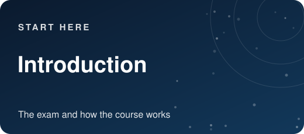
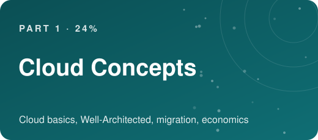
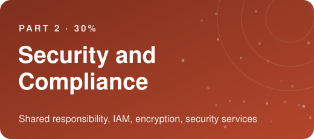
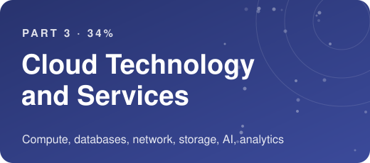
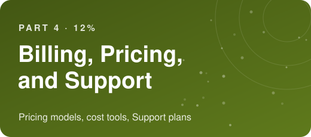
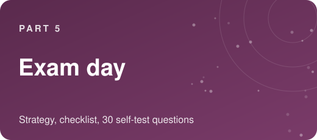
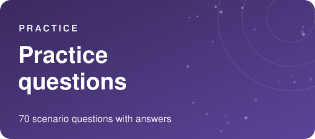
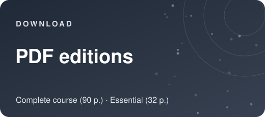

<div align="center">


</div>

## About this course

A complete course for the **AWS Certified Cloud Practitioner (CLF-C02)** exam, written for people who start from zero.

It follows the **official AWS exam guide (version 1.3)** task statement by task statement. Every topic is explained in plain words, with everyday analogies, concrete examples, diagrams and the traps to avoid on the exam. A small bakery, *Sara's Bakery*, follows you through the whole course: every service is applied to her online shop.

> [!TIP]
> **Two PDF editions:**
> - [**Complete course**](pdf/AWS-CLF-C02-Complete-Course.pdf) (88 pages): every topic explained from zero, with analogies, examples, notes and diagrams. The main course.
> - [**Essential edition**](pdf/AWS-CLF-C02-Essential-Edition.pdf) (32 pages): a short version for the last days of revision.

## The exam at a glance

| | |
|---|---|
| **Questions** | 65 (50 scored + 15 unscored), multiple choice and multiple response |
| **Score** | 100 to 1000, **pass with 700**, no penalty for wrong answers |
| **Delivery** | Pearson VUE test center or online proctored |
| **Domains** | Cloud Concepts **24%** · Security and Compliance **30%** · Cloud Technology and Services **34%** · Billing, Pricing, and Support **12%** |

## Course contents

<table>
<tr>
<td width="50%"><a href="course/00-introduction.md"></a></td>
<td width="50%"><a href="course/01-cloud-concepts.md"></a></td>
</tr>
<tr>
<td width="50%"><a href="course/02-security-and-compliance.md"></a></td>
<td width="50%"><a href="course/03-cloud-technology-and-services.md"></a></td>
</tr>
<tr>
<td width="50%"><a href="course/04-billing-pricing-and-support.md"></a></td>
<td width="50%"><a href="course/05-exam-day.md"></a></td>
</tr>
<tr>
<td width="50%"><a href="practice/practice-questions.md"></a></td>
<td width="50%"><a href="pdf/"></a></td>
</tr>
</table>

Click a card to open the chapter.

## Repository structure

```text
aws-clf-c02-study-guide/
├── README.md
├── course/          the course, one file per part
├── practice/        70 practice questions with answers
├── pdf/             complete course (88 pages) and essential edition (32 pages)
└── assets/          banners
```

## How to study

| Day | What to do | Time |
|---|---|---|
| 1 | Introduction + Part 1. Cloud Concepts | about 1 h 30 |
| 2 | Part 2. Security and Compliance | about 2 h |
| 3 | Part 3, sections 3.1 to 3.4 | about 1 h 30 |
| 4 | Part 3, sections 3.5 to 3.8 | about 1 h 30 |
| 5 | Part 4. Billing, Pricing, and Support | about 1 h |
| 6 | Part 5 + the 70 practice questions; re-read the sections of your wrong answers | about 2 h |
| 7 | Official AWS practice questions on Skill Builder, then book the exam when you score 85% or more | |

## Official AWS resources

- [AWS Certified Cloud Practitioner (CLF-C02) exam guide](https://docs.aws.amazon.com/aws-certification/latest/cloud-practitioner-02/cloud-practitioner-02.html)
- [AWS Skill Builder: CLF-C02 exam preparation](https://skillbuilder.aws/category/exam-prep/cloud-practitioner-foundational-CLF-C02), including the official practice question set
- [AWS Documentation](https://docs.aws.amazon.com/) and [AWS Whitepapers](https://aws.amazon.com/whitepapers/)
- [AWS Well-Architected Framework](https://aws.amazon.com/architecture/well-architected/)
- [AWS Support plans](https://aws.amazon.com/premiumsupport/plans/) and [AWS Pricing Calculator](https://calculator.aws/)

> [!NOTE]
> This course is not affiliated with or endorsed by Amazon Web Services. It contains no real exam questions. AWS updates its services and the exam guide regularly: always check the official pages before your exam.

---

<p align="center"><sub>Written by <a href="https://github.com/ibtihelsalhi">Ibtihel Salhi</a></sub></p>
