A self-contained study guide for the **AWS Certified Cloud Practitioner (CLF-C02)** exam, aligned with the **latest official exam guide (v1.3, published 29 October 2026)**. It covers every task statement of the four domains with explanations, diagrams, comparison tables, traps to avoid and 70 original practice questions.

> Not affiliated with AWS. Written in my own words from the official AWS exam guide and AWS documentation. No exam dumps, no real exam questions.

## Exam at a glance

| | |
|---|---|
| Exam | **CLF-C02** AWS Certified Cloud Practitioner (Foundational) |
| Questions | 65 = 50 scored + 15 unscored · multiple choice and multiple response |
| Score | Scaled 100 to 1000 · **pass = 700** · compensatory · no penalty for guessing |
| Domains | Cloud Concepts **24%** · Security and Compliance **30%** · Cloud Technology and Services **34%** · Billing, Pricing, and Support **12%** |

## Always up to date

AWS revises the exam guide regularly and publishes each change about one month before it applies to the exam (v1.0 to v1.3 between June and October 2026). This guide follows **v1.3** and tags anything that differs from older versions:

| Tag | Meaning |
|---|---|
| `[v1.3]` | Listed in the latest guide |
| `[NEW]` | New or renamed in v1.3 (for example *QuickSight → Amazon Quick*, *SageMaker → SageMaker AI*, Support plans *Business Support+ / Enterprise Support / Unified Operations*) |
| `[LEGACY]` | In older guides, not listed now: learn the one-liner only |
| `[OUT]` | Explicitly out of scope |

Full scope map and version history: [notes/00-exam-guide-versions-and-scope.md](notes/00-exam-guide-versions-and-scope.md)

## Contents

### Notes (read on GitHub)

| # | File | What's inside |
|---|---|---|
| 0 | [Exam guide, versions and scope](notes/00-exam-guide-versions-and-scope.md) | Official versions, exam facts, full task-statement checklist, in-scope and out-of-scope services, Skill Builder resources, 5-day plan |
| 1 | [Cloud concepts](notes/01-cloud-concepts.md) | **Domain 1 (24%)**: cloud models, six advantages, Well-Architected pillars, CAF, migration strategies, cloud economics |
| 2 | [Security and compliance](notes/02-security-compliance.md) | **Domain 2 (30%)**: shared responsibility, IAM, encryption, CloudTrail / CloudWatch / Config, security services |
| 3 | [Cloud technology and services](notes/03-cloud-technology-services.md) | **Domain 3 (34%)**: overview and "which service?" master table |
| 3a | [Deploy, global infrastructure, compute](notes/03a-deploy-global-compute.md) | Deployment methods, connectivity, Regions / AZs / edge, EC2, load balancing, Auto Scaling, containers, Lambda |
| 3b | [Databases, networking, storage](notes/03b-databases-networking-storage.md) | RDS, Aurora, DynamoDB, VPC, Route 53, CloudFront, S3 storage classes, EBS, EFS, FSx |
| 3c | [AI/ML, analytics and other services](notes/03c-ai-analytics-other-services.md) | AI/ML, analytics, application integration, developer tools, management and governance, IoT |
| 4 | [Billing, pricing and support](notes/04-billing-pricing-support.md) | **Domain 4 (12%)**: pricing models, data transfer, cost tools, new Support plans, partners |
| 5 | [Practice questions](notes/05-practice-questions.md) | 70 original scenario questions with explanations |
| 6 | [Glossary and service index](notes/06-glossary-service-index.md) | A to Z service index with scope tags |
| - | [Exam tips](notes/exam-tips.md) | Strategy, keyword to service table, top traps, last-day checklist |

### PDF edition (print or offline)

| File | Content |
|---|---|
| [Global study](pdf/AWS-CLF-C02_0_Global-Study.pdf) | Exam facts, scope, versions, glossary |
| [Domain 1](pdf/AWS-CLF-C02_1_Domain1-Cloud-Concepts.pdf) | Cloud Concepts |
| [Domain 2](pdf/AWS-CLF-C02_2_Domain2-Security-Compliance.pdf) | Security and Compliance |
| [Domain 3](pdf/AWS-CLF-C02_3_Domain3-Technology-Services.pdf) | Cloud Technology and Services |
| [Domain 4](pdf/AWS-CLF-C02_4_Domain4-Billing-Pricing-Support.pdf) | Billing, Pricing and Support |
| [Tips and practice](pdf/AWS-CLF-C02_5_Tips-and-Practice.pdf) | Exam strategy and practice questions |

## Suggested 5-day plan

| Day | Study |
|---|---|
| 1 | Domain 1 + Domain 4 |
| 2 | Domain 2 |
| 3 | Domain 3 (3a + 3b) |
| 4 | Domain 3 (3c) + glossary |
| 5 | Practice questions + official AWS practice question set + exam tips |

## Official resources

- [AWS Certified Cloud Practitioner (CLF-C02) exam guide](https://docs.aws.amazon.com/aws-certification/latest/cloud-practitioner-02/cloud-practitioner-02.html)
- [AWS Skill Builder: CLF-C02 exam prep](https://skillbuilder.aws/category/exam-prep/cloud-practitioner-foundational-CLF-C02) (Exam Prep courses, Official Practice Question Set, Official Practice Exam)
- AWS documentation, whitepapers, Well-Architected Framework, AWS Support plans page

## Contributing

AWS changes often. Spotted something outdated? Open an issue or a pull request and cite the official page.

---

Written by [Ibtihel Salhi](https://github.com/ibtihelsalhi)
