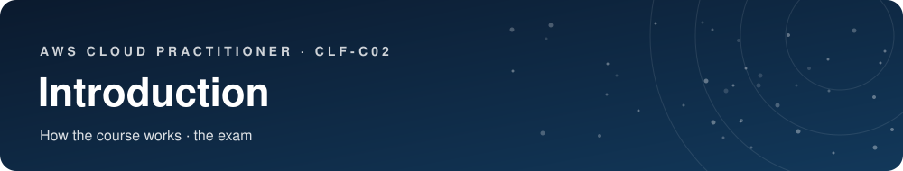

## How this course works

This course is built in two layers.

1. **The base is the official AWS exam guide (version 1.3, 29 October 2026).** Every section of Parts 1 to 4 is one official *task statement* (1.1 to 4.3), in the same order as the guide, and starts with the official objective: what AWS says you must know.
2. **On top of it comes the explanation**: plain-language explanations, everyday comparisons, examples, diagrams and practical tips, built from the official AWS documentation, whitepapers and service pages.

You do not need to know anything about the cloud to start. Read one part per sitting, take your time with the diagrams, and do the 30 questions at the end.

**The boxes you will meet**

> [!IMPORTANT]
> **Official objective.** What the AWS exam guide expects you to know for this section.

> [!TIP]
> **Analogy.** An everyday comparison to make an idea stick.

> [!NOTE]
> **Example.** A concrete situation where the concept is used.

> [!NOTE]
> **Note.** A term or a detail explained in more depth.

> [!TIP]
> **Good to know.** A practical tip or detail worth remembering.

> [!WARNING]
> **On the exam.** How questions are asked, and the traps.

> [!TIP]
> **Our story through this course.** A small bakery, Sara's Bakery, follows us through the course: every concept is applied to her online shop.

Tags: `NEW` new or renamed in v1.3 · `LEGACY` only in older guides, know one line · `OUT` out of scope, just recognize the name.

## The exam

| | |
|---|---|
| Questions | 65 in total: 50 count, 15 are unscored test questions you cannot identify |
| Question types | Multiple choice (1 correct out of 4) and multiple response (2 or more correct out of 5 or more) |
| Time | 90 minutes of exam, about 120 minutes in total with check-in `verify` |
| Score | Scaled from 100 to 1000. **You pass with 700.** The score is global: you can be weak in one domain if you are strong elsewhere. A wrong answer costs nothing, so never leave a blank |
| Where | Pearson VUE test center or online from home with a proctor (webcam, clean desk) |
| Validity | 3 years |

| Domain | Weight | What it is about |
|---|---|---|
| 1 Cloud Concepts | 24% | Why the cloud, its benefits, good design, migration, economics |
| 2 Security and Compliance | 30% | Who protects what, identities and access, security services, compliance |
| 3 Cloud Technology and Services | 34% | The services: compute, storage, databases, network, AI, and others |
| 4 Billing, Pricing, and Support | 12% | How AWS charges, how to control costs, support plans |

The exam does not ask you to code or configure anything. It asks: **which service or concept fits this situation?** If you understand what each service is *for*, you pass.

---

 &nbsp;·&nbsp; <a href="../README.md">Contents</a> &nbsp;·&nbsp; [Cloud Concepts →](01-cloud-concepts.md)

