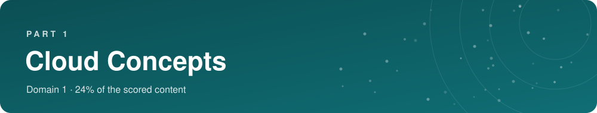
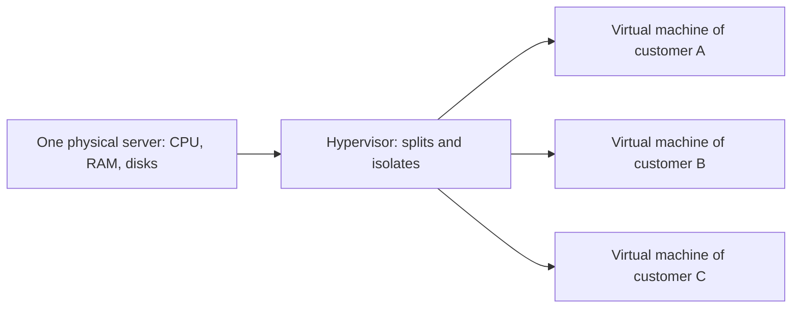
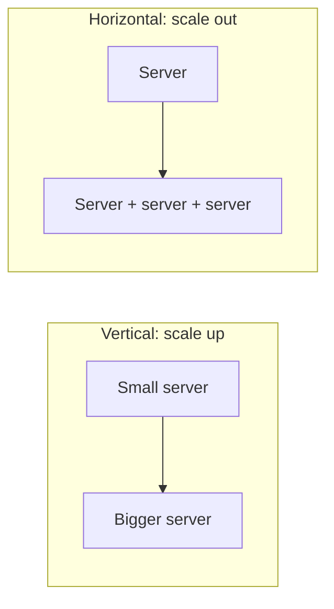
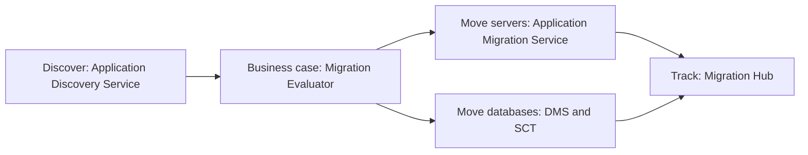

**24% of the scored content.** What the cloud is, why companies use it, what makes a good cloud architecture, how a company moves to the cloud, and how the cloud changes the money side of IT.

> [!NOTE]
> **In this part**
>
> - 1.1 Define the benefits of the AWS Cloud
> - 1.2 Identify design principles of the AWS Cloud
> - 1.3 Understand the benefits of and strategies for migration to the AWS Cloud
> - 1.4 Understand concepts of cloud economics

> [!TIP]
> **Our story through this course.** Sara owns a small bakery, *Sara's Bakery*. She wants to sell cakes online. We will follow her as she builds her website, protects it, grows it and pays for it. Every time a new idea appears, ask yourself: what would it change for Sara?

## 1.1 The benefits of the AWS Cloud

> [!IMPORTANT]
> **Official objective. Task statement 1.1: Define the benefits of the AWS Cloud**
>
> Knowledge of:
>
> - Value proposition of the AWS Cloud
>
> Skills in:
>
> - Understanding the economies of scale (for example, cost savings)
> - Understanding the benefits of global infrastructure (for example, speed of deployment, global reach)
> - Understanding the advantages of high availability, elasticity, and agility

### Step 1: what is a server?

**In plain words.** When you open a website, your phone or laptop sends a request over the internet to another computer somewhere in the world. That computer prepares the page and sends it back. This computer is called a **server**, because it *serves* answers to others.

A server is a computer like yours, with a processor (**CPU**), memory (**RAM**) and disks, but built to run **24 hours a day**, to answer **many people at once**, and usually without a screen or keyboard. You manage it remotely.

Every application you know runs on servers: Instagram, your bank's app, Netflix, an online shop. Even a tiny website needs at least one.

> [!NOTE]
> **Note.** Three words you will meet everywhere. **Compute** = the processing power that runs programs (CPU and RAM). **Storage** = the space where data is kept (disks). **Network** = the connections that let computers talk to each other and to the internet.

### Step 2: how companies ran servers before the cloud

Before the cloud, a company that needed servers had to **own** them. This is called **on-premises** (often shortened to **on-prem**): the hardware is on the company's premises.

Let us follow Sara in the old world. To open her online shop she must:

1. **Buy servers** (several thousand euros) and wait weeks for delivery.
2. Find a **room** for them with air conditioning (servers produce heat), a reliable electricity supply, maybe a backup generator, and a fast internet connection. A room built for this is a **data center**.
3. **Install** everything: operating system, web software, database, security.
4. **Hire someone**, or learn herself, to maintain it: updates, repairs, backups, replacing broken disks at 3 a.m.
5. **Guess** how much power she needs for the next three to five years.

That last point is the worst. If she buys too little, her site crashes on Mother's Day when everyone orders cakes. If she buys too much "just in case", the machines sit idle 360 days a year and the money is wasted. And she pays everything **upfront**, before selling a single cake online.

> [!TIP]
> **Analogy.** Running your own servers is like generating your own electricity with a generator in the garden. You buy it, maintain it, refuel it, and if your needs grow you buy a bigger one. The cloud is like plugging into the electricity grid: someone else runs the power station, you use what you need and pay for what you consume.

### Step 3: what cloud computing is

AWS gives this official definition, worth learning word for word:

> [!NOTE]
> **Note.** **Cloud computing is the on-demand delivery of IT resources over the internet with pay-as-you-go pricing.**

Let us take it apart:

- **On-demand**: you get resources **when you ask for them**, in minutes, by clicking or by running a command. No ordering hardware, no waiting weeks.
- **IT resources**: servers, storage, databases, networks, and also ready-made services such as email sending, artificial intelligence or video conversion. AWS offers more than 200 services.
- **Over the internet**: you reach and manage everything remotely, from a browser or a program. The data centers are AWS's, not yours.
- **Pay-as-you-go**: you pay **only for what you use**, often by the second or by the gigabyte, with **no upfront payment** and no long contract. When you delete a resource, you stop paying.

Back to Sara in the cloud world. She opens an AWS account with a credit card, chooses a server in a few clicks, and her shop is online the same afternoon. On Mother's Day she adds two more servers for the rush, then removes them the next day. Her bill follows her activity: small when sales are quiet, larger when business is good. She never sees a cable or a fan.

**Who is AWS?** Amazon Web Services is the cloud division of Amazon. Amazon built huge computing skills to run its own online shop, then started renting them to others. Its very first public service was **Amazon SQS** (a message queue) in 2004, followed in 2006 by **Amazon S3** (storage) and **Amazon EC2** (virtual servers). AWS is the largest cloud provider in the world; Microsoft Azure and Google Cloud are the other two big ones.

> [!TIP]
> **Good to know.** A real **cloud service provider (CSP)**, and not just a hosting company, offers dozens or hundreds of services that can be **combined** with each other, all reachable through **one single API** (the programmatic interface), **metered billing** (per second, per GB, per request), **built-in monitoring** of every action (on AWS: CloudTrail), **infrastructure services** (compute, storage, network, databases), and **automation through infrastructure as code**.

### Step 4: how it works behind the scenes, virtualization

How can AWS give a server to millions of customers in minutes? It does not buy one physical machine per customer. It uses **virtualization**.

A big physical server runs a special program called a **hypervisor**. The hypervisor divides the machine into several **virtual machines (VMs)**. Each virtual machine has its own share of CPU, memory and disk, its own operating system, and behaves exactly like an independent computer. Customers sharing the same physical machine are completely isolated from each other and cannot see each other's data. Sharing hardware between many customers is called **multi-tenancy**.

Over time, the way we run applications evolved, and each step leaves you less work:

| Step | What it is | Picture it as | What you still manage |
|---|---|---|---|
| **Dedicated server** | A whole physical machine just for you | Owning a house | Everything, including the hardware |
| **Virtual machine** | A slice of a physical machine, with its own operating system | Renting an apartment in a building | Operating system, software, scaling |
| **Container** | A lightweight package with your application and everything it needs, sharing the operating system of the host | Renting a room in a shared flat: private room, shared kitchen | Your containers and where they run |
| **Function (serverless)** | You upload only a piece of code; it runs when something happens and stops after | Taking a taxi: you only pay for the ride | Only your code |

> [!NOTE]
> **Note.** Serverless functions can have a **cold start**: if a function has not run for a while, the first request waits a little longer while AWS prepares an environment. It is the small price of paying nothing when nothing runs.

### Step 5: the three service models, IaaS, PaaS and SaaS

**In plain words.** When you use a cloud service, a key question is: **how much does the provider manage for you, and how much is left to you?** The answer defines three models: **IaaS**, **PaaS** and **SaaS**.

To understand them, picture an application as a stack of layers, from the bottom (physical things) to the top (what users see):

1. **Hardware**: the physical servers, disks and network equipment, in a data center.
2. **Virtualization**: the hypervisor that creates virtual machines.
3. **Operating system**: Linux or Windows, which must be installed, configured and **patched** (security updates).
4. **Runtime and middleware**: the software your application needs to run, for example Java, Python, a web server.
5. **Data**: the information your application stores.
6. **Application**: the program itself, the part users see.

The three models simply draw the line between "the provider manages this" and "you manage this" at a different height of the stack.

| Layer | On-premises | IaaS | PaaS | SaaS |
|---|---|---|---|---|
| Application | You | You | You | **Provider** |
| Data | You | You | You | Provider (you own your data) |
| Runtime, middleware | You | You | **Provider** | Provider |
| Operating system | You | You | Provider | Provider |
| Virtualization | You | **Provider** | Provider | Provider |
| Hardware, data center | You | Provider | Provider | Provider |

**IaaS, Infrastructure as a Service.** The provider gives you the **basic building blocks**: virtual servers, storage and networks. Everything from the operating system upward is **your job**: installing software, applying updates, configuring security. You get **maximum control and flexibility**, but also the most work. It is the closest to having your own servers, without the hardware.

- AWS examples: **Amazon EC2** (virtual servers), **Amazon VPC** (networks), **Amazon EBS** (virtual disks).
- For Sara: she rents a virtual server on EC2, installs Linux updates herself, installs a shop software, and maintains it.
- Choose it when: you need full control, special software, or you move existing servers to the cloud as they are.

**PaaS, Platform as a Service.** The provider manages the infrastructure **and** the operating system and runtime. You bring **only your application code and your data**. No patching, no server configuration. You lose some control but you gain a lot of time.

- AWS examples: **AWS Elastic Beanstalk** (upload code, AWS creates and runs the servers), **Amazon RDS** (a database where AWS manages the database software), **AWS Lambda** (run code without servers).
- For Sara: her developer uploads the shop's code to Elastic Beanstalk; AWS handles servers, updates and scaling.
- Choose it when: developers want to focus on writing the application, not on running servers.

**SaaS, Software as a Service.** The provider gives you a **complete, ready-to-use application**, usually in a web browser. You do not install or maintain anything; you just use it and configure your settings.

- Examples: Gmail, Microsoft 365, Salesforce, Zoom; on AWS: **Amazon WorkSpaces** (virtual desktops), **Amazon Connect** (call center).
- For Sara: she simply subscribes to a ready-made online shop service and adds her cakes and prices.
- Choose it when: the software you need already exists and you do not want to build or run anything.

> [!TIP]
> **Analogy: getting a pizza.** On-premises: you make the dough, the sauce, bake it in your oven and serve it. IaaS: you buy a ready-made pizza base and do the rest at home. PaaS: you order a pizza delivered, and only provide the table and drinks. SaaS: you eat at the restaurant, everything is done for you.

> [!TIP]
> **Analogy: getting around.** Own car = on-premises (you buy, insure, repair). Rented car = IaaS (no purchase, but you drive and refuel). Taxi = PaaS (you just say where to go). Bus = SaaS (a complete service, you just get on).

> [!WARNING]
> **On the exam.** "Maximum control over the operating system" = IaaS, EC2. "Developers want to deploy code without managing infrastructure" = PaaS, Elastic Beanstalk. "Use a complete application without managing anything" = SaaS. The more you go from IaaS to SaaS, the less you manage, and this also shifts security responsibility (see 2.1).

### Step 6: where the cloud runs, the deployment models

**In plain words.** A company can run its applications in three ways.

**Cloud** (also called public cloud, cloud-native or "all-in"): everything runs at a cloud provider like AWS. "Public" does **not** mean your data is public: it means the infrastructure is shared with other customers, while your resources stay private and isolated. Startups and new projects usually start here: nothing to buy, everything available immediately.

**On-premises** (also called private cloud when it is automated with cloud-like tools such as OpenStack or VMware): everything stays in the company's own data center. Some organizations keep this because of very strict rules, huge past investments, or habits. They keep all the problems we saw in step 2.

**Hybrid**: a mix of both, **connected together**. Some systems stay on-premises, others run in the cloud, and they exchange data. This is very common in large companies: they cannot move everything at once, or some data must stay in their building.

> [!NOTE]
> **Example.** A bank keeps its core banking system in its own data center because of regulations, but runs its mobile app and its data analysis on AWS. The two are linked by a private line (**AWS Direct Connect**) or an encrypted tunnel over the internet (**AWS VPN**). That is a hybrid deployment.

AWS services that make hybrid possible: **AWS Direct Connect** and **AWS VPN** (connect your network to AWS), **AWS Storage Gateway** (your local applications use cloud storage), **AWS Outposts** (AWS installs its own hardware inside your data center).

> [!TIP]
> **Good to know.** Typical profiles: startups and SaaS companies are **cloud**; banks, insurers and large firms with old systems are **hybrid**; some public sector organizations or very regulated industries stay largely **on-premises**, although most now use the cloud for at least part of their work.

### Step 7: the six advantages of cloud computing

AWS summarizes the value of the cloud in six advantages. The exam uses this exact wording, so learn each sentence, and above all understand what it means.

**1. Trade fixed expense for variable expense.**
Before: Sara pays a large amount upfront for servers and a room, whether she sells or not. This is a **fixed** cost, an investment called **CapEx** (capital expenditure).
With the cloud: she pays a monthly bill that follows her real usage. This is a **variable** cost, an operating cost called **OpEx** (operational expenditure). She can start with almost nothing and pay more only when business grows.

**2. Benefit from massive economies of scale.**
AWS buys servers, disks and electricity for millions of customers, so it gets much lower prices than any single company. Because so many customers share the infrastructure, each pays less. AWS has lowered its prices many times as it grew.

**3. Stop guessing capacity.**
Before: you had to guess your needs years in advance, and you were always wrong: too much (wasted money) or too little (crashes). With the cloud you add capacity in minutes when demand rises and remove it when it falls. Sara adds servers for Mother's Day and removes them afterwards.

**4. Increase speed and agility.**
New resources arrive in minutes instead of weeks. Teams can test an idea quickly and cheaply: if it fails, delete everything and the cost was tiny. This encourages innovation.

**5. Stop spending money running and maintaining data centers.**
Racking servers, replacing disks, managing cooling and power is necessary work but does not make a company different from its competitors. AWS calls it **undifferentiated heavy lifting**. In the cloud, AWS does it, and your people focus on your customers and products.

**6. Go global in minutes.**
AWS has data centers on every continent. You can deploy your application close to users in Asia, Europe and America in a few clicks, so everyone gets a fast experience, without building anything abroad.

> [!NOTE]
> **Note.** The official objective of this section maps directly to these advantages: economies of scale (advantage 2), speed of deployment and global reach (advantages 4 and 6), elasticity (advantage 3).

### Step 8: the words you must master

These terms appear in many questions. Take time with each one.

**High availability.** A system is highly available when it **stays reachable** even if a component fails. The key idea is **no single point of failure**: nothing whose failure alone brings everything down. On AWS you get it by running copies in **several Availability Zones** (separate data centers, see 3.2).

> [!NOTE]
> **Example.** Sara runs her shop on two servers in two different data centers, with a load balancer in front that sends visitors to whichever server is healthy. A power cut hits one data center: the load balancer sends everybody to the other server. Customers keep ordering cakes.

**Fault tolerance.** A step further than high availability: the system **keeps working without any interruption** when a component fails, because every part is duplicated and takes over instantly. High availability may accept a short interruption; fault tolerance aims for none. A plane with two engines that can fly on one is fault tolerant.

**Scalability.** The ability of a system to **handle more load**. There are two ways to scale:

- **Vertical scaling (scale up)**: make one server bigger (more CPU, more memory). Simple, but there is a maximum size, and it often requires a restart.
- **Horizontal scaling (scale out)**: add more servers side by side and share the work. Almost no limit, and if one server fails the others continue. This is the cloud way.

**Elasticity.** Scaling that happens **automatically and in both directions**: resources are added when demand grows **and removed when it drops**, so you never pay for idle capacity. Scalability is the *ability* to grow; elasticity is the *automatic adjustment* to demand. On AWS, elasticity for servers comes from **Amazon EC2 Auto Scaling**.

**Agility.** How fast you can experiment and deliver new things. In the cloud, getting a new server takes minutes instead of weeks, so a team can try ten ideas in the time it used to take to try one.

**Durability and availability of data.** Two different promises:

- **Durability**: your data will **not be lost**. Amazon S3 is designed for 99.999999999% durability ("eleven nines"): store 10 million files and you might lose one in 10,000 years.
- **Availability**: your data is **reachable right now** when you ask for it. S3 Standard is designed for 99.99% availability.

A file can be durable (safe) but temporarily unavailable (you cannot reach it for a few minutes).

> [!WARNING]
> **On the exam.** "Automatically add and remove resources to match demand" = **elasticity**, provided by **Auto Scaling**. "No single point of failure", "keep running if a data center fails" = **high availability**, by using **multiple Availability Zones**. "Pay only for what you use instead of buying hardware" = **trade fixed expense for variable expense**. Do not confuse durability (not losing data) and availability (being able to access it).

## 1.2 Design principles: the AWS Well-Architected Framework

> [!IMPORTANT]
> **Official objective. Task statement 1.2: Identify design principles of the AWS Cloud**
>
> Knowledge of:
>
> - AWS Well-Architected Framework
>
> Skills in:
>
> - Understanding the pillars of the Well-Architected Framework (for example, operational excellence, security, reliability, performance efficiency, cost optimization, sustainability)
> - Identifying differences between the pillars of the Well-Architected Framework

### What it is and why it exists

**In plain words.** Building in the cloud is easy; building **well** is harder. A system can work on day one and still be fragile, insecure or too expensive. Over many years AWS has reviewed thousands of customer architectures and written down what good ones have in common. The result is the **AWS Well-Architected Framework**: a set of best practices and questions to check that a system (AWS calls it a **workload**) is built well.

It is organized in **six pillars**. Each pillar looks at the system from one angle and asks one big question: does it run well, is it protected, does it survive failures, does it use the right resources, is there waste, and is its impact on the planet low?

### The six pillars, one by one

**1. Operational excellence: run the system well and keep improving.**
How you deploy, monitor and operate your application day to day, and how you learn from problems. Main ideas:

- **Perform operations as code**: describe infrastructure and procedures in code and scripts rather than doing them by hand, so they are repeatable and less error-prone.
- **Make frequent, small, reversible changes**: small changes are easy to test and easy to undo if something goes wrong.
- **Anticipate failure** and **learn from all operational failures**: practice incidents, write down what happened, improve.

*Sara's case: every update of her shop goes through an automated, tested procedure instead of someone copying files manually at night.*

**2. Security: protect information, systems and assets.**
Main ideas:

- **Implement a strong identity foundation**: control who can do what, with the **least privilege** (only the permissions needed).
- **Enable traceability**: record who did what and when (logs), and react to alerts.
- **Apply security at all layers**: network, servers, application, data.
- **Protect data in transit and at rest**: encrypt it while it moves and while it is stored.
- **Prepare for security events**: have a plan for incidents.

*Sara's case: the customer database is encrypted, only her developer can access it, and every access is logged.*

**3. Reliability: work correctly and recover from failures.**
Main ideas:

- **Automatically recover from failure**: monitor the system and repair or replace failed parts without human action.
- **Test recovery procedures**: do not just hope backups work, test them.
- **Scale horizontally** to increase availability: several small servers rather than one big one.
- **Stop guessing capacity**: let the system scale with demand.
- **Manage change through automation**.

*Sara's case: her shop runs in two data centers and her database has an automatic standby copy.*

**4. Performance efficiency: use computing resources efficiently.**
Main ideas:

- **Democratize advanced technologies**: instead of building complex technology yourself (machine learning, databases), use AWS managed services that make it available to everyone.
- **Go global in minutes**: deploy close to users.
- **Use serverless architectures**: no servers to run, AWS adapts the capacity.
- **Experiment more often** and choose the right type of resource for each job.

*Sara's case: her cake photos are delivered from servers close to each visitor, so pages load fast everywhere.*

**5. Cost optimization: deliver value at the lowest price.**
Main ideas:

- **Adopt a consumption model**: pay only for what you use, switch off what you do not use (test servers at night).
- **Measure overall efficiency** and **analyze and attribute expenditure**: know which team or project spends what.
- **Stop spending money on undifferentiated heavy lifting**: let AWS run the infrastructure.

*Sara's case: her test server stops automatically every evening, and her main server is the right size, not oversized.*

**6. Sustainability: reduce the environmental impact.**
Main ideas: understand your impact, **maximize utilization** (busy servers waste less energy than idle ones), use **managed services** and the most efficient hardware, reduce the data you keep and move.

**General design principles** that apply to all pillars: stop guessing your capacity needs, test systems at production scale, automate to make experimentation easier, allow architectures to evolve, drive decisions with data, and practice through **game days** (simulated incidents).

| Pillar | The question it answers | Key words in a question |
|---|---|---|
| **Operational excellence** | Do we run and improve the system well? | operations as code, small reversible changes, runbooks, learn from failures |
| **Security** | Are data and systems protected? | least privilege, traceability, encryption, all layers |
| **Reliability** | Does it recover and meet demand? | recover from failure, test recovery, Multi-AZ, scale horizontally, stop guessing capacity |
| **Performance efficiency** | Do we use the right resources efficiently? | right instance type, serverless, go global, democratize technologies |
| **Cost optimization** | Are we wasting money? | pay for use, rightsizing, Spot, turn off idle resources |
| **Sustainability** | Is the environmental impact minimal? | utilization, efficient hardware, carbon footprint |

**Tools.** The **AWS Well-Architected Tool** is a free service in the AWS console: you describe your workload, answer questions pillar by pillar, and get a list of risks and recommendations. The **AWS Architecture Center** is a website with reference architectures and diagrams for common use cases.

> [!NOTE]
> **Note.** Pillars overlap, and the exam asks for the **best** match. Ask yourself what the question is mainly worried about: losing service = Reliability; paying too much = Cost optimization; being slow = Performance efficiency; being attacked or leaking data = Security; daily operations and improvement = Operational excellence; energy and carbon = Sustainability.

> [!WARNING]
> **On the exam.** "Stop guessing capacity", "automatically recover from failure" = Reliability. "Perform operations as code", "small reversible changes" = Operational excellence. "Democratize advanced technologies", "use serverless", "go global in minutes" = Performance efficiency. "Enable traceability", "least privilege" = Security.

## 1.3 Migration to the AWS Cloud

> [!IMPORTANT]
> **Official objective. Task statement 1.3: Understand the benefits of and strategies for migration to the AWS Cloud**
>
> Knowledge of:
>
> - Cloud adoption strategies
> - Resources to support the cloud migration journey
>
> Skills in:
>
> - Understanding the components of the AWS Cloud Adoption Framework (AWS CAF) (for example, reduced business risk; improved environmental, social, and governance [ESG] performance; increased revenue; increased operational efficiency)
> - Identifying appropriate migration strategies (for example, database replication)

**In plain words.** A **migration** is moving existing applications and data from a company's own data center (or another provider) to AWS. For a big company it is a long project: hundreds of applications, thousands of servers, many teams. AWS gives two kinds of help: a framework to **prepare the organization** (the CAF) and a method to **decide what to do with each application** (the 7 Rs), plus tools to do the move.

### The AWS Cloud Adoption Framework (AWS CAF)

**Why it exists.** Most cloud migrations that fail do not fail because of technology. They fail because staff are not trained, nobody owns the budget, security teams block everything, or managers do not know why they are migrating. The **CAF** is AWS's guide to prepare the **whole organization**, not only the servers.

The CAF looks at the move from **six perspectives**. Each perspective is a group of people in the company with its own concerns:

**Business capabilities**

- **Business perspective**: makes sure the cloud investment serves the company's goals (growth, new products, savings). People: CEO, finance, business leaders. *Question they ask: why are we doing this and what will we gain?*
- **People perspective**: culture, skills, training, organization of teams, change management. People: HR, managers. *Question: are our people ready and trained?*
- **Governance perspective**: manage the program, the risks, the budget and the benefits. People: CIO, program and project managers, risk and finance. *Question: are we controlling risks and costs?*

**Technical capabilities**

- **Platform perspective**: build a scalable, reliable cloud environment and architecture. People: CTO, architects, engineers. *Question: what will we build on AWS?*
- **Security perspective**: confidentiality, integrity and availability of data and workloads. People: CISO, security teams. *Question: will it be secure and compliant?*
- **Operations perspective**: run and support cloud services day to day at the agreed level. People: IT operations, support. *Question: who will run it and how?*

**The four benefits of the CAF** (exact list from the exam guide):

1. **Reduced business risk**: better reliability, security and performance lower the risk of incidents.
2. **Improved environmental, social and governance (ESG) performance**: for example, more energy-efficient infrastructure and better use of data for sustainability goals.
3. **Increased revenue**: new digital products and faster time to market.
4. **Increased operational efficiency**: lower costs, more automation, more productive staff.

> [!WARNING]
> **On the exam.** "Training staff, culture, organizational change" = **People**. "Managing risk, budget, portfolio" = **Governance**. "Aligning the cloud with business goals" = **Business**. "Architecture and infrastructure" = **Platform**. "Protecting data" = **Security**. "Running and supporting services" = **Operations**.

### The 7 Rs: what to do with each application

For each application it owns, the company chooses one of seven strategies. Picture moving house: some things go to the dump, some stay behind, some move as they are, some get repainted, some are replaced by new ones.

**Retire.** Switch off applications that nobody needs any more. During the inventory, companies often discover old systems still running for nothing. *Saving: immediate.*

**Retain.** Keep the application where it is, for now. Reasons: it was recently upgraded, it must stay for legal reasons, or it is too complex to move yet. Revisit later.

**Rehost, "lift and shift".** Move the application **as it is**, without changing its code, from a server in the data center to an EC2 instance. It is the **fastest** strategy with quick savings, and teams can optimize later once in the cloud. Tool: **AWS Application Migration Service**.

**Relocate.** Move a whole platform without changes, for example an entire VMware environment moved to **VMware Cloud on AWS**. Similar idea to rehost, at the scale of a platform.

**Replatform, "lift, tinker and shift".** Move the application with **a few optimizations** that bring benefits, without changing its architecture. Classic example: instead of moving the database server as it is, move the data to **Amazon RDS**, so AWS manages the database software, backups and patches.

**Repurchase, "drop and shop".** Abandon the existing application and **buy a different product**, usually SaaS. Example: replace an old in-house customer management tool with a SaaS CRM.

**Refactor or re-architect.** **Redesign and rewrite** the application to use cloud-native features (serverless, managed services, microservices). It takes the **most time and effort** but gives the **most benefits**: scalability, agility, lower long-term costs.

| Strategy | Effort | When it fits | Example |
|---|---|---|---|
| Retire | None | Nobody uses it | Old reporting tool |
| Retain | None | Must stay or not ready | System with legal constraints |
| Rehost | Low | Move fast, no changes | Servers copied to EC2 |
| Relocate | Low | Move a whole platform | VMware to VMware Cloud on AWS |
| Replatform | Medium | Small gains without rewriting | Database moved to RDS |
| Repurchase | Medium | A better product exists | In-house CRM to SaaS |
| Refactor | High | Maximum cloud benefits | Monolith to serverless |

### The migration tools

A migration usually follows the same path: **discover** what you have, **build a business case**, **move** servers and databases, **track** progress.

- **AWS Application Discovery Service**: collects information about the servers in your data center (configuration, usage, which server talks to which) so you know what you have before planning.
- **Migration Evaluator** `NEW` (formerly TSO Logic): analyzes your current usage and estimates what it would cost on AWS, to build a **business case** for managers.
- **AWS Application Migration Service**: the main tool to **rehost**. It continuously copies your servers to AWS while they keep running, then lets you switch over with very little downtime.
- **AWS Database Migration Service (DMS)**: moves databases to AWS. The source database **keeps working during the copy**, and DMS keeps copying new changes (**database replication**) until you switch. Result: minimal downtime. It works between identical engines (MySQL to MySQL) and different ones (Oracle to Aurora).
- **AWS Schema Conversion Tool (SCT)**: when you change database engine, it converts the **schema** (the structure of tables, views, procedures) from one engine to the other. SCT converts the structure, DMS moves the data.
- **AWS Migration Hub**: a single dashboard to follow the progress of all migrations.
- Snow Family `LEGACY`: rugged physical devices that AWS ships to you, you fill them with data and ship them back, used when the network is too slow for terabytes or petabytes.

> [!WARNING]
> **On the exam.** "Fastest migration without changing the application" = Rehost. "Move the database to a managed service with small changes" = Replatform. "Replace with a SaaS product" = Repurchase. "Rewrite to be cloud-native" = Refactor. "Estimate costs to build a business case" = Migration Evaluator. "Migrate a database with minimal downtime" = DMS; "convert from Oracle to PostgreSQL" = SCT + DMS.

## 1.4 Cloud economics

> [!IMPORTANT]
> **Official objective. Task statement 1.4: Understand concepts of cloud economics**
>
> Knowledge of:
>
> - Aspects of cloud economics
> - Cost savings of moving to the cloud
>
> Skills in:
>
> - Understanding the role of fixed costs compared with variable costs
> - Understanding costs that are associated with on-premises environments
> - Understanding the differences between licensing strategies (for example, Bring Your Own License [BYOL] model compared with included licenses)
> - Understanding the concept of rightsizing
> - Identifying benefits of automation
> - Understanding the economies of scale (for example, cost savings)

### Fixed costs and variable costs

**In plain words.** A **fixed cost** stays the same whatever you do; a **variable cost** goes up and down with your activity.

On-premises IT is mostly **fixed**. Sara bought servers for 10,000 euros: whether she sells 10 cakes or 10,000, the money is spent. Such purchases are **CapEx** (capital expenditure): a big investment upfront in assets that lose value over years (depreciation).

Cloud IT is mostly **variable**. Sara pays, say, 40 euros in a quiet month and 120 euros in December. This is **OpEx** (operational expenditure): a running cost, paid as you go.

Why does it matter? Variable costs mean **no big upfront investment**, **less financial risk** (if a project fails, you stop paying), and costs that **follow revenue**.

### The real cost of on-premises

When comparing on-premises and cloud, people often compare only the price of a server with the price of a cloud instance. That is misleading. The full cost of owning infrastructure, called **total cost of ownership (TCO)**, includes many hidden costs:

- **Hardware** (servers, storage, network equipment), replaced every 3 to 5 years.
- **Data center space**: rent or construction, racks, physical security.
- **Electricity and cooling**: servers run day and night and produce heat.
- **Staff**: people to install, maintain, repair and secure the hardware.
- **Software licenses and maintenance contracts**.
- **Spare capacity** bought "just in case" and rarely used.
- **Time**: weeks to get new hardware, which slows the business.

### Licenses: BYOL or license included

**What a license is.** Commercial software such as Microsoft Windows Server, SQL Server or Oracle Database is not free: you pay the vendor for the right to use it. That right is a **license**. Licenses are often counted per server, per CPU socket or per CPU core.

On AWS you have two options:

- **License included**: the price of the AWS resource **already contains** the license. For example, a Windows EC2 instance costs a bit more per hour than a Linux one because the Windows license is included. Simple: nothing to buy or track.
- **BYOL, bring your own license**: you **reuse licenses you already own** from your on-premises servers, so you do not pay twice. Some licenses are tied to physical hardware (sockets or cores), which is why AWS offers **Dedicated Hosts**: a whole physical server for you, where you can see the sockets and cores. **AWS License Manager** helps you track how many licenses you use and stay within the vendor's rules.

### Rightsizing

**Rightsizing** means choosing the resource type and size that **match the real need**. Many servers are oversized "to be safe". If a server uses only 10% of its CPU, you pay for 90% of nothing: switch to a smaller, cheaper size. Rightsizing is an ongoing habit, because needs change. AWS helps with **AWS Compute Optimizer** and the recommendations in **AWS Cost Explorer**, which analyze your actual usage and suggest better sizes.

### Automation

Automation means letting scripts, templates and services do the work humans used to do by hand. Benefits: **fewer human errors**, **faster** deployments, **less staff time**, the **same result every time**, and resources that run **only when needed** (for example, test environments created in the morning and deleted in the evening). Tools you will meet: **AWS CloudFormation** (infrastructure as code) and **Auto Scaling**.

### Economies of scale

Because AWS serves millions of customers, it buys hardware and energy in enormous quantities, builds its own optimized hardware, and spreads its costs over everyone. Its cost per unit is far lower than any single company could achieve, and AWS passes part of these savings to customers through lower prices.

> [!WARNING]
> **On the exam.** "Avoid large upfront investments" = variable expense, OpEx. "Costs of on-premises" = hardware, space, power, cooling, staff, licenses. "Reuse existing per-core licenses" = BYOL + Dedicated Hosts, tracked with License Manager. "Server only 10% used" = rightsizing. "Lower prices thanks to AWS's size" = economies of scale.

> [!IMPORTANT]
> **Key takeaways.**
>
> - Cloud computing = **on-demand delivery of IT resources over the internet with pay-as-you-go pricing**. It removes the purchase, the data center and the guessing.
> - Virtualization lets AWS split physical servers into isolated virtual machines for many customers.
> - IaaS (EC2: you manage the OS), PaaS (Elastic Beanstalk, RDS: you bring code and data), SaaS (a finished application).
> - Deployment models: cloud, hybrid (connected with Direct Connect, VPN, Storage Gateway, Outposts), on-premises.
> - The six advantages: variable expense, economies of scale, stop guessing capacity, speed and agility, no data center work, go global in minutes.
> - High availability = no single point of failure (several AZs). Elasticity = automatic scaling up and down (Auto Scaling). Durability ≠ availability.
> - Six Well-Architected pillars, each with its question: operations, security, reliability, performance, cost, sustainability.
> - CAF prepares the organization: six perspectives, four benefits. 7 Rs decide each application's fate; DMS, SCT, Application Migration Service do the move.
> - Economics: fixed → variable, TCO hidden costs, BYOL vs license included, rightsizing, automation, economies of scale.

---

[← Introduction](00-introduction.md) &nbsp;·&nbsp; <a href="../README.md">Contents</a> &nbsp;·&nbsp; [Security and Compliance →](02-security-and-compliance.md)

