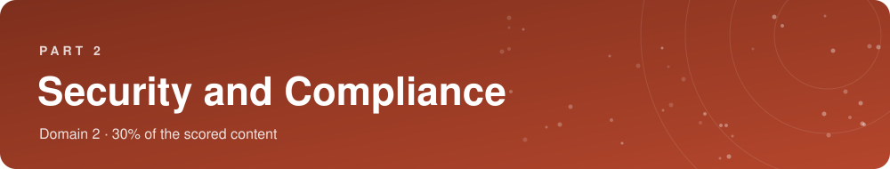
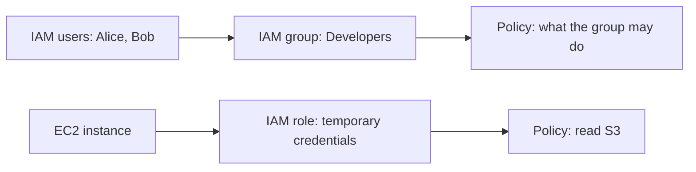
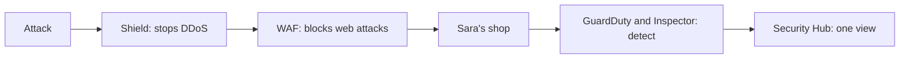

**30% of the scored content, the second biggest domain.** Who protects what in the cloud, how to control who can access your resources, which services protect and watch your workloads, and how to prove that you follow the rules. Most of it is logic: once you understand the shared responsibility model, many questions answer themselves.

> [!NOTE]
> **In this part**
>
> - 2.1 Understand the AWS shared responsibility model
> - 2.2 Understand AWS Cloud security, governance, and compliance concepts
> - 2.3 Identify AWS access management capabilities
> - 2.4 Identify components and resources for security

> [!TIP]
> **Our story through this course.** Sara's shop is online and orders are coming in. Now she stores customer names, addresses and order histories. She must protect them: from hackers, from mistakes, and from people who should not see them. And her bank asks her to prove that payments are handled securely.

## 2.1 The shared responsibility model

### Why security is "shared"

**In plain words.** On-premises, the company is responsible for **everything**: the building's locks, the servers, the network, the software, the data. When it moves to AWS, part of this work is done by AWS, and part stays with the customer. The **shared responsibility model** is the official description of **who does what**. It is one of the most tested topics on the exam.

AWS sums it up in two short sentences, worth learning by heart:

- **AWS is responsible for security OF the cloud**: the infrastructure that runs all the services.
- **The customer is responsible for security IN the cloud**: everything the customer puts in the cloud and how they configure it.

> [!TIP]
> **Analogy: renting an apartment.** The landlord is responsible for the building: the walls, the roof, the main entrance door with its code, the stairs, the electricity network. You, the tenant, are responsible for your apartment: locking your own door, choosing who gets a copy of your key, closing your windows, and protecting what you keep inside. If you leave your door open and get robbed, it is not the landlord's fault.

### What AWS takes care of: security OF the cloud

- **Physical security of data centers**: guarded buildings, controlled access with badges and biometrics, cameras, staff background checks. Customers cannot even visit them. Old disks are destroyed securely.
- **Hardware**: servers, storage devices, network equipment, and their maintenance and replacement.
- **The global network** between data centers and Regions.
- **The virtualization layer** (hypervisor) that keeps customers isolated from each other.
- **The software of managed services**: for example the database engine of Amazon RDS or the servers behind AWS Lambda, including their patching.

### What the customer takes care of: security IN the cloud

- **Customer data**: always the customer's responsibility, whatever the service. You decide what you store, who can read it and whether it is encrypted.
- **Identity and access management**: who has an account, which permissions, whether MFA is enabled (section 2.3).
- **Operating system, applications and their patches** when you use infrastructure services like EC2.
- **Network and firewall configuration**: security groups, network access control lists (section 3.5).
- **Encryption choices**: turning encryption on, managing keys when you choose to.

| Customer: security **IN** the cloud | AWS: security **OF** the cloud |
|---|---|
| Customer data | Software of the managed services (compute, storage, database, networking) |
| Identity and access management | Hardware and global infrastructure: Regions, Availability Zones, edge locations |
| Guest operating system, applications, patches (on EC2) | Virtualization layer |
| Network and firewall configuration, encryption options | Physical security of the data centers |

### The line moves with the service

The more **managed** a service is, the more AWS does, and the less is left to you. Let us follow Sara with three ways of running her database.

**Option 1, database on Amazon EC2 (IaaS).** Sara rents a virtual server and installs MySQL herself. AWS protects the data center, the hardware and the hypervisor. Sara must patch the **operating system**, install and patch **MySQL**, configure backups, set the **firewall** (security group), manage database users, and protect the data.

**Option 2, Amazon RDS (managed database).** AWS also handles the operating system, the **installation and patching of the database engine**, and automated backups. Sara still manages the **data**, the **database users and passwords**, **who can connect** (network settings), and whether encryption is enabled.

**Option 3, AWS Lambda for her order-processing code (serverless).** AWS manages the servers, operating system, runtime and scaling. Sara is responsible for her **code**, its **permissions**, and the **data** it handles.

| Service | AWS takes care of | The customer takes care of |
|---|---|---|
| **Amazon EC2** | Data center, hardware, hypervisor | **Guest OS and its patches**, applications, security groups, data, accounts |
| **Amazon RDS** | Plus the OS, **database engine installation and patching**, automated backups | Data, database users, network access, encryption settings |
| **AWS Lambda** | Plus servers, OS, runtime, scaling | Code, function permissions, data |
| **Amazon S3** | Infrastructure, durability, availability | Who can access (bucket policies, IAM), encryption choice, the data |

### Shared controls

Some security controls apply to **both** parties, each in its own layer:

- **Patch management**: AWS patches the infrastructure and managed services; the customer patches their guest operating systems and applications.
- **Configuration management**: AWS configures its infrastructure devices; the customer configures their operating systems, databases and applications.
- **Awareness and training**: AWS trains its employees; the customer trains its own.

> [!WARNING]
> **On the exam.** "Who patches the guest OS of an EC2 instance?" The customer. "Who patches the database engine on RDS?" AWS. "Who is responsible for the physical security of data centers?" AWS. "Who configures security groups?" The customer. "Who is responsible for customer data?" **Always the customer.** "Patch management" is a **shared** control.

## 2.2 Security, governance and compliance concepts

### Three words: security, governance, compliance

- **Security** protects data and systems against attacks, mistakes and leaks.
- **Governance** is the set of rules a company sets for itself and the means to enforce them: who may create what, which Regions are allowed, how much can be spent.
- **Compliance** means **following external rules**: laws and industry standards, and being able to **prove** it to an auditor.

> [!TIP]
> **Good to know.** Security is often summarized by the **CIA triad**. **Confidentiality**: only authorized people can see the data (access control, encryption). **Integrity**: the data is not altered without permission (logs, checksums). **Availability**: the data and services are there when needed (redundancy, DDoS protection). Every security service protects one or more of these three.

### Compliance: proving that you follow the rules

**In plain words.** Many activities are regulated. Before a bank lets Sara accept card payments, she must respect card security rules. A hospital must protect health records. A European company must protect personal data of EU citizens. Each set of rules is called a **compliance program** or **standard**, and companies are checked by **auditors**.

The main ones you should recognize:

| Program | What it is about |
|---|---|
| **PCI DSS** | Security of **payment card** data |
| **HIPAA** | Protection of **health data** in the United States |
| **GDPR** | Protection of **personal data** of people in the European Union |
| **SOC 1, SOC 2, SOC 3** | Independent audit reports on a company's controls (financial, security, availability) |
| **ISO 27001** | International standard for managing information security |
| **FedRAMP** | Security requirements for cloud services used by the US government |

**How it works with AWS.** AWS has its infrastructure and many services audited and certified against these programs. That covers **AWS's part**. But because of the shared responsibility model, **using a certified service does not make your application compliant automatically**: you must still configure and use the services correctly (encryption, access control, logging). Also:

- Requirements **differ by country and by industry**: a German hospital, a US bank and a French retailer have different obligations.
- **Not every AWS service is covered by every program**: before storing health data in a service, check that the service is in scope of HIPAA on AWS's compliance pages.

**AWS Artifact** is the place to **get the proof**. It is a free, self-service portal in the AWS console with two parts:

- **Artifact Reports**: download AWS's audit reports and certifications (SOC reports, PCI DSS attestation, ISO certificates) to give to your auditors.
- **Artifact Agreements**: review and accept legal agreements with AWS, such as the **Business Associate Addendum (BAA)** needed for HIPAA.

> [!NOTE]
> **Example.** Sara's bank asks for proof that the infrastructure hosting payment data is PCI DSS compliant. Sara opens AWS Artifact, downloads the AWS PCI DSS attestation and sends it. For her own part, she shows that she encrypts data and restricts access.

### Encryption

**In plain words.** **Encryption** transforms readable data into unreadable characters using a secret value called a **key**. Only someone with the right key can turn it back into readable data (**decryption**). If a thief steals encrypted data without the key, it is useless to them.

There are two moments when data needs protection:

- **In transit**: while it travels over a network, for example between a customer's browser and Sara's website. Protected with **TLS** (the protocol behind **HTTPS** and the padlock in your browser). TLS needs a **certificate** that proves the website's identity.
- **At rest**: while it is stored, on a disk, in a database, in S3. Protected by encrypting the storage with a key.

The AWS services:

| Service | What it does in plain words | When to use it |
|---|---|---|
| **AWS Key Management Service (KMS)** | Creates, stores and controls **encryption keys** for you, and lets you decide who may use them. Integrated with most AWS services: encrypting an EBS disk, an S3 bucket or an RDS database is often a single checkbox | The default choice for **encryption at rest** |
| **AWS CloudHSM** | Gives you a **dedicated hardware security module** (HSM): a physical, tamper-resistant device used only by you, in which **you alone** control the keys | Strict regulations that require single-tenant hardware and full customer control of keys |
| **AWS Certificate Manager (ACM)** | Provides and **renews automatically** the SSL/TLS certificates for your websites; public certificates are free | **Encryption in transit** (HTTPS) |
| **AWS Secrets Manager** | Stores passwords and API keys securely and can rotate them | Secrets (see 2.3) |

> [!NOTE]
> **Note.** To encrypt data **inside your application** before sending it anywhere (client-side encryption), AWS provides the **AWS Encryption SDK**, a free library that works with KMS keys.

> [!NOTE]
> **Note.** Encryption is one of the **benefits of cloud security** in the official objective: on AWS it is easy, cheap and integrated, while doing it on-premises often required expensive equipment and expertise.

> [!WARNING]
> **On the exam.** "Encrypt data at rest with managed keys" = **KMS**. "Dedicated hardware, customer-only control of keys" = **CloudHSM**. "SSL/TLS certificate for HTTPS" = **ACM**. "Data in transit" = TLS. "Download a SOC 2 or PCI report" = **Artifact**. "Is the customer automatically compliant because AWS is?" **No.**

### Logs, monitoring and governance

**In plain words.** A **log** is a record of events: who connected, what was changed, which error occurred. Logs are essential to investigate incidents and to prove compliance. Three AWS services record different things, and the exam loves to mix them up.

| The question | The service | What it records |
|---|---|---|
| **WHO** did **WHAT** and **WHEN**? | **AWS CloudTrail** | Every **API call** made in your account: user, action, time, source IP address |
| **HOW** is it performing **NOW**? | **Amazon CloudWatch** | **Metrics** (CPU, traffic, errors), **logs** from applications, **alarms**, dashboards |
| **WHAT** is the configuration, and is it **COMPLIANT**? | **AWS Config** | The **configuration history** of each resource and its compliance with your rules |

**AWS CloudTrail.** Every action in AWS, whether a click in the console, a CLI command or an application call, is an **API call**. CloudTrail records them as **events**. The last 90 days of management events are visible for free in the event history, and you can create a **trail** to keep logs longer in S3. It is your **audit trail**: the answer to "who deleted this database?".

**Amazon CloudWatch.** The monitoring service. It collects **metrics** (numbers over time, like CPU usage or number of requests), stores **logs** sent by applications and services (**CloudWatch Logs**), displays **dashboards**, and triggers **alarms** when a metric crosses a threshold: send an email, add servers, restart an instance. A **billing alarm** in CloudWatch warns you when your estimated bill passes an amount.

**AWS Config.** Records the **configuration** of your resources over time (for example: "this S3 bucket was private until Tuesday, public since then") and evaluates them against **rules** you choose ("all disks must be encrypted", "no bucket may be public"). Non-compliant resources are flagged, and you can fix them automatically.

> [!NOTE]
> **Example.** One morning, one of Sara's storage buckets has become public. **CloudTrail** shows that a developer called `PutBucketPolicy` at 14:02 from a given IP address. **AWS Config** shows the bucket's configuration before and after the change and marks it **non-compliant** with the rule "no public buckets". **CloudWatch** shows a spike of downloads and had triggered an **alarm** that emailed Sara.

**Governance services:**

- **AWS Organizations**: groups many AWS accounts under one **management account**, with one bill. **Service control policies (SCPs)** set the **maximum** permissions any account in the organization can have (guardrails), for example "nobody may use Regions outside Europe" or "nobody may turn off CloudTrail".
- **AWS Control Tower**: sets up a secure, well-organized multi-account environment (a **landing zone**) automatically, with recommended guardrails already in place.
- **AWS Systems Manager**: operates your servers at scale (patching, running commands, inventory) and stores configuration values.
- **Access reports**: IAM produces the **credential report** (every user with the status of their passwords, keys and MFA) and **last-accessed information** (which permissions are really used). Auditors love them.

> [!NOTE]
> **Note.** The services that help customers secure their resources, such as Inspector, Security Hub, GuardDuty and Shield, are explained in section 2.4.

> [!WARNING]
> **On the exam.** "Audit who made an API call" = CloudTrail. "Alarm when CPU passes 80%", "billing alarm" = CloudWatch. "Track configuration changes and check compliance with rules" = AWS Config. "Prevent all accounts from using a service" = SCP in AWS Organizations. "Report of all users and their credentials" = credential report.

## 2.3 Access management

### Authentication and authorization

Every access control system answers two questions:

- **Authentication**: **who are you?** You prove your identity with a password, a code, a key.
- **Authorization**: **what are you allowed to do?** Once identified, your permissions decide which actions you may perform on which resources.

> [!TIP]
> **Analogy: an office building.** At the entrance you show your badge: that is authentication. The badge then opens some doors and not others: that is authorization.

### The root user

When you create an AWS account, you sign up with an email address and a password. This identity is the **root user**. It has **complete, unrestricted access** to everything in the account, including the billing, and the power to close the account. Nothing can limit it.

That makes it dangerous: if someone steals the root credentials, they own your account. So AWS recommends:

- Enable **MFA** on the root user immediately.
- Use a **strong, unique password**.
- **Never create access keys** for the root user.
- **Do not use it for daily work**: create other identities with only the permissions they need, and lock the root credentials away.
- Use it only for the few **tasks that only the root user can perform**:
  - change account settings: account name, root email address, root password;
  - **close the AWS account**;
  - **change or cancel the AWS Support plan**;
  - restore IAM permissions when every administrator has locked themselves out;
  - register as a seller in the **Reserved Instance Marketplace**;
  - enable **MFA Delete** on an S3 bucket;
  - sign up for AWS GovCloud (US).

> [!TIP]
> **Analogy.** The root user is the master key of a building. You keep it in a safe and give employees personal badges.

### AWS Identity and Access Management (IAM)

**In plain words.** **IAM** is the free AWS service that lets you create identities and control **who can do what on which resources** in your account. It is a **global** service (not tied to a Region).



**IAM users.** An identity for **one person or one application**, with **long-term credentials**: a password to sign in to the console and/or access keys for programs. Sara creates a user for herself and one for her developer, so nobody shares a login.

**IAM groups.** A collection of users. You attach permissions to the group once, and every member gets them. When someone joins the team, add them to the group; when they leave, remove them. A user can be in several groups. Groups cannot contain other groups.

**IAM roles.** An identity that **has no permanent password or keys**. Instead, someone or something **assumes** the role and receives **temporary credentials** that expire automatically (from minutes to hours). This is safer: nothing permanent to steal. Roles are used for:

- **AWS services**: an EC2 instance that needs to read files in S3 gets a role, instead of storing keys on the server.
- **Cross-account access**: a user from another AWS account temporarily works in yours.
- **Federated users**: employees who sign in with their company account (see below).

**IAM policies.** A **policy** is a document, written in **JSON**, that lists permissions. You attach it to a user, a group or a role. Example:

```json
{
  "Version": "2012-10-17",
  "Statement": [{
    "Effect": "Allow",
    "Action": "s3:GetObject",
    "Resource": "arn:aws:s3:::sara-invoices/*"
  }]
}
```

Read it like a sentence: **Effect** (Allow or Deny) **Action** (here, read a file from S3) on **Resource** (every file in the bucket `sara-invoices`). An optional **Condition** can add rules such as "only from this IP address" or "only with MFA".

There are two kinds of policies:

- **Managed policies**: standalone policies you can attach to many identities. **AWS managed** policies are written and maintained by AWS for common jobs (for example `AmazonS3ReadOnlyAccess`); **customer managed** policies are written by you and reusable.
- **Inline (custom) policies**: written directly inside one user, group or role, for a single special case.

**How AWS decides.** When someone tries an action, AWS evaluates all policies that apply:

1. By default, everything is **denied** (implicit deny).
2. If a policy **allows** the action, it is permitted...
3. ...unless any policy explicitly **denies** it: an **explicit deny always wins**.

### The principle of least privilege

**Give every identity only the permissions it needs to do its job, and nothing more.** Sara's developer needs to deploy the website, not to read the accounting data or close the account. If his credentials are stolen, the damage stays limited.

How to apply it: start with minimal permissions and add when needed, use groups and roles rather than many individual permissions, review regularly. Tools: **IAM Access Analyzer** (finds resources shared with outside accounts and helps write tight policies), **last-accessed information** (shows permissions never used, to remove them), and the **credential report**.

### Proving who you are: credentials and authentication methods

**Passwords and password policies.** IAM users who use the console have a password. A **password policy** sets account-wide rules: minimum length, required character types, expiration, no reuse of old passwords.

**Multi-factor authentication (MFA).** A password alone can be stolen or guessed. MFA adds a second proof: **something you know** (the password) plus **something you have** (a device). Types supported by AWS:

- **Virtual MFA**: an authenticator app on a phone that shows a six-digit code changing every 30 seconds.
- **Hardware TOTP token**: a small physical device that displays codes.
- **FIDO security keys and passkeys**: a key you plug in or touch (or your phone's biometrics).

Enable MFA on the root user and on every user with significant permissions.

**Access keys.** Programs (the CLI, SDKs, scripts) cannot type a password in a web page. They use **access keys**: an **access key ID** (like a username) and a **secret access key** (like a password). Rules: never share them, **never put them in code or push them to GitHub** (bots scan for them within minutes), rotate them regularly, delete unused ones, never create them for root, and **prefer IAM roles** wherever possible.

**Storing secrets.** Applications need secrets: database passwords, API keys of payment providers. Never write them in the code. Use:

- **AWS Secrets Manager**: stores secrets encrypted, controls who can read them, and can **rotate them automatically** (for example change the database password every 30 days without breaking the application).
- **AWS Systems Manager Parameter Store**: stores configuration values and secrets, simpler and cheaper, without built-in automatic rotation for most cases.

### Identities for employees and for customers

**IAM Identity Center** (formerly AWS Single Sign-On). Large companies have many AWS accounts and many business applications. Creating an IAM user in each account for each employee would be unmanageable. IAM Identity Center provides **single sign-on (SSO)**: an employee signs in **once**, with their company identity, and accesses **all the AWS accounts and applications** they are allowed to use. It connects to the company directory (Microsoft Active Directory, Microsoft Entra ID, Okta) or has its own.

**Federation.** "Federated identity" means trusting identities managed by **another system** instead of creating new users in AWS. The company's **identity provider (IdP)** authenticates the employee, and AWS gives them a role with temporary credentials. Standards used: **SAML 2.0** and **OpenID Connect (OIDC)**.

**Cross-account IAM roles.** A user in account A assumes a role in account B to work there temporarily, without a second user.

**Amazon Cognito.** For the **customers of your application**, not your employees. Cognito handles sign-up, sign-in and password recovery for millions of app users, including "Sign in with Google, Apple or Facebook". Sara uses it for customer accounts on her shop.

**AWS Directory Service.** Runs a managed **Microsoft Active Directory** in AWS, for applications that need one.

| Who signs in | Service |
|---|---|
| Your employees, across many AWS accounts and apps | **IAM Identity Center** (with federation) |
| An application or AWS service (EC2, Lambda) | **IAM role** |
| A user from another AWS account | **Cross-account IAM role** |
| The customers of your web or mobile app | **Amazon Cognito** |
| A small team in one account | IAM users in groups |

**AWS Security Token Service (STS).** The service behind every role: it issues the **temporary credentials** (valid from minutes to hours) that a user, an application or another account receives when it **assumes a role** or signs in through federation.

### Connecting to servers securely

Administrators sometimes need a command line on an EC2 instance. Two modern options avoid long-lived SSH keys and open ports:

- **EC2 Instance Connect**: connect by SSH with a **temporary key** pushed through IAM, so access is controlled by IAM policies and logged in CloudTrail.
- **AWS Systems Manager Session Manager**: open a shell from the browser or the CLI **without opening any inbound port**, without SSH keys and without a bastion host; every session can be recorded. It relies on the **SSM Agent** installed on the instance (preinstalled on Amazon Linux and many AMIs).

### First steps in a new account

1. Turn on **MFA** for the root user.
2. **Never** create access keys for root.
3. Create an **administrator identity** (an IAM user in an admin group, or IAM Identity Center) and use it for daily work.
4. Create a **budget** with an email alert (section 4.2), so a forgotten resource never surprises you.

> [!TIP]
> **Good to know.** In a new account, the classic first ten minutes: an IAM user in an *admin* group, an **account alias** so the sign-in address is easy to remember, and MFA with a phone app or a hardware key. Do it in your own Free Tier account.

**Zero trust.** A modern security idea: **never trust automatically** because a request comes from "inside" the network; **always verify** identity and permissions for each request. In the cloud, **identity is the main security perimeter**, which is why IAM, MFA and least privilege matter so much.

> [!WARNING]
> **On the exam.** "Give an EC2 instance access to S3" = **IAM role** (never keys on the server). "Employees need one login for many AWS accounts" = **IAM Identity Center**. "Use the company's existing identities" = **federation**. "Sign-in for the users of a mobile app" = **Cognito**. "Rotate database passwords automatically" = **Secrets Manager**. "Permissions for a team" = **group**. "Grant only the needed permissions" = **least privilege**. "Close the account" or "change the Support plan" = **root user**.

## 2.4 Security components and resources

**In plain words.** AWS offers a security service for each job: blocking attacks, detecting threats, finding weaknesses, finding sensitive data, investigating, and giving one overall view. The easiest way to remember them is to follow an attack on Sara's shop.



### Blocking attacks at the door

**AWS Shield: protection against DDoS.** A **DDoS attack** (distributed denial of service) floods a website with so much fake traffic, from thousands of infected machines, that real customers cannot get in. Shield absorbs and filters these floods.

- **Shield Standard**: **free and automatic** for every AWS customer, protects against the most common network attacks.
- **Shield Advanced**: **paid**, for critical applications. Adds protection against larger and more sophisticated attacks, a 24/7 **Shield Response Team** (SRT, formerly called the DDoS Response Team) of AWS experts, detailed reports, and **cost protection** (AWS credits you for the extra scaling costs caused by an attack).

**AWS WAF: web application firewall.** Some attacks do not flood the site; they send cleverly crafted requests to trick the application. For example **SQL injection** (inserting database commands in a form field to steal data) and **cross-site scripting (XSS)** (injecting malicious scripts into pages). WAF inspects each web request (it works at the application layer, "layer 7") and blocks those that match your rules or AWS managed rules, as well as known bad IP addresses, bots, or too many requests from one source. It protects CloudFront, load balancers and API Gateway.

**AWS Firewall Manager.** A company with fifty AWS accounts needs the same WAF rules, Shield Advanced protections and security group rules everywhere. Firewall Manager applies and enforces them **centrally across all accounts** of an AWS Organization.

### Detecting threats and weaknesses

**Amazon GuardDuty: threat detection.** GuardDuty continuously analyzes your account's activity, using **CloudTrail logs, VPC Flow Logs (network traffic) and DNS logs**, with machine learning and threat intelligence. It raises **findings** when something looks wrong: an instance talking to a known malicious server, crypto-mining, unusual API calls from an unknown country, credentials used in a strange way. You turn it on with one click; there is nothing to install.

**Amazon Inspector: vulnerability scanning.** Inspector automatically scans your **EC2 instances, container images and Lambda functions** for **known software vulnerabilities** (CVEs, missing patches) and unintended network exposure (open ports), and gives a risk score so you fix the worst first.

**Amazon Macie: sensitive data in S3.** Macie uses machine learning to discover **sensitive data**, such as names, addresses, credit card numbers or ID numbers (**personally identifiable information, PII**), stored in **S3 buckets**, and alerts you if such data is exposed or unencrypted. Useful for GDPR.

**Amazon Detective: investigation.** When GuardDuty raises a finding, you need to understand what really happened. Detective collects logs and builds visual graphs of the activity over time to help you find the **root cause** quickly.

**AWS Security Hub: one dashboard.** Instead of checking GuardDuty, Inspector, Macie and others separately, Security Hub **gathers all findings in one place**, prioritizes them, and runs automated checks of your accounts against security best practices and standards. This is called **cloud security posture management (CSPM)**.

**AWS Trusted Advisor: best-practice checks.** Trusted Advisor inspects your account and gives recommendations, including **security** ones: MFA not enabled on root, security groups open to the whole internet on sensitive ports, public S3 buckets, exposed access keys. (It also covers cost, performance, fault tolerance and limits, see 4.3.)

| Service | Job | Key words in a question |
|---|---|---|
| **Shield** | Stop **DDoS** floods (Standard free, Advanced paid) | DDoS |
| **WAF** | Block **web exploits** (SQL injection, XSS), bad IPs, bots | SQL injection, layer 7, web requests |
| **Firewall Manager** | Manage firewall rules **across accounts** | central, organization-wide rules |
| **GuardDuty** | **Detect threats** from logs | malicious activity, compromised, unusual behaviour |
| **Inspector** | **Scan for vulnerabilities** | CVE, patches, software flaws |
| **Macie** | Find **sensitive data in S3** | PII, personal data, GDPR |
| **Detective** | **Investigate** the root cause | investigate, analyze a finding |
| **Security Hub** | **One view** of all findings and best-practice checks | single dashboard, aggregate |
| **Trusted Advisor** | Best-practice **recommendations** on the account | recommendations, checks |
| AWS Network Firewall `OUT` | Network firewall for a VPC | |

> [!TIP]
> **Good to know.** A useful way to separate two "checking" services: **Inspector** examines your **workloads** (an instance, a container image) for software vulnerabilities. **Trusted Advisor** examines your **account** for best practices across cost, performance, security, fault tolerance and limits. Both run checks, but on different things.

**Defense in depth.** Never rely on a single protection. Secure **every layer**: data (encryption), application (WAF, secure code), compute (patching, Inspector), network (security groups, network ACLs), perimeter (Shield, CloudFront), identity and access (IAM, MFA), and the physical layer (AWS's job). If one layer fails, the next one still protects you.

**Third-party security products.** If a company already trusts a security vendor (firewall, antivirus, monitoring), it can usually find and buy that product in **AWS Marketplace** and deploy it in a few clicks, billed on the AWS bill.

### Where to find security information and help

| Resource | What you find there |
|---|---|
| **AWS Security Center** | AWS's security overview, best practices and compliance resources |
| **AWS Security Blog** | Articles and news on AWS security features and practices |
| **AWS Knowledge Center** | Answers to the most frequent questions received by AWS Support |
| **AWS documentation, whitepapers** | Detailed official guidance, such as the security pillar of Well-Architected |
| **AWS re:Post** | Community questions and answers |
| **AWS Trust & Safety team** | Where to **report abuse** coming from AWS resources: spam, attacks, malware hosted on AWS |

**Penetration testing.** A penetration test is a simulated attack on your own systems to find weaknesses. AWS allows customers to test their own resources on a list of common services (EC2, RDS, Lambda, and others) **without asking for permission first**. Simulating denial-of-service attacks follows a separate, stricter policy.

> [!WARNING]
> **On the exam.** DDoS = **Shield**. SQL injection, XSS = **WAF**. Same rules in all accounts = **Firewall Manager**. Threat detection = **GuardDuty**. Vulnerability scan = **Inspector**. PII in S3 = **Macie**. Root cause = **Detective**. Single pane = **Security Hub**. Account best-practice checks = **Trusted Advisor**. Buy a third-party firewall = **Marketplace**. Report abuse = **Trust & Safety**.

> [!IMPORTANT]
> **Key takeaways.**
>
> - AWS secures the cloud (facilities, hardware, network, hypervisor, managed service software). You secure what you put in it (data, IAM, configuration, guest OS on EC2).
> - The more managed the service (EC2 → RDS → Lambda), the more AWS takes over. Data is always yours. Patch and configuration management are shared.
> - Compliance programs (PCI DSS, HIPAA, GDPR, SOC, ISO) vary by industry, country and service. AWS Artifact gives AWS's reports and agreements; AWS being compliant does not make you compliant.
> - Encryption in transit (TLS, ACM) and at rest (KMS; CloudHSM for dedicated hardware).
> - CloudTrail = who did what. CloudWatch = metrics, logs, alarms. Config = configuration history and compliance. Organizations + SCPs = guardrails.
> - Root user: MFA, no access keys, only for root-only tasks. IAM: users, groups, roles (temporary credentials), JSON policies; explicit deny wins; least privilege.
> - MFA, password policies, access keys (never in code), Secrets Manager (rotation). Identity Center = employees' SSO; Cognito = app customers; federation = existing identities.
> - Shield, WAF, Firewall Manager, GuardDuty, Inspector, Macie, Detective, Security Hub, Trusted Advisor: one job each.

---

<p align="center">[← Cloud Concepts](01-cloud-concepts.md) &nbsp;·&nbsp; <a href="../README.md">Contents</a> &nbsp;·&nbsp; [Cloud Technology and Services →](03-cloud-technology-and-services.md)</p>
