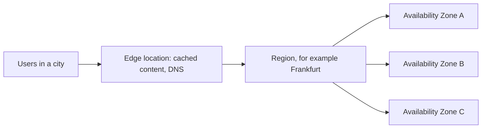
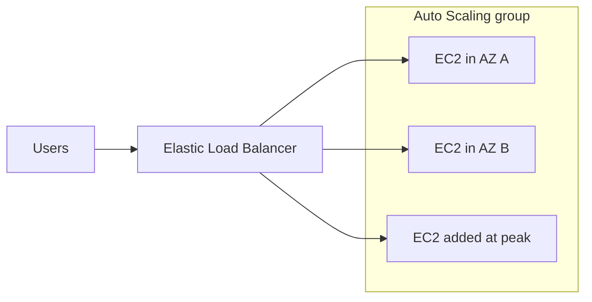
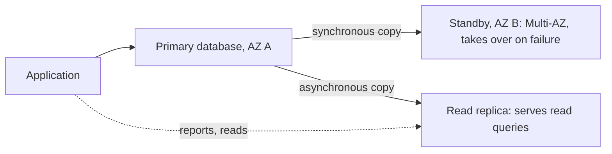
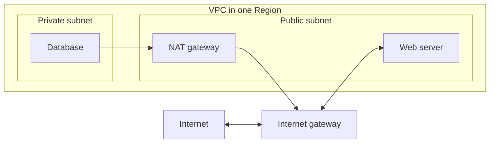
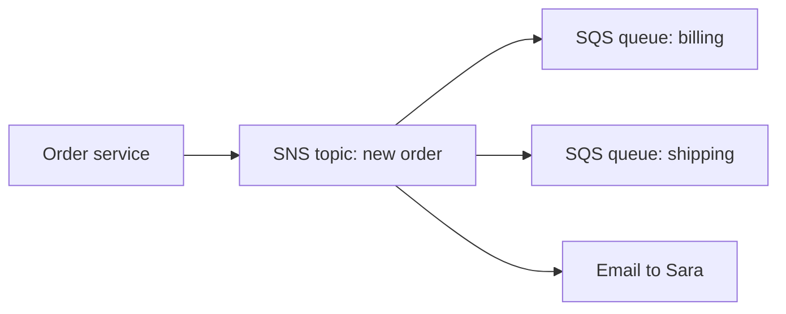

**34% of the scored content, the largest domain.** The exam describes a need and asks which service fits. For each service, remember **what problem it solves** and **when to choose it**, not how to configure it. This part follows the eight task statements of the guide.

> [!NOTE]
> **In this part**
>
> - 3.1 Define methods of deploying and operating in the AWS Cloud
> - 3.2 Define the AWS global infrastructure
> - 3.3 Identify AWS compute services
> - 3.4 Identify AWS database services
> - 3.5 Identify AWS network services
> - 3.6 Identify AWS storage services
> - 3.7 Identify AWS AI/ML services and analytics services
> - 3.8 Identify services from other in-scope AWS service categories

> [!TIP]
> **Our story through this course.** Sara's shop is growing. She needs servers that cope with peaks, a database for orders, storage for thousands of cake photos, fast pages for customers abroad, and maybe a chatbot. In this part, we build her whole architecture service by service.

## 3.1 Deploying and operating in the AWS Cloud

> [!IMPORTANT]
> **Official objective. Task statement 3.1: Define methods of deploying and operating in the AWS Cloud**
>
> Knowledge of:
>
> - Various ways of provisioning and operating in the AWS Cloud
> - Various ways to access AWS services
> - Types of cloud deployment models
>
> Skills in:
>
> - Deciding between options such as programmatic access (for example, APIs, SDKs, CLI), the AWS Management Console, and infrastructure as code (IaC)
> - Evaluating requirements to determine whether to use one-time operations or repeatable processes
> - Identifying deployment models (for example, cloud, hybrid, on-premises)

### Everything in AWS is an API

**In plain words.** An **API** (application programming interface) is a door through which programs talk to a service. Every action in AWS, "create a server", "upload a file", "delete a database", is a request sent to an AWS **API**. All the tools below are just different ways of sending these requests: by clicking, by typing commands, by writing code or by describing what you want in a file.

**Provisioning** means creating and preparing resources (servers, networks, databases) so they are ready to use. **Operating** means running and managing them afterwards.

### The ways to access AWS

**The AWS Management Console.** The website where you sign in and **click**. Every service has its page with buttons and forms. Ideal for **learning**, exploring, looking at dashboards and doing **one-time** tasks. Not ideal for repeating the same setup fifty times: it is slow and people make mistakes. There is also a mobile app for checking resources and alarms.

**The AWS CLI (command line interface).** A program you install on your computer to manage AWS by **typing commands** in a terminal, for example `aws s3 ls` to list your storage buckets. Commands can be put in **scripts** to automate repetitive tasks.

**The AWS SDKs (software development kits).** Libraries for programming languages (Python, Java, JavaScript, .NET, Go...) so that **your application's code** can call AWS. Sara's shop uses the SDK to store each new order photo in S3.

**AWS Tools for PowerShell and IDE toolkits.** AWS commands for Windows PowerShell, and plugins for code editors such as VS Code, for administrators and developers who prefer these tools.

**Infrastructure as code (IaC).** Instead of clicking or typing commands one by one, you **describe your whole infrastructure in a text file**, and AWS builds exactly what the file says.

- **AWS CloudFormation**: you write a **template** in JSON or YAML listing the resources (for example "one network, two servers, one database, with these settings"). CloudFormation creates them together as a **stack**, in the right order. You can run the same template in another Region or account and get an **identical** environment; you can update the stack by changing the template; if creation fails, it **rolls back** automatically. CloudFormation itself is free: you pay only for the resources it creates.
- **AWS CDK (Cloud Development Kit)**: the same idea, but you describe the infrastructure in a programming language; the CDK turns it into CloudFormation.

> [!NOTE]
> **Example.** Sara wants a test copy of her shop, identical to production, to try a new feature. With the console her developer would spend a day clicking and might forget a setting. With a CloudFormation template, he runs it once: in fifteen minutes the test environment exists, identical. When the test is over, he deletes the stack and everything disappears.

### One-time operation or repeatable process?

The official objective asks you to choose the right approach:

- **One-time, simple, exploratory** tasks (look at a dashboard, test a service, fix one setting): the **console** is fine.
- **Repeatable** tasks (create the same environment several times, deploy every week, manage many accounts): use **CLI scripts, SDKs or infrastructure as code**. Benefits: speed, **consistency**, fewer human errors, version history, easy review.

**ARN (Amazon Resource Name).** Each AWS resource has a unique identifier called an ARN, for example `arn:aws:s3:::sara-invoices`. You see ARNs in permissions (IAM policies) and in scripts, to point to an exact resource.

> [!TIP]
> **Good to know.** Some services are **global** and some are **regional**. In the console, IAM, CloudFront and Route 53 show *Global* at the top right, while EC2 or RDS show the Region you are working in. A classic beginner surprise: you create a server, switch Region by accident, and think it has disappeared. For practice labs, **us-east-1 (North Virginia)** is a good default: it is the oldest Region and offers the most services. AWS CloudShell, a terminal inside the console, is `OUT` in v1.3.

### Deployment models, a reminder

The three deployment models were explained in section 1.1: **cloud** (everything on AWS), **hybrid** (on-premises and AWS connected together) and **on-premises** (everything in your own data center). The exam may ask you to identify them from a description: "the company keeps its mainframe in its data center and runs its website on AWS, connected with Direct Connect" is **hybrid**.

> [!WARNING]
> **On the exam.** "Repeatable, consistent deployments in several Regions" = **CloudFormation** (infrastructure as code). "Automate tasks with scripts" = **CLI**. "Application code calls AWS" = **SDK**. "Web interface, one-time task" = **Management Console**.

## 3.2 The AWS global infrastructure

> [!IMPORTANT]
> **Official objective. Task statement 3.2: Define the AWS global infrastructure**
>
> Knowledge of:
>
> - AWS Regions, Availability Zones, and edge locations
> - High availability
> - Use of multiple Regions
> - Benefits of edge locations
>
> Skills in:
>
> - Describing relationships among Regions, Availability Zones, and edge locations
> - Describing how to achieve high availability by using multiple Availability Zones
> - Recognizing that Availability Zones do not share single points of failure
> - Describing when to use multiple Regions (for example, disaster recovery, business continuity, low latency for end users, data sovereignty)

### Regions, Availability Zones and edge locations

**In plain words.** AWS has data centers all over the world. They are organized in three levels, from the largest to the smallest.

**Regions.** A **Region** is a geographic area of the world where AWS has a group of data centers, for example Ireland (`eu-west-1`), Frankfurt (`eu-central-1`), Paris (`eu-west-3`) or North Virginia (`us-east-1`). There are more than 30 Regions. Key facts:

- Each Region is **completely independent and isolated** from the others: a problem in one Region does not affect the others.
- **Your data stays in the Region you choose.** AWS never moves it to another Region unless you decide to copy it. This matters for laws on where data must be kept.
- You choose the Region for each resource; prices and available services vary between Regions.

**Availability Zones (AZs).** Each Region contains **several Availability Zones**, at least three in most Regions. An AZ is **one or more data centers**, each with **its own power supply, cooling and network**. The AZs of a Region are physically **separated by a meaningful distance** (kilometres apart) so that a flood, fire or power cut is unlikely to hit two of them, but they are connected by fast, private fibre links with very low latency. The official wording: **Availability Zones do not share single points of failure.** They are named like `eu-west-1a`, `eu-west-1b`, `eu-west-1c`.

**Edge locations.** Much smaller sites, in **many more cities** than there are Regions (hundreds of them), also called **points of presence**. They do not run your servers. Their job is to bring some services **closer to users**: **Amazon CloudFront** caches copies of your files there, **Amazon Route 53** answers DNS requests there, **AWS Global Accelerator** lets user traffic enter the fast AWS network there.

> [!TIP]
> **Analogy.** A Region is a city. Its Availability Zones are separate neighbourhoods of that city, each with its own power station and water supply, linked by fast motorways. Edge locations are small kiosks in many other towns that keep popular items close to customers.

> [!NOTE]
> **Note.** **Latency** is the time it takes for data to travel between a user and a server, measured in milliseconds. The farther away the server, the higher the latency, and the slower the website feels. Choosing a Region near your users and using edge locations both reduce latency.

### Achieving high availability with several Availability Zones

Because AZs do not share points of failure, the basic rule for **high availability** on AWS is: **run your application in at least two Availability Zones.** If one AZ has a problem, the other keeps serving.

> [!NOTE]
> **Example.** Sara runs her web servers in two AZs of the Paris Region, with a load balancer in front, and her database has a standby copy in a second AZ (RDS Multi-AZ). A power failure hits AZ A: the load balancer sends all visitors to the servers in AZ B, and the database switches to its standby. Customers notice nothing.

### When to use several Regions

One Region with several AZs is enough for high availability in most cases. You use **several Regions** for four reasons listed in the official guide:

1. **Disaster recovery**: survive an event that affects a whole Region.
2. **Business continuity**: keep the business running whatever happens.
3. **Low latency for end users**: serve customers on different continents from a Region near them.
4. **Data sovereignty**: keep each country's data inside that country, as its laws require.

### How to choose a Region

1. **Compliance and data residency**: what the law or your customers require, for example health data of German patients kept in Germany. This comes first.
2. **Proximity to users (latency)**: choose the Region closest to most of your users.
3. **Service availability**: not every service or feature exists in every Region; new ones usually arrive first in `us-east-1`.
4. **Pricing**: prices differ from one Region to another.

### Other kinds of locations

| Name | In plain words |
|---|---|
| **AWS Outposts** | AWS installs and manages its own racks of servers **inside your data center**, running AWS services with the same APIs and tools. For data that must stay on site or applications that need very low latency to local systems `v1.3` |
| **AWS GovCloud (US)** | Isolated Regions for US government agencies and companies with strict US regulations |
| **AWS China Regions** | Beijing and Ningxia, operated by local Chinese partners, isolated from other Regions, with separate accounts |
| Local Zones `LEGACY` | Small extensions of a Region in large cities, for single-digit millisecond latency |
| Wavelength Zones `OUT` | AWS infrastructure inside 5G mobile networks |

### Disaster recovery

**In plain words.** A **disaster** is any event that makes your application unusable: a whole Region down (very rare), a major mistake, a cyberattack that destroys data. **Disaster recovery (DR)** is your plan to restore service, usually in another Region. Two numbers define what you need:

- **RPO, Recovery Point Objective**: the maximum amount of **data** you accept to lose, expressed in time. "RPO of 1 hour" means losing the last hour of orders is acceptable, so you need copies at least every hour.
- **RTO, Recovery Time Objective**: the maximum time the service can be **down**. "RTO of 15 minutes" means the shop must be back within 15 minutes.

The smaller these numbers, the more you must keep running in the second Region, and the more it costs. AWS describes four strategies, from cheapest and slowest to most expensive and fastest:

**Backup and restore.** You regularly copy your data (backups, snapshots) to another Region. Nothing else runs there. After a disaster, you rebuild everything from the backups. RPO and RTO: **hours**. Cost: **lowest**.

**Pilot light.** The **data** is continuously copied to the second Region, and the essential parts of the system are set up but **switched off** or minimal. In a disaster you "light" them up and scale. RPO and RTO: **tens of minutes**.

**Warm standby.** A **complete but smaller** copy of the whole environment **is always running** in the second Region. In a disaster you simply scale it up to full size and redirect users. RPO and RTO: **minutes**.

**Multi-site active/active.** The full application **runs at the same time in two or more Regions**, all serving users. If one Region fails, the others take all the traffic. RPO and RTO: **near zero**. Cost: **highest**.

| Strategy | Picture it as | Running in the second Region | Recovery |
|---|---|---|---|
| Backup and restore | Photocopies of your documents in a safe | Only backups | Hours |
| Pilot light | The small flame of a gas boiler, ready to ignite | Data replicated, core systems ready but off | Tens of minutes |
| Warm standby | A spare car with the engine idling | Small but complete working copy | Minutes |
| Multi-site active/active | Two shops open at the same time | Full copy serving users | Almost none |

Services: **AWS Backup** creates and manages backups centrally (EC2, EBS, RDS, DynamoDB, EFS, FSx...) and can copy them to another Region. **AWS Elastic Disaster Recovery** (formerly CloudEndure Disaster Recovery) continuously replicates your servers into a low-cost staging area in AWS, so you can launch them in minutes after a disaster.

> [!WARNING]
> **On the exam.** "Region contains several AZs, an AZ is one or more data centers, edge locations are separate" is the core relationship. "High availability" = **multiple AZs**. "Survive a Region-wide disaster", "users on several continents", "data must stay in a country" = **multiple Regions**. "Data stays in its Region unless you move it". "Lowest DR cost, recovery in hours" = backup and restore; "scaled-down copy always running" = warm standby; "near-zero downtime" = multi-site. RPO = data loss, RTO = downtime.

## 3.3 Compute services

> [!IMPORTANT]
> **Official objective. Task statement 3.3: Identify AWS compute services**
>
> Knowledge of:
>
> - AWS compute services
>
> Skills in:
>
> - Recognizing the appropriate use of various EC2 instance types (for example, compute optimized, storage optimized)
> - Recognizing the appropriate use of various container options (for example, Amazon ECS, Amazon EKS)
> - Recognizing the appropriate use of various serverless compute options (for example, AWS Fargate, Lambda)
> - Recognizing that auto scaling provides elasticity
> - Identifying the purposes of load balancers

**In plain words.** "Compute" is the processing power that runs your applications. AWS offers it in several forms, from the most control (virtual servers) to the least management (serverless). Choosing among them is a frequent exam question.

### Amazon EC2: virtual servers

**Amazon EC2 (Elastic Compute Cloud)** lets you rent **virtual servers**, called **instances**, in minutes. You choose the operating system (Linux, Windows, macOS), the size, the storage and the network settings. You have **full control** of the operating system and everything installed on it, and you are **responsible** for it (it is IaaS: you patch, configure and secure the OS). You can start, stop and terminate instances at any time; Linux instances are billed per second.

To launch an instance, you choose five things:

1. **An AMI (Amazon Machine Image)**: the template containing the operating system and optionally pre-installed software, like an installation disk. AWS, vendors (in Marketplace) and you can provide AMIs.
2. **An instance type**: the amount of CPU, memory, storage speed and network capacity, for example `t3.micro` (tiny, part of the Free Tier) or `m7g.large`.
3. **Storage**: usually an **EBS volume**, a virtual disk (see 3.6).
4. **A security group**: the firewall rules saying which traffic may reach the instance (see 3.5).
5. **A key pair**: the cryptographic key used to connect securely to the instance (SSH for Linux).

**Instance families.** Instance types are grouped in families, each optimized for a kind of workload. The first letter of the name gives the family.

| Family | Optimized for | Typical workloads |
|---|---|---|
| **General purpose** (T, M) | Balance of CPU, memory and network | Web servers, small and medium databases, development environments |
| **Compute optimized** (C) | High-performance processors | Batch processing, video encoding, gaming servers, scientific modeling, high performance computing (HPC), machine learning inference |
| **Memory optimized** (R, X) | Large amounts of memory | In-memory databases and caches, real-time big data analytics |
| **Storage optimized** (I, D) | Very fast, high-throughput local storage, high IOPS | Large transactional databases, data warehouses, distributed file systems |
| **Accelerated computing** (P, G, Inf, Trn) | GPUs or specialized machine learning chips | Training ML models, graphics rendering, video processing |

> [!NOTE]
> **Note.** **IOPS** (input/output operations per second) measures how many small reads and writes a disk can do each second. Databases do huge numbers of small reads and writes, so they need high IOPS: that is the job of **storage optimized** instances and fast SSD volumes.

> [!TIP]
> **Good to know.** AWS designs its own server technology, the **Nitro System** (dedicated hardware cards and a lightweight hypervisor), used by all recent instance types for performance and security. You can even rent **bare metal** instances, with no hypervisor at all, when software must run directly on the hardware. For the exam, just recognize the names.

### Elastic Load Balancing: spreading the traffic

**The problem.** One server can handle only so many visitors, and if it fails, the site is down. So we run several servers. But then, how do visitors reach them, and how do we avoid sending people to a broken one?

**The solution.** A **load balancer** is placed in front of the servers. Visitors connect to the load balancer, and it **distributes the requests** among the servers. It continuously runs **health checks** (small test requests) and **stops sending traffic to unhealthy servers**. It can spread traffic across several **Availability Zones**, which gives high availability. On AWS, the service is **Elastic Load Balancing (ELB)**, fully managed and scaling automatically.

Types of load balancer:

- **Application Load Balancer (ALB)**: understands web traffic (HTTP and HTTPS, "layer 7"). It can route requests by their content, for example `/images` to one group of servers and `/api` to another. The usual choice for websites and web applications.
- **Network Load Balancer (NLB)**: works at the network level (TCP/UDP, "layer 4"), handles millions of requests per second with very low latency, and supports static IP addresses. For extreme performance or non-web protocols.
- **Gateway Load Balancer (GWLB)**: sends traffic through a fleet of third-party virtual appliances such as firewalls.
- Classic Load Balancer: the old generation.

### Amazon EC2 Auto Scaling: elasticity

**The problem.** Sara's traffic changes: quiet at night, busy at lunchtime, enormous on Mother's Day. Fixed capacity is either too small (crash) or too big (waste).

**The solution.** **Amazon EC2 Auto Scaling** automatically **adds instances when demand rises and removes them when it falls**. You create an **Auto Scaling group** with three numbers: a **minimum** (never fewer, for availability), a **desired** capacity, and a **maximum** (never more, to control cost). Scaling can follow:

- a **metric** (for example, keep average CPU around 50%: dynamic scaling);
- a **schedule** (for example, 10 servers every Saturday morning: scheduled scaling);
- a **forecast** based on past patterns (predictive scaling).

Auto Scaling also **replaces unhealthy instances** automatically. It is free; you pay for the instances. **Auto Scaling is what gives elasticity** to EC2, a fact the exam asks often.

> [!TIP]
> **Analogy: a restaurant.** The **load balancer** is the host at the entrance who sends each customer to a free table, in several dining rooms. **Auto Scaling** is the manager who calls in extra waiters when the restaurant fills up and sends them home when it is quiet.

### Containers: ECS, EKS, ECR and Fargate

**The problem.** A developer's application works on their laptop but fails on the server because a library version is different. And virtual machines are heavy: each carries a full operating system.

**The solution.** A **container** packages an application **with everything it needs** (code, libraries, settings) into one standard unit that runs the same way everywhere. Containers on the same host **share its operating system**, so they are much lighter and faster to start than virtual machines; one server can run many containers. **Docker** is the best-known container technology. Large applications are often split into many small services, each in its own container (**microservices**).

> [!TIP]
> **Analogy.** Shipping containers: whatever is inside, every ship, crane and truck in the world handles the same standard box. Software containers do the same for applications.

Running many containers needs an **orchestrator**: a system that decides where each container runs, restarts failed ones, and scales them. On AWS:

- **Amazon ECS (Elastic Container Service)**: AWS's own container orchestrator, simple and deeply integrated with AWS.
- **Amazon EKS (Elastic Kubernetes Service)**: runs **Kubernetes**, the very popular open-source orchestrator, managed by AWS. Choose it when the team already uses Kubernetes or wants portability.
- **Amazon ECR (Elastic Container Registry)**: a private **library where you store your container images**, ready to be deployed.
- **AWS Fargate**: a **serverless engine for containers**. With ECS or EKS you normally need EC2 instances to run the containers. With Fargate you do not manage any server: you say "run this container with this much CPU and memory", and AWS does the rest. You pay for the resources the container uses.

### Serverless: AWS Lambda

**In plain words.** **Serverless** does not mean there are no servers. It means **you never see, manage, patch or size them**. AWS runs them, scales automatically from zero to thousands of requests, and you **pay only when your code runs**.

**AWS Lambda** runs small pieces of code, called **functions**, **in response to events**: a file uploaded to S3, a request coming through API Gateway, a message in a queue, a change in a database, or a schedule ("every night at 2 a.m."). You upload your code (Python, Node.js, Java...), set the memory, and Lambda handles everything else. You pay per **request** and per **millisecond** of execution. A single run can last **up to 15 minutes**, so Lambda suits short tasks, not long-running programs.

> [!NOTE]
> **Example.** A customer uploads a photo of the cake she wants copied. S3 triggers a Lambda function, which creates a small preview image and stores it. Between uploads, nothing runs and nothing is paid.

> [!TIP]
> **Analogy.** An EC2 instance is like owning a car: it costs money even when parked. Lambda is like a taxi: you pay only for the journey.

### Other compute services

**AWS Elastic Beanstalk.** A **platform as a service**: developers upload their application code (Java, .NET, PHP, Node.js, Python, Ruby, Go, Docker), and Beanstalk **automatically creates and manages** the EC2 instances, load balancer, Auto Scaling and monitoring. You keep access to the underlying resources if needed. Beanstalk is free; you pay for the resources.

**Amazon Lightsail.** **Simple virtual private servers** at a **fixed, low monthly price** that includes storage and a data transfer allowance, with an easy interface. Ideal for small websites, blogs (WordPress), simple apps, and beginners who want a predictable bill.

**AWS Batch.** Runs **batch computing jobs** (thousands of processing tasks such as simulations, rendering, analysis) at any scale. It decides how many and which instances to use, can use cheap Spot Instances, and queues the jobs.

**AWS Outposts.** AWS compute and other services **in your own data center** (see 3.2).

| If the question says | Choose |
|---|---|
| Full control of the operating system, custom software | **EC2** |
| Spread traffic across instances and AZs, health checks | **Elastic Load Balancing** |
| Automatically add and remove instances (elasticity) | **EC2 Auto Scaling** |
| Run containers with AWS's orchestrator | **ECS** |
| Kubernetes | **EKS** |
| Containers without managing servers | **Fargate** |
| Store container images | **ECR** |
| Run code on events, no servers, pay per request | **Lambda** |
| Developers upload code, AWS handles deployment | **Elastic Beanstalk** |
| Simple server, fixed monthly price | **Lightsail** |
| Large numbers of batch jobs | **Batch** |

> [!WARNING]
> **On the exam.** "Elasticity" = **Auto Scaling**. "Distribute traffic, route around unhealthy instances" = **load balancer**. "Compute optimized" for CPU-heavy work, "memory optimized" for in-memory databases, "storage optimized" for high IOPS. "Serverless" options = **Lambda** (functions) and **Fargate** (containers).

## 3.4 Database services

> [!IMPORTANT]
> **Official objective. Task statement 3.4: Identify AWS database services**
>
> Knowledge of:
>
> - AWS database services
> - Database migration
>
> Skills in:
>
> - Deciding when to use EC2 hosted databases or AWS managed databases
> - Identifying relational databases (for example, Amazon RDS, Amazon Aurora)
> - Identifying NoSQL databases (for example, DynamoDB)
> - Identifying memory-based databases (for example, Amazon ElastiCache)
> - Identifying database migration tools (for example, AWS Database Migration Service [AWS DMS], AWS Schema Conversion Tool [AWS SCT])

### What a database is

**In plain words.** A **database** is software that stores data in an organized way so that applications can save, find and update it quickly and safely, even when thousands of users do it at the same time. Sara's shop needs one for customers, products, orders and payments.

There are two big families.

**Relational databases (SQL).** Data is stored in **tables** with rows and columns, like linked spreadsheets: a *Customers* table, an *Orders* table, a *Products* table, connected by **relations** (each order points to a customer). You query them with the **SQL** language. They enforce a strict structure (a **schema**) and guarantee consistency: an order is either fully saved or not at all (**transactions**). Perfect for orders, payments, accounting. Examples of engines: MySQL, PostgreSQL, MariaDB, Oracle, Microsoft SQL Server.

**Non-relational databases (NoSQL).** Data is stored in more flexible formats, without a fixed table structure:

- **Key-value**: each item is found by a unique key, like a giant dictionary ("cart-12345" → contents of the cart). Extremely fast and scalable.
- **Document**: each item is a document (usually JSON) that can have its own fields, convenient for product catalogs or user profiles.
- **Graph**: stores items and the **relationships** between them (who knows whom, who bought what), for social networks, recommendations, fraud detection.
- **In-memory**: data kept in RAM for microsecond access, mostly used as a **cache**.

NoSQL databases scale to enormous sizes and traffic and handle changing data structures easily.

### Managed or self-managed?

You can install a database yourself on an **EC2 instance**: you get **full control** (any engine, any version, any setting), but you must install it, patch the OS and the database, configure backups, replication and failover, and scale it. Or you use an **AWS managed database**: AWS handles provisioning, patching, backups, high availability and scaling; you focus on your data and queries.

Choose **EC2-hosted** when you need something a managed service does not offer (a special engine or version, OS-level access). Otherwise choose **managed**: it is the answer the exam usually expects, because it reduces operational work.

### The AWS database services

**Amazon RDS (Relational Database Service).** Managed relational databases with your choice of engine: **MySQL, PostgreSQL, MariaDB, Oracle, Microsoft SQL Server, IBM Db2**. AWS handles installation, OS and engine patching, **automated backups** with point-in-time recovery, monitoring and failover.

**Amazon Aurora.** AWS's own relational engine, **compatible with MySQL and PostgreSQL** (applications work without changes), designed for the cloud: much faster than standard MySQL, highly available, storing **six copies of your data across three AZs**, and growing storage automatically. Choose it for demanding relational workloads. **Aurora Serverless** adjusts capacity automatically.

**Amazon DynamoDB.** A **serverless NoSQL key-value and document database**. No servers to manage, automatic scaling, and **single-digit millisecond** response times **at any scale**, from ten users to millions. Used for shopping carts, user sessions, gaming leaderboards, IoT data.

**Amazon ElastiCache.** An **in-memory** data store (Redis-compatible engines or Memcached). Reading from memory takes **microseconds**. Its main use is as a **cache** in front of a database: frequently requested results (the list of best-selling cakes) are kept in memory, so the database is not asked the same question a thousand times per second. Result: faster pages and less load on the database.

**Amazon DocumentDB** `NEW`. A managed **document** database, **compatible with MongoDB**: ideal when a team uses MongoDB and wants AWS to manage it.

**Amazon Neptune.** A managed **graph** database for highly connected data: social networks, recommendation engines ("customers who bought this also bought..."), fraud detection, knowledge graphs.

**Amazon Redshift.** A **data warehouse**: a database designed to analyze **huge amounts of historical data** (up to petabytes) with SQL, for reports and business intelligence.

Out of scope: Amazon Keyspaces `OUT`, Amazon MemoryDB `OUT`.

> [!NOTE]
> **Note.** Two types of database work. **OLTP** (online transaction processing): many small, fast operations by users, such as placing an order; served by RDS, Aurora, DynamoDB. **OLAP** (online analytical processing): few but huge queries over years of data, such as "sales by region over five years"; served by a data warehouse, **Redshift**.

### Multi-AZ and read replicas

Two RDS features are often confused:

- **Multi-AZ deployment** = **high availability**. RDS keeps a **standby copy** of the database in another AZ, updated **synchronously**. If the main database fails, RDS **automatically switches** to the standby. The standby does not serve traffic; it waits.
- **Read replicas** = **performance**. Extra copies, updated asynchronously, that **answer read queries** (reports, product pages) to take load off the main database. They improve read scalability.

### Moving databases to AWS

- **AWS Database Migration Service (DMS)** copies a database to AWS while the source **keeps running**, then continuously replicates new changes until you switch over: **minimal downtime**. It works between the same engine (MySQL to MySQL) or different engines (Oracle to Aurora).
- **AWS Schema Conversion Tool (SCT)** converts the **schema** (tables, views, stored procedures) when you change engine. SCT converts the structure; DMS moves the data.

| If the question says | Choose |
|---|---|
| Managed relational database, choice of engine | **RDS** |
| MySQL/PostgreSQL compatible, highest performance and availability | **Aurora** |
| NoSQL, key-value, millisecond latency at any scale, serverless | **DynamoDB** |
| Cache, microsecond reads, reduce database load | **ElastiCache** |
| MongoDB compatible | **DocumentDB** |
| Relationships, social graph, recommendations | **Neptune** |
| Data warehouse, analytics on huge historical data | **Redshift** |
| Full control of the database software and OS | Database on **EC2** |
| High availability of an RDS database | **Multi-AZ** |
| Improve read performance | **Read replicas** |
| Migrate a database with minimal downtime | **DMS** (+ **SCT** if the engine changes) |

## 3.5 Network services

> [!IMPORTANT]
> **Official objective. Task statement 3.5: Identify AWS network services**
>
> Knowledge of:
>
> - AWS network services
>
> Skills in:
>
> - Identifying the components of a VPC (for example, subnets, gateways)
> - Understanding security in a VPC (for example, network ACLs, security groups, Amazon Inspector)
> - Understanding the purpose of Amazon Route 53
> - Identifying network connectivity options to AWS (for example, AWS VPN, AWS Direct Connect)

### Amazon VPC: your private network in AWS

**In plain words.** When Sara launches servers and a database, they must be connected to a network, and she must decide what can be reached from the internet and what must stay hidden. **Amazon VPC (Virtual Private Cloud)** gives her **her own logically isolated network** inside AWS, in one Region. Nobody else can see into it. She chooses its range of private IP addresses and divides it into smaller networks. VPCs themselves are free.

> [!TIP]
> **Analogy.** The VPC is your private floor in a big office tower shared with other companies. **Subnets** are the rooms of your floor. The **public subnet** is the reception area, where visitors may come. The **private subnet** is the back office, closed to visitors. The **internet gateway** is the main door of your floor. The **NAT gateway** is the mail room: back-office staff can send letters out, but strangers cannot walk in through it.

The components:

- **Subnets.** A subnet is a section of the VPC's address range, placed in **one Availability Zone**. For high availability you create subnets in several AZs.
  - A **public subnet** has a route to the internet gateway: resources there (such as a web server or a load balancer) can be reached from the internet.
  - A **private subnet** has no direct route from the internet: resources there (such as the database) are hidden.
- **Internet gateway.** Connects the VPC to the internet, in both directions, for resources in public subnets.
- **NAT gateway.** Lets resources in a **private** subnet **start connections to the internet** (to download updates, for example) while remaining **unreachable from the internet**.
- **Route tables.** Sets of rules that decide where network traffic from each subnet is sent (to the internet gateway, to the NAT gateway, to another network).
- **Security groups and network ACLs.** The two firewalls (explained below).

> [!NOTE]
> **Example.** Sara's architecture: the load balancer and web servers sit in **public subnets** in two AZs; the database sits in **private subnets**, so nobody on the internet can reach it directly; only the web servers can talk to it. The database server downloads its updates through the NAT gateway.

### Security in a VPC: security groups and network ACLs

Two firewalls protect resources in a VPC, at different levels.

**Security groups** act at the level of **each instance** (more precisely, its network interface). You write **allow** rules only, for example "allow HTTPS from anywhere", "allow SSH only from my office's IP", "allow the database port only from the web servers' security group". Everything not allowed is blocked. Security groups are **stateful**: if a request is allowed in, the reply is automatically allowed out, without a separate rule.

**Network ACLs (access control lists)** act at the level of a **whole subnet**, as a second barrier. They have **allow and deny** rules, evaluated in order by number. They are **stateless**: incoming and outgoing traffic are checked separately, so you must allow the reply traffic explicitly.

> [!TIP]
> **Analogy.** The **network ACL** is the guard at the gate of the residence: he checks everyone entering **and** leaving the whole residence, and he has a list of people allowed and a list of people **banned**. The **security group** is the lock of your own apartment door: it only lets in people on your guest list, and once a guest is in, they can leave freely.

| | **Security group** | **Network ACL** |
|---|---|---|
| Protects | An **instance** | A **subnet** |
| Rules | **Allow** only | **Allow and deny** |
| State | **Stateful**: replies are allowed automatically | **Stateless**: in and out checked separately |
| Typical use | "Allow web traffic, SSH from my IP" | "**Block this malicious IP address**" |

> [!TIP]
> **Good to know.** The classic example to separate the two: you want to **block one specific IP address**. A security group cannot do it, because it only has allow rules (you would have to allow every other address one by one). A network ACL can, with a single deny rule.

The official objective also mentions **Amazon Inspector** for VPC security: it reports instances that are reachable from the internet in unintended ways (open ports) as well as software vulnerabilities (see 2.4).

### Connecting networks together

- **VPC peering**: a private connection between **two VPCs** (even in different accounts or Regions), so their resources communicate as if on the same network.
- **AWS Transit Gateway** `NEW`: a **central hub** that connects **many VPCs and on-premises networks** together. With ten VPCs, peering every pair would need dozens of connections; with Transit Gateway each network connects once to the hub.
- **AWS PrivateLink** (VPC endpoints) `NEW`: lets resources in your VPC reach AWS services, or services offered by other companies, **privately**, without going through the internet. Traffic stays on the AWS network, which improves security.

### Connecting your office or data center to AWS

**Public internet.** Simply use AWS over the normal internet, with encryption (HTTPS). Simple, but performance varies with internet conditions.

**AWS Site-to-Site VPN.** Creates an **encrypted tunnel** (IPsec) over the internet between your company network and your VPC. Your office network and your AWS network behave like one. **Quick to set up** (minutes to hours), **low cost**, **encrypted**, but performance depends on the internet.

**AWS Client VPN.** The same idea for **individual users**: employees connect from their laptops, from anywhere, to the company's AWS and on-premises networks.

**AWS Direct Connect.** A **dedicated, private physical connection** between your data center and AWS, through a **Direct Connect location** (a partner data center where AWS has equipment). Traffic **does not travel over the public internet**, so performance is **consistent**, bandwidth is high, and data transfer out costs less. It takes **weeks** to install and costs more. Direct Connect is **not encrypted by default**: for encryption, run a VPN over it.

> [!TIP]
> **Analogy.** A VPN is an armoured truck on the public motorway: protected, but stuck in the same traffic as everyone. Direct Connect is your own private road.

### Reaching users around the world

**Amazon Route 53: DNS.** Computers find each other with IP addresses (like `52.95.110.1`), but people type names (`www.saras-bakery.com`). **DNS (Domain Name System)** is the internet's phone book that translates names into addresses. **Route 53** is AWS's highly available DNS service. It can also:

- **register domain names** (buy `saras-bakery.com`);
- **check the health** of your servers;
- **route users** intelligently: to the Region with the **lowest latency** for them, by their **geographic location**, by **weights** (90% to the old version, 10% to the new), or to a backup site if the main one fails (**failover**).

**Amazon CloudFront: content delivery network (CDN).** If Sara's servers are in Paris, a customer in Tokyo waits longer for every photo. CloudFront **caches copies** of her images, videos, pages and files in **edge locations** around the world. The Tokyo customer receives them from a nearby edge location: much faster. It also reduces the load on Sara's servers and integrates with **AWS Shield** and **AWS WAF** for security.

**AWS Global Accelerator.** Gives your application **two fixed (static) IP addresses** reachable worldwide. Users' traffic enters the AWS network at the nearest edge location and travels on AWS's fast private network to the best Region, instead of crossing the public internet. It improves performance and availability for **any TCP or UDP traffic**, not only websites (games, voice, IoT).

**Amazon API Gateway.** Lets developers create, publish, secure and monitor **APIs**, the front doors through which apps (mobile apps, websites) call the back end. Often placed in front of Lambda functions.

| If the question says | Choose |
|---|---|
| Isolated private network in AWS | **VPC** |
| Private subnet must download updates from the internet | **NAT gateway** |
| Instance-level firewall, stateful, allow rules | **Security group** |
| Subnet-level firewall, stateless, can deny an IP | **Network ACL** |
| Connect many VPCs and on-premises networks through a hub | **Transit Gateway** |
| Reach a service privately without the internet | **PrivateLink** |
| Encrypted connection over the internet, quick to set up | **Site-to-Site VPN** |
| Dedicated private connection, consistent performance | **Direct Connect** |
| DNS, domain registration, latency or failover routing | **Route 53** |
| Cache content near users, CDN | **CloudFront** |
| Static IPs, faster global routing for any traffic | **Global Accelerator** |
| Create and secure APIs | **API Gateway** |

## 3.6 Storage services

> [!IMPORTANT]
> **Official objective. Task statement 3.6: Identify AWS storage services**
>
> Knowledge of:
>
> - AWS storage services
>
> Skills in:
>
> - Identifying the uses for object storage
> - Recognizing the differences in Amazon S3 storage classes
> - Identifying block storage solutions (for example, Amazon Elastic Block Store [Amazon EBS], instance store)
> - Identifying file services (for example, Amazon Elastic File System [Amazon EFS], Amazon FSx)
> - Identifying cached file systems (for example, AWS Storage Gateway)
> - Understanding use cases for lifecycle policies
> - Understanding use cases for AWS Backup

### Three ways to store data

**In plain words.** Data can be stored in three different ways, and AWS has a service for each.

| Type | How it works | Picture it as | AWS service |
|---|---|---|---|
| **Block storage** | Data is split into fixed-size blocks on a disk that is attached to **one server**; the operating system formats it and uses it like a hard disk | The hard disk inside a computer | **Amazon EBS**, instance store |
| **File storage** | Files are organized in folders and shared over the network; **many servers** can open the same files at the same time | A shared network drive in an office | **Amazon EFS**, **Amazon FSx** |
| **Object storage** | Each file is stored as an **object** with its data, metadata and a unique key, in a flat space, and reached over HTTP through an API | A valet storage service: hand over a labelled box, get it back with the label, never mind where it is kept | **Amazon S3** |

### Amazon S3: object storage

**Amazon S3 (Simple Storage Service)** stores any amount of data as **objects** inside containers called **buckets**.

- An **object** is a file plus its **metadata** (information about it) and a **key** (its name, for example `photos/cakes/chocolate.jpg`). An object can be from **0 bytes up to 5 TB**.
- A **bucket** holds objects. Bucket names must be **globally unique** across all AWS accounts (like domain names), but each bucket lives in **one Region** that you choose.
- Storage is **virtually unlimited**: you never provision space, you pay for what you store.
- S3 is designed for **eleven nines of durability** (99.999999999%): objects are automatically stored on multiple devices across at least three AZs (except One Zone classes).
- Everything is **private by default**. You grant access with bucket policies and IAM.
- **Versioning** keeps every version of an object, so you can recover from accidental deletion or overwriting.
- Typical uses: website images and videos, **backups and archives**, log files, data lakes for analytics, **static website hosting**, software distribution.

> [!TIP]
> **Good to know.** An S3 object can even be **0 bytes**, and the maximum is **5 TB** per object. S3 now also offers an account-level naming option that avoids bucket name clashes, but the exam still expects: **bucket names are globally unique**.

### S3 storage classes

**The idea.** Not all data is used equally. Photos on Sara's homepage are viewed thousands of times a day; invoices from five years ago are almost never opened but must be kept by law. S3 offers **storage classes**: the less often you need the data, the **cheaper it is to store**, but the more it costs or the longer it takes to **retrieve** it.

> [!TIP]
> **Analogy: your clothes.** Everyday clothes are in the wardrobe (Standard). Winter clothes are in the cupboard upstairs (Infrequent Access). Old souvenirs are in a box at your parents' house (Glacier). Documents you keep only because the law says so are in a storage unit outside town (Glacier Deep Archive).

**S3 Standard.** For **frequently accessed** data. Fast, highly available, stored in at least three AZs. The default class.

**S3 Intelligent-Tiering.** For data whose access pattern is **unknown or changes**. S3 **automatically moves** each object between access tiers based on its use, with no retrieval fee and no performance impact; you pay a small monitoring fee per object. When you do not know, choose this.

**S3 Standard-Infrequent Access (Standard-IA).** For data accessed **less than about once a month** but needed **immediately** when requested (backups, older documents). Cheaper storage than Standard, but a **fee per GB retrieved**, and a minimum storage duration of 30 days.

**S3 One Zone-Infrequent Access (One Zone-IA).** Like Standard-IA but stored in **a single AZ**, so about 20% cheaper. If that AZ is destroyed, the data is lost. Use it only for data you can **re-create** (for example, copies or thumbnails).

**S3 Glacier Instant Retrieval.** For **archives** accessed rarely (for example a few times a year) but that must come back **in milliseconds** (old medical images, news archives). Minimum 90 days.

**S3 Glacier Flexible Retrieval** (formerly S3 Glacier). For archives where waiting **minutes to hours** for retrieval is acceptable. Cheaper. Minimum 90 days.

**S3 Glacier Deep Archive.** The **cheapest** storage in AWS, for data kept for **years** for compliance and almost never read (financial records kept 7 to 10 years). Retrieval within **12 hours** (up to 48 hours for bulk). Minimum 180 days.

| Class | Access pattern | Retrieval | Note |
|---|---|---|---|
| **Standard** | Frequent | Immediate | Default, 3+ AZs |
| **Intelligent-Tiering** | Unknown or changing | Immediate | Automatic tiering, monitoring fee |
| **Standard-IA** | Monthly or less | Immediate, with fee | 30-day minimum |
| **One Zone-IA** | Monthly or less, re-creatable | Immediate, with fee | **One AZ only** |
| **Glacier Instant Retrieval** | A few times a year | Milliseconds | 90-day minimum |
| **Glacier Flexible Retrieval** | Rare | Minutes to hours | 90-day minimum |
| **Glacier Deep Archive** | Almost never | Within 12 to 48 hours | **Cheapest**, 180-day minimum |

**S3 Lifecycle policies.** Rules that **automatically move objects to cheaper classes or delete them** as they age. Example: "move order receipts to Standard-IA after 30 days, to Glacier Flexible Retrieval after 1 year, and delete them after 10 years". Use case: reduce cost without manual work, and apply retention rules automatically.

### Block storage: Amazon EBS and instance store

**Amazon EBS (Elastic Block Store)** provides **virtual hard disks (volumes)** that you attach to EC2 instances.

- **Persistent**: data stays when the instance is stopped, and the volume can be detached and attached to another instance.
- A volume lives in **one Availability Zone** and is normally attached to **one instance** at a time.
- **Snapshots** are point-in-time backups of a volume, stored in S3; you can restore them or copy them to another Region.
- Types: SSD volumes (general purpose or high-IOPS for databases) and cheaper HDD volumes for large sequential data.

**Instance store** is storage on disks **physically attached to the host machine** running your instance. It is very fast, but **temporary (ephemeral)**: data is **lost** when the instance is stopped, terminated, or the hardware fails. Use it only for temporary data: caches, buffers, scratch files.

### File storage: Amazon EFS and Amazon FSx

**Amazon EFS (Elastic File System)** is a fully managed **shared file system for Linux** (NFS protocol). **Many EC2 instances**, in several AZs, can mount it and use the **same files at the same time**. It **grows and shrinks automatically** as you add and remove files; you pay for what you store. Use it when several servers need shared files, such as website content or shared documents.

**Amazon FSx** provides managed file systems built on popular commercial or high-performance technologies:

- **FSx for Windows File Server**: Windows file shares (SMB protocol) integrated with Microsoft **Active Directory**, for Windows applications.
- **FSx for NetApp ONTAP** and **FSx for OpenZFS**: for companies using these technologies on-premises.
- FSx for Lustre `OUT`: high-performance computing.

### Hybrid storage and backups

**AWS Storage Gateway** connects **on-premises applications** to **cloud storage**. It installs as a virtual machine (or appliance) in your data center, keeps a **local cache** of frequently used data for fast access, and stores the data in AWS. That is why the guide calls it a **cached file system**. Three types:

- **File Gateway**: your servers see a normal network file share; files are stored as objects in S3.
- **Volume Gateway**: your servers see disks; data is backed up to AWS (cached mode keeps the most used data locally, the rest in AWS).
- **Tape Gateway**: replaces physical backup tapes with **virtual tapes** stored in S3 and Glacier, without changing existing backup software.

**AWS Backup** is a central service to **define backup plans** (how often, how long to keep, where to copy) and apply them across many services: EC2, EBS, RDS, Aurora, DynamoDB, EFS, FSx, Storage Gateway and more, even across accounts and Regions. Use case: one place to make sure everything is backed up and to prove it to auditors.

**AWS Elastic Disaster Recovery** replicates whole servers for fast recovery (see 3.2).

| If the question says | Choose |
|---|---|
| Store unlimited files, images, backups, static website | **S3** |
| Unknown or changing access pattern | **S3 Intelligent-Tiering** |
| Infrequent but immediate access | **S3 Standard-IA** |
| Infrequent, re-creatable, cheapest IA | **S3 One Zone-IA** |
| Cheapest long-term archive, hours to retrieve | **S3 Glacier Deep Archive** |
| Move objects to cheaper classes automatically as they age | **Lifecycle policy** |
| Persistent disk for one EC2 instance | **EBS** |
| Temporary, very fast disk, lost on stop | **Instance store** |
| Shared file system for many Linux instances | **EFS** |
| Windows file shares with Active Directory | **FSx for Windows File Server** |
| On-premises applications using cloud storage with a local cache | **Storage Gateway** |
| Central backup plans across services | **AWS Backup** |

## 3.7 AI/ML and analytics services

> [!IMPORTANT]
> **Official objective. Task statement 3.7: Identify AWS artificial intelligence and machine learning (AI/ML) services and analytics services**
>
> Knowledge of:
>
> - AWS AI/ML services
> - AWS analytics services
>
> Skills in:
>
> - Understanding AI/ML services and the tasks that they accomplish (for example, Amazon SageMaker AI, Amazon Lex)
> - Identifying the services for data analytics (for example, Amazon Athena, Amazon Kinesis, AWS Glue, Amazon Quick)

### First, the vocabulary

**Artificial intelligence (AI)** is the broad idea of computers performing tasks that normally need human intelligence: understanding speech, recognizing images, translating, deciding. **Machine learning (ML)** is the main way to build AI today: instead of writing rules by hand, you show the system many examples (data) and it **learns patterns**; the result is a **model** that makes predictions on new data. **Generative AI** is a kind of AI that **creates new content**, such as text, images or code, from instructions.

AWS offers AI in two ways:

- **Ready-made AI services**: you send data through an API and get results. **No ML knowledge needed.**
- **A platform to build your own models**: for data scientists who train models on their own data (Amazon SageMaker AI).

### The AI services, by task

**Amazon SageMaker AI** `NEW` (formerly Amazon SageMaker). The platform to **build, train and deploy your own machine learning models** at scale: prepare data, train, tune, deploy, monitor. *Sara's case: predict how many cakes to bake each day from past sales and the weather.*

**Amazon Q** `NEW`. A **generative AI assistant**: it answers questions, summarizes documents and helps with tasks using a company's own data (Amazon Q Business), and helps developers write, explain and fix code and work with AWS (Amazon Q Developer).

**Amazon Lex.** Builds **chatbots and voice bots** that understand natural language, with the same technology as Alexa. *Sara adds a chatbot that answers "Where is my order?".*

**Amazon Polly.** **Text to speech**: turns written text into lifelike spoken audio, in many languages and voices.

**Amazon Transcribe.** **Speech to text**: turns audio (calls, videos, meetings) into written text, for subtitles or call analysis.

**Amazon Translate.** **Translates** text between languages automatically. *Sara's website in French, English and Arabic.*

**Amazon Comprehend.** **Understands text** with natural language processing: detects the **sentiment** (positive or negative), key phrases, people, places and the language. *Sara analyzes thousands of customer reviews.*

**Amazon Rekognition.** **Analyzes images and videos**: detects objects, scenes, faces, text, and inappropriate content.

**Amazon Textract.** **Extracts text and data from scanned documents**, including forms and tables (invoices, ID cards), going beyond simple character recognition.

Older or out-of-scope names: Amazon Kendra `LEGACY` (intelligent enterprise search); Amazon Personalize, Amazon Fraud Detector, Amazon CodeGuru `OUT`.

> [!NOTE]
> **Note.** A memory aid: Polly **speaks**, Transcribe **writes down**, Translate **translates**, Comprehend **understands**, Rekognition **sees**, Textract **reads documents**, Lex **chats**, SageMaker AI **builds your own model**, Q **assists**.

### Analytics: turning data into answers

**In plain words.** Companies collect huge amounts of data: sales, website clicks, logs, sensor readings. **Analytics** means collecting, preparing, storing, querying and visualizing this data to make decisions. Picture a pipeline: data **arrives** (streaming), is **prepared** (ETL), **stored** (data lake in S3 or a data warehouse), **queried**, and **visualized** in dashboards.

**Amazon Kinesis.** Collects and processes **real-time streaming data**: website clickstreams, IoT sensor data, application logs, as it arrives, second by second. Use it when data must be analyzed **live**.

**AWS Glue.** A serverless **ETL** service (**extract, transform, load**): it finds data in various sources, cleans and transforms it, and loads it where it will be analyzed. It also keeps a **data catalog** describing where data is and how it is structured.

**Amazon Athena.** Run **SQL queries directly on files stored in S3** (CSV, JSON, Parquet), without loading them into a database and without servers. You pay per query (for the data scanned). *Sara queries a year of website logs in S3 in seconds.*

**Amazon EMR.** Managed clusters running big data frameworks such as **Apache Spark and Hadoop**, to process petabytes of data.

**Amazon Redshift.** The **data warehouse**: stores structured historical data for fast SQL analytics and reporting (see 3.4).

**Amazon OpenSearch Service.** **Search and log analytics**: full-text search for websites and apps, and real-time analysis of logs and metrics.

**Amazon Quick** `NEW` (formerly Amazon QuickSight). **Business intelligence**: interactive **dashboards and charts** for managers, built on your data, with AI features to ask questions in natural language.

| If the question says | Choose |
|---|---|
| Build, train and deploy your own ML model | **SageMaker AI** |
| Generative AI assistant for business or developers | **Amazon Q** |
| Chatbot, conversational interface | **Lex** |
| Text to speech / speech to text / translation | **Polly** / **Transcribe** / **Translate** |
| Sentiment or meaning of text | **Comprehend** |
| Analyze images and videos | **Rekognition** |
| Extract data from scanned documents | **Textract** |
| Real-time streaming data | **Kinesis** |
| ETL, data catalog | **Glue** |
| SQL directly on S3, serverless | **Athena** |
| Big data with Spark or Hadoop | **EMR** |
| Data warehouse | **Redshift** |
| Search and log analytics | **OpenSearch Service** |
| BI dashboards | **Amazon Quick** |

## 3.8 Other in-scope services

> [!IMPORTANT]
> **Official objective. Task statement 3.8: Identify services from other in-scope AWS service categories**
>
> Knowledge of:
>
> - Application integration services of Amazon EventBridge, Amazon SNS, and Amazon SQS
> - Business application services of Amazon Connect and Amazon SES
> - Customer enablement services (for example, AWS Support)
> - Developer tool services and capabilities (for example, AWS CodeBuild, AWS CodePipeline, and AWS X-Ray)
> - End-user computing services of Amazon AppStream 2.0, Amazon WorkSpaces, and Amazon WorkSpaces Secure Browser
> - Frontend web and mobile services of AWS Amplify
> - IoT services (for example, AWS IoT Core)
>
> Skills in:
>
> - Choosing the appropriate service to deliver messages and to send alerts and notifications
> - Choosing the appropriate service to meet business application needs
> - Choosing the appropriate option for business support assistance
> - Identifying the tools to develop, deploy, and troubleshoot applications
> - Identifying the services that can present the output of virtual machines (VMs) on end-user machines
> - Identifying the services that can create and deploy frontend and mobile services
> - Identifying the services that manage IoT devices

### Application integration: making the parts talk

**The problem.** Modern applications are made of several parts: the website, the order service, the payment service, the email service. If they call each other directly and one is slow or down, everything breaks. The solution is to **decouple** them: put a messaging service between them, so each part can work at its own pace and failures do not spread.

> [!TIP]
> **Analogy: a restaurant kitchen.** **SQS** is the ticket rail: waiters pin orders, cooks take them when they are free; when the kitchen is overloaded, tickets wait but none are lost. **SNS** is the loudspeaker: one announcement is heard by everyone listening at once. **EventBridge** is the receptionist who routes each kind of event to the right person, and rings the bell at fixed times. **Step Functions** is the recipe that says which step comes after which.

**Amazon SQS (Simple Queue Service).** A **message queue**. One part (the producer) puts messages in the queue; another part (the consumer) **pulls** them when it is ready. Messages wait safely until processed. *Sara's website puts each new order in a queue; the order-processing service takes them one by one. On Mother's Day, orders pile up in the queue instead of crashing the system.*

**Amazon SNS (Simple Notification Service).** **Publish/subscribe** messaging. A message published to a **topic** is **pushed** instantly to **all subscribers**: email addresses, SMS, mobile push notifications, SQS queues, Lambda functions, HTTP endpoints. Used for **alerts and notifications** and for **fan-out** (one event, many receivers). CloudWatch alarms often notify through SNS.

**Amazon EventBridge.** An **event bus**: it receives events from AWS services, your applications and SaaS partners, and **routes them to targets according to rules** ("when an order over 100 euros is placed, start the VIP workflow"). It also runs **scheduled** tasks ("every night at midnight").

**AWS Step Functions.** **Orchestrates workflows**: you define a sequence of steps (call this Lambda function, then wait for approval, then branch, retry on failure), and Step Functions runs it and shows its progress visually.

### Business applications

**Amazon Connect.** A cloud **contact center**: phone and chat customer service, with call routing, recordings, analytics and AI features. Pay per use, set up in minutes. *Sara's customer service line.*

**Amazon SES (Simple Email Service).** Sends **emails** at scale from your applications: **transactional** emails (order confirmations, password resets) and **marketing** emails (newsletters). It can also receive emails.

> [!NOTE]
> **Note.** **SNS or SES?** SNS sends **notifications** (short messages to subscribers of a topic: SMS, push, simple email alerts) triggered by events. SES sends **real emails** to customers (HTML, personalized, transactional or marketing). Pinpoint (campaigns) and WorkMail (company mailboxes) are not on the v1.3 list.

### Customer enablement

**AWS Support**, the plans and resources that help customers, is part of this category; it is explained in section 4.3.

### Developer tools

These services help developers **build, deploy and troubleshoot** applications, which is the job of a **CI/CD** pipeline (continuous integration and continuous delivery: every code change is automatically built, tested and deployed).

- **AWS CodeBuild**: **compiles** code, runs **tests** and produces ready-to-deploy packages. Serverless, pay per build minute.
- **AWS CodePipeline**: automates the whole **release pipeline**: when code changes, it triggers build, test and deployment stages in order.
- **AWS X-Ray**: **traces requests** as they travel through the parts of a distributed application, showing where errors and slowdowns happen. Used to **troubleshoot**.
- **AWS CLI**: the command line (see 3.1).

Out of scope or legacy: CodeDeploy, CodeArtifact, CloudShell, Application Composer `OUT`; CodeCommit, Cloud9 `LEGACY`.

### End-user computing

These services **present the output of virtual machines on users' devices**: the user sees and uses software that actually runs in AWS.

- **Amazon WorkSpaces**: full **virtual desktops** (Windows or Linux) in the cloud. Employees reach their desktop from any laptop, tablet or thin client; data stays in AWS. *Useful for remote workers or temporary staff.*
- **Amazon AppStream 2.0**: **streams a single application** (not a whole desktop) to a web browser. *A design company lets clients use a heavy 3D program from a browser.*
- **Amazon WorkSpaces Secure Browser** `NEW` (formerly WorkSpaces Web): gives employees **secure browser access to internal websites and SaaS applications**, without a full desktop and without data reaching the device.

### Frontend web and mobile

**AWS Amplify**: tools and hosting to **build, deploy and host web and mobile applications** quickly, and connect them to back-end features (authentication, data, storage) without deep cloud expertise.

### Internet of Things

**AWS IoT Core**: **connects** billions of **devices** (sensors, machines, appliances) to AWS **securely**, receives their messages, and routes data to other services. *Sara's fridges send their temperature every minute; an alert fires if it rises.*

### Management and governance, a summary

These services appear throughout the course; here they are together.

| Service | In plain words |
|---|---|
| **Amazon CloudWatch** | Monitoring: metrics, logs, alarms, dashboards |
| **AWS CloudTrail** | Audit log of every API call |
| **AWS Config** | Configuration history and compliance rules |
| **AWS Systems Manager** | Operate servers at scale: patching, commands, inventory, Parameter Store |
| **AWS Organizations** | Manage many accounts: consolidated billing, SCPs |
| **AWS Control Tower** | Automated, governed multi-account setup (landing zone) |
| **AWS Service Catalog** | A catalog of **approved** products (templates) employees can launch themselves |
| **AWS License Manager** | Track software licenses (BYOL) |
| **AWS Compute Optimizer** | Rightsizing recommendations from real usage |
| **AWS Health Dashboard** | AWS service status and events affecting your resources |
| **AWS Trusted Advisor** | Best-practice checks: cost, performance, security, fault tolerance, limits |
| **Service Quotas** `NEW` | View and request increases of service limits (for example, number of instances per Region) |
| **AWS Well-Architected Tool** | Review a workload against the six pillars |
| **AWS Auto Scaling** | Scaling of resources with demand |

### Look-alike services: the exam's favourite traps

> [!TIP]
> **Good to know.** Many questions test pairs of services with similar names or purposes. The table below gathers the classic confusions.

| They look alike | The difference |
|---|---|
| CloudTrail / CloudWatch / Config | **Who** did what (API audit) / **how** it performs (metrics, alarms) / **what** the configuration is and whether it complies |
| AWS Config / AWS AppConfig `OUT` | Resource compliance / feature flags and settings for applications |
| SQS / SNS / EventBridge | Queue, the consumer pulls / message pushed to many subscribers / events routed by rules and schedules |
| SNS / SES | Notifications / real emails |
| GuardDuty / Inspector / Trusted Advisor | **Active threats** / **software vulnerabilities** / **best-practice checks** of the account |
| Shield / WAF / Firewall Manager | DDoS / web exploits such as SQL injection / central management of rules |
| KMS / CloudHSM / ACM / Secrets Manager | Managed keys / dedicated key hardware / TLS certificates / passwords with rotation |
| S3 / EBS / EFS / instance store | Objects / disk for one instance / shared Linux files / temporary disk |
| RDS / Aurora / DynamoDB / Redshift | Managed SQL / high-performance SQL / NoSQL key-value / data warehouse |
| RDS Multi-AZ / read replica | High availability / read performance |
| CloudFront / Global Accelerator | Caches content (HTTP) / static IPs and fast routing for any traffic |
| Direct Connect / VPN | Private dedicated line / encrypted tunnel over the internet |
| Organizations / Control Tower | Accounts, SCPs, consolidated billing / automated governed setup |
| IAM Identity Center / Cognito | Employees' single sign-on / your app's customers |
| Elastic Beanstalk / CloudFormation / Lightsail | Deploy code (PaaS) / infrastructure as code / simple fixed-price server |
| WorkSpaces / AppStream 2.0 | Full desktop / one streamed application |
| Macie / GuardDuty | Sensitive data in S3 / threats across the account |

> [!IMPORTANT]
> **Key takeaways.**
>
> - Console for one-time tasks; CLI, SDKs and **CloudFormation** (infrastructure as code) for repeatable ones.
> - Region (independent, data stays there) → 2+ AZs (separate data centers, no shared point of failure) → many edge locations (CloudFront, Route 53, Global Accelerator).
> - Multi-AZ for high availability; multi-Region for disaster recovery, business continuity, latency and data sovereignty. DR: backup and restore → pilot light → warm standby → multi-site.
> - EC2 (control, instance families) · ELB (spread traffic) · Auto Scaling (elasticity) · ECS/EKS/ECR (containers) · Fargate and Lambda (serverless) · Beanstalk (PaaS) · Lightsail (simple) · Batch.
> - RDS and Aurora (relational) · DynamoDB (NoSQL) · ElastiCache (cache) · DocumentDB · Neptune (graph) · Redshift (warehouse). Multi-AZ = availability, read replicas = performance. DMS + SCT to migrate.
> - VPC with public and private subnets, internet and NAT gateways; security groups (stateful, allow) vs network ACLs (stateless, deny). Transit Gateway, PrivateLink, VPN vs Direct Connect, Route 53, CloudFront, Global Accelerator.
> - S3 classes from Standard to Glacier Deep Archive, lifecycle policies; EBS, instance store, EFS, FSx, Storage Gateway, AWS Backup.
> - AI services by task, SageMaker AI to build models, Amazon Q; Kinesis, Glue, Athena, EMR, Redshift, OpenSearch, Quick for analytics.
> - SQS (queue), SNS (notifications), EventBridge (events), Step Functions (workflows), Connect, SES, WorkSpaces, AppStream, Amplify, IoT Core, CodeBuild, CodePipeline, X-Ray.

---

[← Security and Compliance](02-security-and-compliance.md) &nbsp;·&nbsp; <a href="../README.md">Contents</a> &nbsp;·&nbsp; [Billing, Pricing, and Support →](04-billing-pricing-and-support.md)

