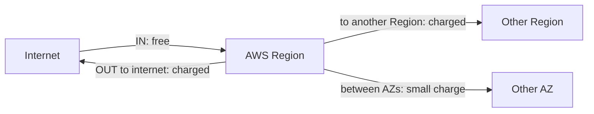
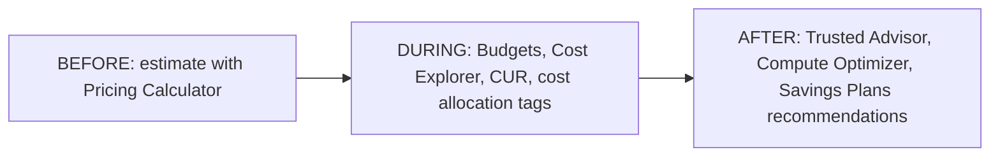
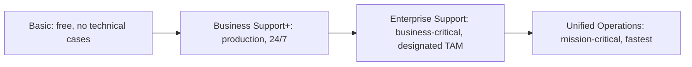

**12% of the scored content.** How AWS charges, how to pay less, the tools that keep the bill under control, and where to get help. A small domain with easy points if you understand the logic of each option.

> [!NOTE]
> **In this part**
>
> - 4.1 Compare AWS pricing models
> - 4.2 Understand resources for billing, budget, and cost management
> - 4.3 Identify AWS technical resources and AWS Support options

> [!TIP]
> **Our story through this course.** Sara's shop runs well, but her accountant asks three questions: why does the bill change every month, how can we pay less, and who do we call if something breaks on a Saturday night?

## 4.1 Pricing models

> [!IMPORTANT]
> **Official objective. Task statement 4.1: Compare AWS pricing models**
>
> Knowledge of:
>
> - Compute purchasing options (for example, On-Demand Instances, Reserved Instances, Spot Instances, Savings Plans, Dedicated Hosts, Dedicated Instances, Capacity Reservations)
> - Storage options and tiers
>
> Skills in:
>
> - Identifying when to use various compute purchasing options
> - Describing Reserved Instance flexibility
> - Describing Reserved Instance behavior in AWS Organizations
> - Understanding incoming data transfer costs and outgoing data transfer costs (for example, from one Region to another Region, within the same Region)
> - Understanding pricing options for various storage options and tiers

### How AWS charges: three principles

1. **Pay as you go.** You pay for what you use, for as long as you use it, with no upfront payment, no long-term contract and no termination fee. Stop using a resource and you stop paying.
2. **Pay less when you reserve.** If you **commit** to using a certain amount for **1 or 3 years**, AWS gives you a large discount, because it can plan its capacity.
3. **Pay less per unit when you use more.** Some services have **volume tiers**: for example, the price per GB stored in S3 drops as your total storage grows.

**What you actually pay for.** Almost every AWS bill comes from three things:

- **Compute**: the time your servers, containers or functions run (per second, per hour, or per request and millisecond for Lambda).
- **Storage**: the amount of data you keep, per GB per month, depending on the storage class.
- **Data transfer out**: data **leaving** AWS to the internet or to another Region.

> [!TIP]
> **Good to know.** A useful habit: there are about **730 hours in a month**. Multiply an hourly price by 730 to estimate the monthly cost. A cache node at about 0.20 dollars per hour, left running and forgotten, already costs around 150 dollars a month. That is why you create a budget on day one (section 4.2).

### Buying EC2 capacity: the seven options

**In plain words.** The same EC2 server can be paid for in several ways. The cheapest option depends on **how long** you will use it, **how predictable** your usage is, and whether your work **can be interrupted**.

> [!TIP]
> **Analogy: a hotel.** **On-Demand** is walking in and paying the full nightly rate: total freedom, highest price. **Reserved Instances** is booking the same type of room for one or three years at a big discount. **Savings Plans** is promising to spend a fixed amount per hour at the hotel chain, and using any room you like. **Spot** is taking unsold rooms at up to 90% off, but you may be asked to leave with two minutes' notice. A **Dedicated Host** is renting a whole building for yourself. A **Capacity Reservation** is paying to hold a room on a specific date, whether you come or not.

**On-Demand Instances.** Pay by the second (Linux) or hour, **no commitment**, start and stop whenever you want. The most flexible and the most expensive per hour. **When**: short-term, unpredictable or spiky workloads, development and testing, new applications whose usage you do not know yet, workloads that cannot be interrupted.

**Savings Plans.** You commit to a **consistent amount of spending per hour** (for example 10 dollars per hour) for **1 or 3 years**, and receive up to about **72% discount** on usage up to that amount. Two main kinds:

- **Compute Savings Plans**: the most **flexible**: the discount applies to EC2 of **any family, size, Region and operating system**, and also to **AWS Fargate and AWS Lambda**. You can change instances freely.
- **EC2 Instance Savings Plans**: bigger discount, but tied to **one instance family in one Region** (any size, OS within it).

**When**: steady, predictable usage, when you want a big discount **and** flexibility.

**Reserved Instances (RIs).** You commit to a **specific instance configuration** (instance type, Region, operating system, tenancy) for **1 or 3 years**, and get up to about **72% discount**. Reserved Instances also exist for **RDS, ElastiCache, Redshift** and other services.

- **Payment options**: **All Upfront** (biggest discount), **Partial Upfront**, **No Upfront** (smallest discount). A 3-year term gives more discount than 1 year.
- **Standard RIs**: the **largest discount**. You can modify some attributes (the AZ, the instance size within the same family) and you can **sell** unused Standard RIs on the **Reserved Instance Marketplace**.
- **Convertible RIs**: smaller discount, but you can **exchange** them for RIs of a **different family, operating system or tenancy**, as long as the new value is equal or greater.

**When**: steady-state workloads that run all the time with a known configuration, for example a database running 24 hours a day.

**Reserved Instance flexibility.** A Regional RI applies its discount automatically to **any size within the same instance family** in that Region (for example, one `large` reservation can cover two `medium` instances), and Convertible RIs can be exchanged. That is what the guide calls RI flexibility.

**Reserved Instances in AWS Organizations.** When several accounts are grouped in an organization with consolidated billing, **RI and Savings Plans discounts are shared across all accounts**: if account A does not use all its reservations, the discount applies to matching usage in account B. Discount sharing can be turned off for specific accounts.

**Spot Instances.** Use AWS's **spare, unused capacity** at up to about **90% discount**. The catch: when AWS needs the capacity back, it can **interrupt** your instance with a **two-minute warning**. **When**: work that **can stop and restart without harm**: batch processing, big data analysis, image and video rendering, scientific simulations, CI/CD test runs, stateless web servers in a mixed fleet. **Never** for critical databases or work that cannot be interrupted.

**Dedicated Hosts.** A **whole physical server dedicated to you**, where you can see the **sockets and cores** and control where your instances are placed. **When**: **bring your own license (BYOL)** for software licensed per socket or per core (Windows Server, SQL Server, Oracle), and strict compliance needs. The most expensive option. Can be paid On-Demand or reserved.

**Dedicated Instances.** Instances that run on hardware **dedicated to your account** (no other customer on the same machine), but without visibility or control of the physical server. **When**: compliance requires hardware isolation, without the licensing needs of Dedicated Hosts.

**Capacity Reservations.** **Reserve EC2 capacity in a specific Availability Zone** for any duration, so you are sure the instances are available when needed. No commitment and **no discount by themselves**: you pay the On-Demand price whether you use the capacity or not, and you can combine them with Savings Plans or Regional RIs to get a discount. **When**: a critical event (Black Friday), disaster recovery, or regulatory needs to guarantee capacity.

| Option | Commitment | Discount | Best for |
|---|---|---|---|
| **On-Demand** | None | None | Short, unpredictable, dev/test, cannot be interrupted |
| **Savings Plans** | 1 or 3 years, $ per hour | Up to ~72% | Steady usage with flexibility (Compute SP covers Fargate and Lambda) |
| **Reserved Instances** | 1 or 3 years, specific configuration | Up to ~72% | Steady, predictable workloads; Standard (sellable) or Convertible (exchangeable) |
| **Spot** | None | Up to ~90% | Fault-tolerant, interruptible jobs |
| **Dedicated Hosts** | On-Demand or reserved | | BYOL per socket/core, compliance |
| **Dedicated Instances** | On-Demand or reserved | | Hardware isolation |
| **Capacity Reservations** | None | None alone | Guaranteed capacity in one AZ |

> [!NOTE]
> **Example.** Sara's shop: her database runs all year with the same size → **Reserved Instance** (or a Savings Plan). Her web servers grow and shrink → a **Compute Savings Plan** for the base, **On-Demand** for peaks. Her nightly job that resizes photos can be restarted if stopped → **Spot**.

### Data transfer costs

**In plain words.** Moving data also costs money, but not in every direction.

- **Data coming into AWS** from the internet: **free** (AWS wants your data to come in).
- **Data going out to the internet**: **charged** per GB, with a small free allowance each month and lower prices at high volumes.
- **Between two Regions**: **charged**.
- **Between Availability Zones** in the same Region: a **small charge** per GB.
- **Within the same AZ** using private IP addresses: **free**.
- **Amazon CloudFront** and **AWS Direct Connect** can **reduce** the cost of data going out.

> [!NOTE]
> **Example.** Sara uploads 100 GB of photos to S3: free. Customers download 500 GB of pages and photos in a month: she pays for data out, less if served through CloudFront. She copies her backups to another Region: she pays inter-Region transfer.

### Storage pricing

Storage prices depend on: the **amount** stored (per GB per month), the **storage class** (S3 Standard is more expensive to store than Glacier, but cheaper to read), the number of **requests**, **retrieval fees** for infrequent and archive classes, **minimum storage durations** (30, 90 or 180 days), and **data transfer** out. For EBS, the **volume type** (fast SSD or cheaper HDD) and its size and performance matter.

### Free things and the Free Tier

- **Free services**: IAM, VPC, AWS Organizations and consolidated billing, Auto Scaling, CloudFormation and Elastic Beanstalk. For CloudFormation, Beanstalk and Auto Scaling you pay only for the resources they create.
- **AWS Free Tier**: lets new customers try AWS at no cost within limits: offers that are **always free** (for example a monthly number of Lambda requests or a small amount of DynamoDB storage), offers **free for a limited period** after sign-up, and short **trials** of some services. AWS has changed the program for new accounts recently (including credit-based plans), so check the current terms on the AWS Free Tier page.
- **Promotional credits**: AWS credits (for example from events, startup programs or training) are applied to your bill like money.

> [!WARNING]
> **On the exam.** "Unpredictable, short-term, cannot be interrupted" = **On-Demand**. "Steady 1 to 3 years, flexible across instance families, includes Lambda and Fargate" = **Compute Savings Plans**. "Steady, specific instance, biggest discount" = **Standard Reserved Instances**; "need to change family later" = **Convertible**. "Cheapest, can be interrupted" = **Spot**. "Per-core licenses" = **Dedicated Hosts**. "Guarantee capacity in an AZ" = **Capacity Reservations**. "Data into AWS" = **free**. "RI discounts in an organization" = **shared across accounts**.

## 4.2 Billing, budgets and cost management

> [!IMPORTANT]
> **Official objective. Task statement 4.2: Understand resources for billing, budget, and cost management**
>
> Knowledge of:
>
> - Billing support and information
> - Pricing information for AWS services
> - AWS Organizations
> - AWS cost allocation tags
>
> Skills in:
>
> - Understanding the appropriate uses and capabilities of AWS Budgets and AWS Cost Explorer
> - Understanding the appropriate uses and capabilities of AWS Pricing Calculator
> - Understanding AWS Organizations consolidated billing and allocation of costs
> - Understanding various types of cost allocation tags and their relation to billing reports (for example, AWS Cost and Usage Report)

**In plain words.** AWS gives a set of free or low-cost tools to manage spending. Think of three moments: **before** building (estimate), **while** running (watch, alert, understand), and **after** (optimize).

**AWS Pricing Calculator: estimate before you build.** A free website (no account needed) where you describe the architecture you plan, for example "two web servers of this size, a 100 GB database, 1 TB of S3, 500 GB of data out", and get an **estimated monthly cost**. You can save and share the estimate. Use it to compare options and to build budgets or migration business cases. For programs, the **AWS Price List API** gives AWS prices programmatically.

**AWS Budgets: get alerted.** You set a **budget** for cost, usage, or Reserved Instance and Savings Plans coverage, for example "300 dollars per month". AWS Budgets sends **alerts** (by email or through SNS) when the **actual** spending, or the **forecasted** spending for the month, passes thresholds you choose (for example 80% and 100%). Budgets can also trigger **actions**, such as applying a policy that stops creating new resources.

**AWS Cost Explorer: understand and forecast.** An interactive tool with **charts** of your costs and usage over time: by service, by account, by Region, by tag. It shows up to the last 12 months (more on request), **forecasts** future spending, and gives **recommendations**: rightsizing of underused instances, and which Reserved Instances or Savings Plans to buy. Use it to answer "what did we spend on, and why did it change?".

**AWS Cost and Usage Report (CUR): every detail.** The **most comprehensive and detailed** billing data: one line per resource, per hour or day, with prices, discounts and tags. It is delivered as files into an **S3 bucket**, to be analyzed with tools such as Amazon Athena or Amazon Quick. Finance teams and large companies use it for detailed analysis and chargeback.

**Cost allocation tags: split the bill.** A **tag** is a label made of a **key** and a **value** that you attach to AWS resources, for example `project = website`, `team = marketing`, `environment = test`. Once **activated** in the Billing console as **cost allocation tags**, tags appear in Cost Explorer and the Cost and Usage Report, so you can see the cost **per project, team or environment**. Two types:

- **AWS-generated tags**: created by AWS, such as `aws:createdBy` (who created the resource).
- **User-defined tags**: created by you, such as `project`.

Both must be activated before they show in billing reports.

**AWS Organizations and consolidated billing.** A company often has **many AWS accounts** (one per team, per project, per environment), which isolates them for security. AWS Organizations groups them, with one **management account** that receives **one single bill** for all **member accounts**: this is **consolidated billing**, a free feature. Benefits:

- **One bill** and one payment method for everything, with costs still visible per account.
- **Combined usage for volume discounts**: the usage of all accounts is added together to reach cheaper price tiers sooner.
- **Shared Reserved Instance and Savings Plans discounts** across accounts.

> [!NOTE]
> **Example.** Sara now has three accounts: production, test and accounting. Each uses 40 TB of S3. Separately, none reaches the next cheaper tier; combined under consolidated billing, 120 TB does, and every account benefits from the lower price.

**AWS Cost Anomaly Detection** uses machine learning to spot **unusual spending** (a sudden spike) and alerts you.

**Billing support.** Questions about bills and payments can be sent to AWS through the **Support Center**; billing and account support is included in **every** Support plan, even Basic.

> [!TIP]
> **Good to know.** Some services have expensive defaults, and a beginner can receive a surprise bill. Create a budget with an email alert first. If it happens to you, open a billing case in the Support Center and explain: AWS often refunds a first honest mistake.

> [!WARNING]
> **On the exam.** "Estimate the cost before building or migrating" = **Pricing Calculator**. "Alert when cost exceeds or is forecasted to exceed a threshold" = **Budgets**. "Visualize, analyze past costs, forecast, rightsizing recommendations" = **Cost Explorer**. "Most detailed, line-item billing data in S3" = **Cost and Usage Report**. "See costs per department or project" = **cost allocation tags** (activated). "One bill for many accounts, volume discounts" = **consolidated billing** in **Organizations**.

## 4.3 Technical resources and AWS Support

> [!IMPORTANT]
> **Official objective. Task statement 4.3: Identify AWS technical resources and AWS Support options**
>
> Knowledge of:
>
> - Resources and documentation available on official AWS websites
> - AWS Support plans
> - Role of the AWS Partner Network, including independent software vendors and system integrators
> - AWS Support Center
>
> Skills in:
>
> - Locating AWS whitepapers, blogs, and documentation on official AWS websites
> - Identifying and locating AWS technical resources (for example, AWS Prescriptive Guidance, AWS Knowledge Center, AWS re:Post)
> - Identifying AWS Support options for AWS customers (for example, customer service and communities, Basic Support, AWS Business Support+, AWS Enterprise Support, AWS Unified Operations)
> - Identifying the role of Trusted Advisor, AWS Health Dashboard, and the AWS Health API to help manage and monitor environments for cost optimization
> - Identifying the role of the AWS Trust and Safety team to report abuse of AWS resources
> - Understanding the role of AWS Partners (for example, AWS Marketplace, independent software vendors, system integrators)
> - Identifying the benefits of being an AWS Partner (for example, partner training and certification, partner events, partner volume discounts)
> - Identifying the key services that AWS Marketplace offers (for example, cost management, governance and entitlement)
> - Identifying technical assistance options available at AWS (for example, AWS Professional Services, AWS solutions architects)

### AWS Support plans

**In plain words.** Every AWS account gets **Basic Support** for free: customer service for **account and billing** questions, documentation, whitepapers and the **re:Post** community. But Basic Support **does not include technical support cases**: you cannot ask an AWS engineer to help with a technical problem. For that you need a **paid plan**. The higher the plan, the faster the response and the more proactive help you get.

The exam guide v1.3 uses **new plan names**. Learn them:

**Basic Support** (free, all customers). Customer service for billing and account questions, documentation, whitepapers, re:Post, the AWS Health Dashboard for your account, and the **core** Trusted Advisor checks.

**AWS Business Support+** `NEW`. The **minimum plan recommended for production workloads**. Technical support **24/7** by phone, chat and email from AWS engineers, unlimited cases, help with third-party software, the **full set** of Trusted Advisor checks, AI-powered assistance, and response within **30 minutes** when a critical system is down (one hour when a production system is down).

**AWS Enterprise Support.** For **business-critical** workloads. Everything in Business Support+, plus a **designated Technical Account Manager (TAM)**, response within **15 minutes** for business-critical system down, consultative architecture reviews, security incident response included, and concierge billing help.

**AWS Unified Operations** `NEW`. For **mission-critical** workloads that need the highest resilience. The **fastest response, within 5 minutes**, a team of designated specialists with continuous architecture and resiliency reviews, incident detection and response included.

| | **Basic** | **Business Support+** | **Enterprise Support** | **Unified Operations** |
|---|---|---|---|---|
| For | Everyone | Production (minimum recommended) | Business-critical | Mission-critical |
| Technical cases | **No** | Yes, 24/7 | Yes, 24/7 | Yes, 24/7 |
| Critical system down | | < 30 min | **< 15 min** | **< 5 min** |
| Production system down | | < 1 h | < 1 h | < 1 h |
| Technical Account Manager | No | No | **Designated** | **Designated** |
| Trusted Advisor | Core checks | **All checks** | All + Priority | All + Priority |
| Price | Free | From about $29/month `verify` | From about $5,000/month `verify` | `verify` |

**The old names** (you may still meet them in some questions or older material; these plans end on 1 January 2027): **Developer** (business-hours email, for testing) and **Business** (24/7, production) are replaced by **Business Support+**; **Enterprise On-Ramp** (pool of TAMs) is replaced by **Enterprise Support**; **Enterprise** = Enterprise Support.

**Technical Account Manager (TAM).** A named AWS technical expert who knows your environment, gives **proactive** guidance (architecture, cost, operations), coordinates access to AWS specialists, and helps during incidents. Only in **Enterprise Support** and **Unified Operations**.

### Tools that watch your environment

**AWS Trusted Advisor** inspects your AWS account and gives **recommendations** to follow best practices. Its main categories:

| Category | Example of check |
|---|---|
| **Cost optimization** | Idle or underused EC2 instances, unassociated Elastic IP addresses, idle load balancers |
| **Performance** | Overused instances, CloudFront configuration |
| **Security** | MFA on the root user, security groups open to the world, public S3 buckets, exposed access keys |
| **Fault tolerance** | No EBS snapshots, instances in a single AZ, RDS without backups |
| **Service limits (quotas)** | Usage close to a service limit |

(There is also an operational excellence category.) Basic Support gets the core checks; Business Support+ and higher get all checks and programmatic access.

**AWS Health Dashboard** (formerly the Personal Health Dashboard) shows two things: the **general status of AWS services** in every Region, and, more importantly, **events that affect your own resources**: scheduled maintenance on one of your instances, an issue in the AZ where your database runs, a certificate about to expire. The **AWS Health API** lets you receive these events in your own tools and automate reactions.

### Where to find help and information

| Resource | Use it for |
|---|---|
| **AWS Documentation** | Official user guides and API references for every service |
| **AWS Whitepapers and guides** | In-depth documents, such as the Well-Architected Framework or security best practices |
| **AWS Blogs** and **What's New** | News, announcements, tutorials |
| **AWS Prescriptive Guidance** | Proven strategies, guides and patterns for migration and modernization projects |
| **AWS Knowledge Center** | Answers to the **most frequent questions** received by AWS Support |
| **AWS re:Post** | **Community** questions and answers, moderated with AWS experts (replaced the old forums) |
| **AWS Architecture Center** | Reference architectures and diagrams |
| **AWS Support Center** | Where you **open and follow support cases**, technical or billing |
| **AWS Trust & Safety team** | Where you **report abuse** coming from AWS resources: spam, attacks, malware, phishing hosted on AWS |

### Partners, Marketplace and expert help

**The AWS Partner Network (APN).** Thousands of companies work with AWS to help customers. Two main kinds:

- **Independent software vendors (ISVs)**: companies that **sell software** that runs on or integrates with AWS (security tools, databases, monitoring), often through AWS Marketplace.
- **System integrators and consulting partners**: companies that **provide services**: design architectures, run migrations, manage environments, train teams.

**Benefits of being an AWS Partner**: access to **partner training and certification**, **partner events**, marketing support and funding, technical support, and **partner volume discounts**.

**AWS Marketplace** is a **digital catalog** of thousands of software products, data products and professional services from third-party vendors that you can **find, buy and deploy** in a few clicks, often as ready-made AMIs or SaaS. Key services it offers: **cost management** (usage-based or annual pricing, charges on your **AWS bill**, private offers with negotiated prices), **governance** (control which products employees may buy), and **entitlement** (license management and tracking).

**Technical assistance from AWS itself:**

- **AWS Professional Services**: a global team of AWS experts you can hire to help with large projects, such as a data center migration or a transformation program.
- **AWS solutions architects**: AWS technical experts who give **architecture guidance** to customers and help them design solutions with best practices.

**Service level agreements (SLAs).** Each AWS service publishes an **SLA**: a commitment to a monthly availability percentage (for example 99.99%). If AWS misses it, customers receive **service credits** on their bill.

> [!WARNING]
> **On the exam.** "Minimum plan recommended for production" = **Business Support+**. "Designated TAM" = **Enterprise Support** or **Unified Operations**. "Fastest response, mission-critical" = **Unified Operations** (< 5 min). "No technical support cases" = **Basic**. "Best-practice checks: cost, security, fault tolerance, limits" = **Trusted Advisor**. "Events affecting my resources" = **AWS Health Dashboard** (API: **AWS Health API**). "Community answers" = **re:Post**. "Frequent support questions" = **Knowledge Center**. "Migration patterns" = **Prescriptive Guidance**. "Report abuse" = **Trust & Safety**. "Buy third-party software billed on the AWS bill" = **Marketplace**. "Software vendor" = **ISV**; "consulting and migration partner" = **system integrator**. "AWS experts for a big project" = **Professional Services**.

> [!IMPORTANT]
> **Key takeaways.**
>
> - Pay as you go, pay less when you reserve, pay less per unit when you use more. You pay for compute, storage and data transfer **out**; data **in** is free.
> - On-Demand (flexible) · Savings Plans and RIs (1 or 3 years, up to ~72%; Standard vs Convertible; shared in Organizations) · Spot (up to ~90%, interruptible) · Dedicated Hosts (BYOL) · Dedicated Instances · Capacity Reservations (guaranteed capacity in an AZ).
> - Pricing Calculator (before) · Budgets (alerts) · Cost Explorer (analyze, forecast, recommend) · CUR (line-item detail in S3) · cost allocation tags (activate them) · Organizations (one bill, combined volume, shared discounts).
> - Support v1.3: Basic (no technical cases) → Business Support+ (production, < 30 min) → Enterprise Support (TAM, < 15 min) → Unified Operations (mission-critical, < 5 min). Old names map to them.
> - Trusted Advisor checks the account; Health Dashboard shows events affecting you. re:Post, Knowledge Center, Prescriptive Guidance, documentation, Support Center, Trust & Safety.
> - Partners: ISVs sell software, system integrators provide services; Marketplace sells third-party products on your AWS bill; Professional Services and solutions architects are AWS's own experts.

---

[← Cloud Technology and Services](03-cloud-technology-and-services.md) &nbsp;·&nbsp; <a href="../README.md">Contents</a> &nbsp;·&nbsp; [Exam day →](05-exam-day.md)

