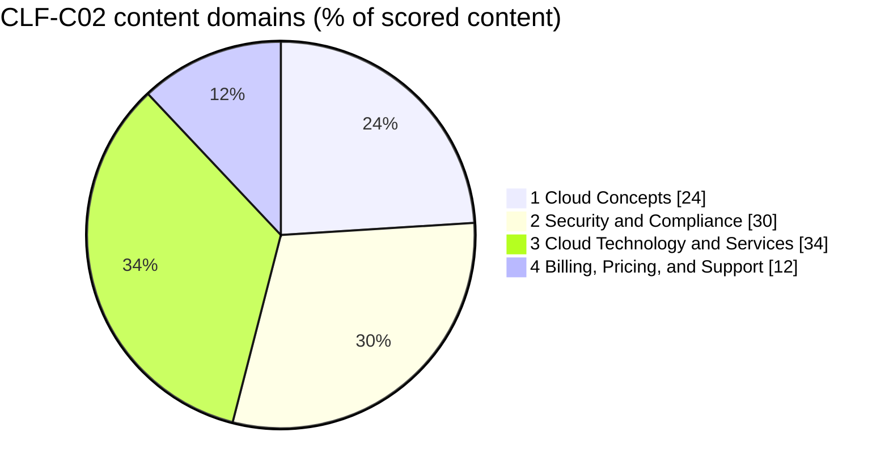
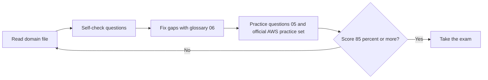

# 00 · Exam Guide, Versions and Scope (latest: **v1.3 — 29 Oct 2026**)

> **Primary sources (official):**
> - AWS Certified Cloud Practitioner (CLF-C02) exam guide — `docs.aws.amazon.com/aws-certification/latest/cloud-practitioner-02/` (landing page, 4 domain pages, *Technologies and Concepts*, *In-Scope Services*, *Out-of-Scope Services*, *Revisions*)
> - AWS Skill Builder — Cloud Practitioner (CLF-C02) exam prep
> - AWS Support documentation (support plans)
>
> Everything below was checked against these pages on **30 Oct 2026**. Items I could not verify on an official page are explicitly flagged **[verify]**.

---

## 1. Which version of the exam guide applies to *you*?

The official **Revisions** page lists four versions of the CLF-C02 guide:

| Version | Published |
|---|---|
| 1.0 | 24 Jun 2026 |
| 1.1 | 28 Aug 2026 |
| 1.2 | 24 Sep 2026 |
| **1.3 (latest)** | **29 Oct 2026** |

AWS states that **guide updates are published about one month before they take effect on the exam**. So:

- Exams taken **now / in the next weeks** are most likely built on the previous guide (≈ v1.2), while
- exams taken **from about late November 2026** follow **v1.3**.

The Revisions page does **not** publish a line-by-line changelog per version — the only itemized change is that **eight services were removed from the out-of-scope list** (Amazon Elastic Transcoder, AWS Elemental MediaStore, Amazon Lookout for Metrics, Amazon Lumberyard, Amazon Monitron, AWS Panorama, AWS RoboMaker, Amazon WorkDocs — i.e., mostly retired services).

### How this guide handles versions (so you're safe either way)
- **The text follows v1.3 (latest).**
- Where the **older (2023-era) guide** differs, the item is tagged **[LEGACY]** — it is still worth knowing (it can appear if your exam is still built on an older guide, and it is real AWS knowledge), but it is **no longer on the v1.3 scope list**.
- Where AWS **renamed** a service, both names are given (e.g., *QuickSight → Amazon Quick*).

| Tag | Meaning |
|---|---|
| [v1.3] | Named in the latest official guide |
| [LEGACY] | In the older guide, **not listed** (or now explicitly out of scope) in v1.3 — lower priority, learn only the one-liner |
| [NEW] | Appears in v1.3 scope (wasn't in the older guide's list) |
| [verify] | Not confirmable on an official page — check before the exam |

---

## 2. Exam facts (official page)

| Item | Value |
|---|---|
| Exam | AWS Certified Cloud Practitioner — **CLF-C02** (Foundational) |
| Question types | **Multiple choice** (1 correct, 3 distractors) · **Multiple response** (2+ correct out of 5+ options) |
| Questions | **50 scored + 15 unscored** (= 65; unscored are not identified) |
| Scoring | Pass/fail · scaled **100–1000** · **minimum passing score = 700** |
| Scoring model | **Compensatory** — you must pass the *overall* exam, not each section |
| Guessing | **No penalty**; unanswered = incorrect → always answer |
| Section feedback | Score report may show per-section classification — interpret with caution (sections have different weights) |
| Duration | Not stated on the guide page. The exam has historically been **90 minutes** **[verify on your registration page]** |
| Candidate | Up to ~6 months of AWS exposure; non-IT backgrounds welcome |
| Out of scope for the candidate | Coding · designing cloud architecture · troubleshooting · implementation · load and performance testing |

**The exam validates that you can:** explain the value of the AWS Cloud · explain the **shared responsibility model** · understand the **Well-Architected Framework** · understand security best practices · understand AWS **costs, economics and billing** · describe and position **core services** (compute, network, database, storage) · identify the **right service for common use cases**.

> 700/1000 is a *scaled* score — not "70% correct". Aim for 85% or more on practice material to keep a margin.

---

## 3. Domains and weights

| # | Domain (official name) | Weight | Where in this guide |
|---|---|---|---|
| 1 | **Cloud Concepts** | 24% | File 01 |
| 2 | **Security and Compliance** | 30% | File 02 |
| 3 | **Cloud Technology and Services** | 34% | Files 03a · 03b · 03c |
| 4 | **Billing, Pricing, and Support** | 12% | File 04 |

---

## 4. Official task statements and skills — v1.3 checklist

Use this as your **tick-list**: you're ready when you can explain every line.

### Domain 1 — Cloud Concepts (24%)
- **1.1 Define the benefits of the AWS Cloud** — benefits of global infrastructure (speed of deployment, global reach) · advantages of **high availability, elasticity, agility**.
- **1.2 Identify design principles of the AWS Cloud** — the **Well-Architected Framework** pillars (operational excellence, security, reliability, performance efficiency, cost optimization, sustainability) · differences between pillars.
- **1.3 Understand the benefits of and strategies for migration** — **AWS CAF** (reduced business risk, improved **ESG** performance, increased revenue, increased operational efficiency) · appropriate **migration strategies** (e.g., database replication) · resources supporting the migration journey.
- **1.4 Understand concepts of cloud economics** — **fixed vs variable costs** · costs of on-premises environments · **licensing strategies** (BYOL vs license-included) · **rightsizing** · benefits of **automation** · **economies of scale**.

### Domain 2 — Security and Compliance (30%)
- **2.1 Shared responsibility model** — components · customer responsibilities · AWS responsibilities · shared responsibilities · how responsibilities **shift by service** (RDS, Lambda, EC2).
- **2.2 Security, governance, compliance concepts** — where to find compliance info (**AWS Artifact**) · compliance needs by geography/industry (**AWS Compliance**) · how customers secure resources (**Inspector, Security Hub, GuardDuty, Shield**) · **encryption** options (in transit / at rest) · governance services (**CloudWatch** monitoring; **CloudTrail** and **Config** auditing; access reports) · compliance requirements vary among services · where to capture/locate **security logs**.
- **2.3 Access management** — **IAM** · protecting the **root user** · **least privilege** · **IAM Identity Center** · access keys, password policies, **credential storage (Secrets Manager, Systems Manager)** · authentication methods (**MFA**, Identity Center, **cross-account roles**) · groups, users, custom and managed policies · **tasks only root can do** · root protection methods · identity types (e.g., **federated**).
- **2.4 Components and resources for security** — security features/services (**WAF, Firewall Manager, Shield, GuardDuty**) · **third-party security products on AWS Marketplace** · where security info lives (**Knowledge Center, Security Center, Security Blog**) · **Trusted Advisor** to identify security issues.

### Domain 3 — Cloud Technology and Services (34%)
- **3.1 Deploying and operating** — decide between **programmatic access (APIs, SDKs, CLI)**, **Management Console**, and **IaC** · one-time operations vs **repeatable processes** · deployment models (**cloud, hybrid, on-premises**).
- **3.2 Global infrastructure** — **Regions, AZs, edge locations** and their relationships · **high availability with multiple AZs** · AZs share no single point of failure · when to use **multiple Regions** (DR, business continuity, low latency, **data sovereignty**) · benefits of edge locations.
- **3.3 Compute** — **EC2 instance types** (compute optimized, storage optimized…) · containers (**ECS, EKS**) · serverless (**Fargate, Lambda**) · **auto scaling provides elasticity** · purpose of **load balancers**.
- **3.4 Databases** — **EC2-hosted vs managed** databases · relational (**RDS, Aurora**) · NoSQL (**DynamoDB**) · memory-based (**ElastiCache**) · migration tools (**DMS, SCT**).
- **3.5 Network** — **VPC components** (subnets, gateways) · VPC security (**network ACLs, security groups, Amazon Inspector**) · **Route 53** · connectivity options (**VPN, Direct Connect**).
- **3.6 Storage** — **object storage** uses · **S3 storage classes** · block (**EBS, instance store**) · file (**EFS, FSx**) · cached file systems (**Storage Gateway**) · **lifecycle policies** · **AWS Backup**.
- **3.7 AI/ML and analytics** — what services do (e.g., **SageMaker AI, Lex**) · analytics (**Athena, Kinesis, Glue, Amazon Quick**).
- **3.8 Other categories** — integration (**EventBridge, SNS, SQS**) · business apps (**Connect, SES**) · customer enablement (**AWS Support**) · developer tools (**CodeBuild, CodePipeline, X-Ray**) · end-user computing (**AppStream 2.0, WorkSpaces, WorkSpaces Secure Browser**) · frontend/mobile (**Amplify**) · IoT (**IoT Core**).

### Domain 4 — Billing, Pricing, and Support (12%)
- **4.1 Pricing models** — compute purchasing options (**On-Demand, Reserved, Spot, Savings Plans, Dedicated Hosts, Dedicated Instances, Capacity Reservations**) · **Reserved Instance flexibility** and behavior in **AWS Organizations** · **data transfer** costs (in/out, cross-Region, same Region) · storage options and tiers.
- **4.2 Billing, budget, cost management** — **Budgets, Cost Explorer** · **Pricing Calculator** · **Organizations consolidated billing** and cost allocation · **cost allocation tags** and **Cost and Usage Report**.
- **4.3 Technical resources and Support options** — official docs/whitepapers/blogs · **Prescriptive Guidance, Knowledge Center, re:Post** · **Support plans (v1.3 names): Basic Support, Business Support+, Enterprise Support, Unified Operations** (+ customer service and communities) · **Trusted Advisor, Health Dashboard, Health API** · **Trust and Safety** (report abuse) · **AWS Partners** (Marketplace, ISVs, system integrators) and partner benefits · key Marketplace capabilities (cost management, governance, entitlement) · **Professional Services, Solutions Architects**.

---

## 5. Service scope map

### In scope — v1.3 official list (non-exhaustive, subject to change)

| Category | Services |
|---|---|
| **Analytics** | Athena · EMR · Glue · Kinesis · OpenSearch Service · **Amazon Quick** ([NEW] name; formerly QuickSight) · Redshift |
| **Application Integration** | EventBridge · SNS · SQS · Step Functions |
| **Business Applications** | Connect · SES |
| **Cloud Financial Management** | Budgets · Cost and Usage Reports · Cost Explorer · Marketplace |
| **Compute** | Batch · EC2 · Elastic Beanstalk · Lightsail · Outposts |
| **Containers** | ECR · ECS · EKS |
| **Customer Enablement** | AWS Support |
| **Database** | Aurora · **DocumentDB** · DynamoDB · ElastiCache · Neptune · RDS |
| **Developer Tools** | AWS CLI · CodeBuild · CodePipeline · X-Ray |
| **End User Computing** | AppStream 2.0 · WorkSpaces · **WorkSpaces Secure Browser** (formerly WorkSpaces Web) |
| **Frontend Web & Mobile** | Amplify |
| **IoT** | IoT Core |
| **Machine Learning** | Comprehend · Lex · Polly · **Amazon Q** · Rekognition · **SageMaker AI** ([NEW] name) · Textract · Transcribe · Translate |
| **Management & Governance** | Auto Scaling · CloudFormation · CloudTrail · CloudWatch · Compute Optimizer · Config · Control Tower · Health Dashboard · License Manager · Management Console · Organizations · Service Catalog · **Service Quotas** · Systems Manager · Trusted Advisor · Well-Architected Tool |
| **Migration & Transfer** | Application Discovery Service · Application Migration Service · DMS · **Migration Evaluator** · Migration Hub · SCT |
| **Networking & Content Delivery** | API Gateway · CloudFront · Direct Connect · Global Accelerator · **PrivateLink** · Route 53 · **Transit Gateway** · VPC · VPN · **Site-to-Site VPN** · **Client VPN** |
| **Security, Identity, Compliance** | Artifact · ACM · CloudHSM · Cognito · Detective · Directory Service · Firewall Manager · GuardDuty · IAM · IAM Identity Center · Inspector · KMS · Macie · RAM · Secrets Manager · Security Hub · Shield · WAF |
| **Serverless** | Fargate · Lambda |
| **Storage** | Backup · EBS · EFS · Elastic Disaster Recovery · FSx · S3 · S3 Glacier · Storage Gateway |

### Explicitly out of scope — v1.3 official list
Amazon AppFlow · AWS Clean Rooms · **AWS Data Exchange** · Amazon DataZone · **Amazon MSK** · AWS AppFabric · Amazon SWF · AWS Copilot · **AWS Wavelength** · Application Cost Profiler · Amazon DevPay · **AWS Activate** · **AWS IQ** · **AWS Managed Services (AMS)** · **AWS Billing Conductor** · Amazon Keyspaces · **Amazon MemoryDB** · **AWS AppConfig** · AWS Application Composer · **CodeArtifact** · **CodeDeploy** · CodeGuru · **CloudShell** · **Device Farm** · GameLift · IoT Device Defender · **IoT Greengrass** · Fraud Detector · Personalize · AWS Chatbot · Data Lifecycle Manager · **Launch Wizard** · AWS Elemental (MediaConnect/Convert/Live/Package/Tailor, appliances) · Amazon IVS · Migration Hub Refactor Spaces · **AWS Transfer Family** · Cloud Map · Network Access Analyzer · Ground Station · VPC Lattice · Cloud Directory · **AWS Network Firewall** · **FSx for Lustre**.

### LEGACY — in the older guide's lists, **not listed** in v1.3 (low priority — learn the one-liner only)
AWS **Snow Family** · AWS **Audit Manager** · Amazon **Kendra** · AWS **AppSync** · AWS **CodeCommit / CodeStar / Cloud9** · AWS **Local Zones** · AWS **Resource Groups & Tag Editor** · AWS **DataSync**.

> *Items marked "not listed" are **not** guaranteed absent — AWS says the list is non-exhaustive — but they are clearly **not priority** under v1.3. The services that are **explicitly out of scope** should not take any of your study time beyond recognizing the name.

### Technologies and concepts that may appear (official list)
APIs · Benefits of migrating to the AWS Cloud · **AWS CAF** · AWS Compliance · Compute · Cost management · Databases · EC2 instance types/purchasing (Reserved, On-Demand, Spot) · AWS global infrastructure (Regions, AZs) · **Infrastructure as Code** · AWS Knowledge Center · Machine learning · Management and governance · Migration and data transfer · Network services · **AWS Partner Network (APN)** · AWS Prescriptive Guidance · **AWS Pricing Calculator** · AWS Professional Services · AWS re:Post · **AWS SDKs** · Security · AWS Security Blog · **Shared responsibility model** · AWS solutions architects · Storage · AWS Support Center · AWS Support plans · **Well-Architected Framework**.

---

## 6. Official preparation resources (AWS Skill Builder)

Skill Builder is a login-gated site, so I could verify only the **names/availability** of these official resources, not their contents:

| Official resource | Notes |
|---|---|
| **Exam Prep Standard Course — AWS Certified Cloud Practitioner (CLF-C02)** | Official AWS exam-prep course, updated for the current exam; uses your Skill Builder login |
| **Exam Prep Enhanced Course — AWS Certified Cloud Practitioner (CLF-C02)** | Enhanced version with practice materials; requires a **Skill Builder subscription** |
| **Official Practice Question Set (CLF-C02)** | AWS-written practice questions with explanations (updated) |
| **Official Practice Exam (CLF-C02)** | Full-length readiness assessment; requires a **Skill Builder subscription** |
| **Exam Prep Official Pretest** | Pretest to assess readiness |

> [verify] Durations, number of questions and prices change — check Skill Builder directly.

**Study order that works:** read this guide → Skill Builder Standard course (gaps) → **Official Practice Question Set** → **Official Practice Exam** → review mistakes with files 05/06 → exam.

---

## 7. Recommended 5-day plan

| Day | Focus | Done when |
|---|---|---|
| 1 | Domain 1 + Domain 4 | All self-checks correct |
| 2 | Domain 2 (30%) | You can draw the shared responsibility model and map every security service |
| 3 | Domain 3 — 03a + 03b | "Which service?" table by heart |
| 4 | Domain 3 — 03c + glossary | AI/ML, analytics, integration, management tools |
| 5 | Practice set + official practice exam + traps list | ≥ 85% twice |
