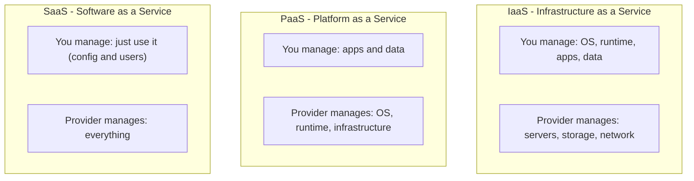
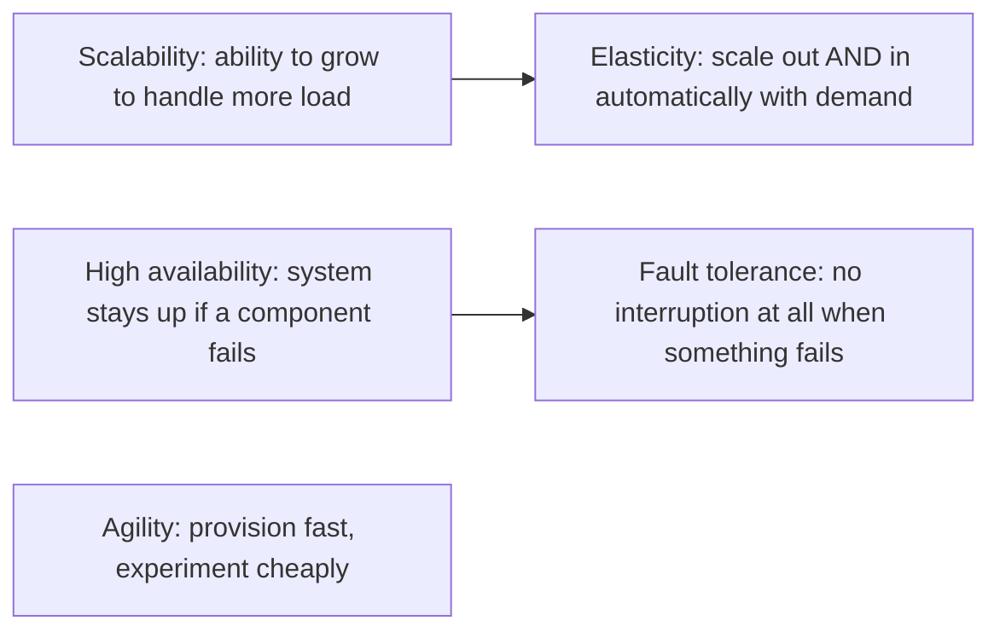
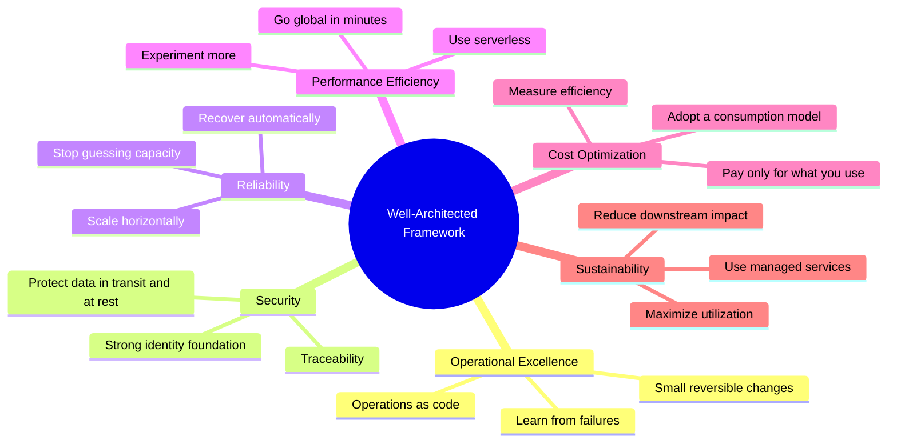
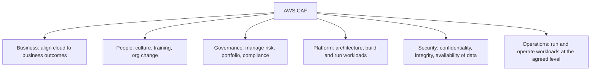

# 01 · Domain 1 — Cloud Concepts (24%)

Task statements: **1.1** Benefits of the AWS Cloud · **1.2** Design principles · **1.3** Migration benefits and strategies · **1.4** Cloud economics

> **Scope tags (official guide v1.3):** [v1.3] listed in the latest guide · [LEGACY] = older guide only / not listed now · [OUT] explicitly out of scope · [NEW] new in the v1.3 list. See file 00 for the full scope map.

---

## 1.0 Foundations you must know first

### What is cloud computing?
**On-demand delivery of IT resources (compute, storage, databases, networking, analytics…) over the internet with pay-as-you-go pricing.** Instead of buying and maintaining physical servers, you rent capacity from AWS and release it when you no longer need it.

### Three cloud service models

| Model | You manage | Example on AWS |
|---|---|---|
| **IaaS** | OS, middleware, apps, data | **Amazon EC2** (+ VPC, EBS) |
| **PaaS** | Your app and data | **AWS Elastic Beanstalk**, RDS (managed DB) |
| **SaaS** | Nothing but your usage | **Amazon Connect** (cloud contact center), Amazon WorkSpaces Web-style end-user services; outside AWS: Gmail, Salesforce |

> Exam rule of thumb: **more managed = less control = less effort**. EC2 (you patch the OS) → Elastic Beanstalk (AWS runs the platform) → SaaS (AWS runs everything).

### Three cloud deployment models

| Model | Meaning | Typical case |
|---|---|---|
| **Cloud (public cloud)** | All resources run in the cloud provider | Startups, new apps |
| **Hybrid** | Cloud + on-premises, connected | Gradual migration, data that must stay on-prem, low-latency to factory |
| **On-premises (private cloud)** | All in your own data center (with virtualization/automation) | Strict regulatory control |

AWS tools for hybrid: **VPN, Direct Connect, Storage Gateway, AWS Outposts**.

---

## 1.1 Benefits of the AWS Cloud

### The six advantages of cloud computing 

| # | Advantage | What it means | Example |
|---|---|---|---|
| 1 | **Trade fixed expense for variable expense** | No upfront data-center investment; pay only for what you consume | Startup launches with $0 hardware cost |
| 2 | **Benefit from massive economies of scale** | AWS aggregates usage of hundreds of thousands of customers → lower prices per unit | Prices go down over time |
| 3 | **Stop guessing capacity** | Scale up or down on demand; no over/under provisioning | Black Friday traffic spike handled automatically |
| 4 | **Increase speed and agility** | Resources in minutes; experiments cost little | Spin up 100 servers for a test, delete after |
| 5 | **Stop spending money running and maintaining data centers** | Focus on customers/business, not racking servers | Redirect IT staff to features |
| 6 | **Go global in minutes** | Deploy in multiple Regions with a few clicks | Low-latency for users in other continents |

### Key vocabulary — don't mix them up

| Term | Definition | AWS example |
|---|---|---|
| **Scalability** | Capacity to increase (or decrease) resources to meet load. *Vertical* = bigger instance; *horizontal* = more instances | Add EC2 instances |
| **Elasticity** | Scalability that happens **automatically**, matching resources to demand in both directions (and you stop paying when you scale in) | **EC2 Auto Scaling**, DynamoDB on-demand |
| **High availability (HA)** | Workload remains accessible with minimal downtime despite failures | Run across **multiple AZs** |
| **Fault tolerance** | Continues operating **without interruption** even if components fail (stronger than HA, usually costlier) | Redundant, replicated, multi-AZ components |
| **Agility** | Speed at which you can provision, test, and change | Launch an environment in minutes with CloudFormation |
| **Durability** | Data is not lost | S3: designed for 99.999999999% (11 nines) durability |
| **Availability** | Data/system is reachable when needed | S3 Standard: 99.99% designed availability |

> Classic trap: **elasticity ≠ scalability.** Elasticity = automatic and *both directions*. If a question says "automatically scale in and out to match demand" → elasticity.

### Benefits of the AWS global infrastructure
- **Speed of deployment** (infrastructure already built)
- **Global reach** (Regions worldwide, edge locations for content)
- **High availability** through multiple Availability Zones
- **Data sovereignty/compliance** — choose the Region where data lives (data does not leave a Region unless *you* move it)

---

## 1.2 Design principles — AWS Well-Architected Framework

The Well-Architected Framework is a set of **best practices** to design and operate reliable, secure, efficient, cost-effective, sustainable workloads. Tool: **AWS Well-Architected Tool** (free, in the console) — review a workload against the pillars and get an improvement plan.

### The six pillars

| Pillar | Core question | Key design principles | Typical services |
|---|---|---|---|
| **Operational Excellence** | How do I run, monitor and **continuously improve** operations? | Perform operations as code · make frequent, small, reversible changes · refine procedures · anticipate failure · learn from all operational failures | CloudFormation, CloudWatch, Systems Manager, Config |
| **Security** | How do I **protect** data, systems and assets? | Strong identity foundation (least privilege) · enable traceability · security at all layers · automate security · protect data in transit/at rest · keep people away from data · prepare for security events | IAM, KMS, GuardDuty, CloudTrail, WAF |
| **Reliability** | Can the workload **recover from failure** and meet demand? | Automatically recover from failure · test recovery procedures · scale horizontally · **stop guessing capacity** · manage change through automation | Multi-AZ, Auto Scaling, Route 53, RDS Multi-AZ, backups |
| **Performance Efficiency** | Am I using the **right resources** efficiently and adapting as needs change? | Democratize advanced technologies · go global in minutes · use serverless architectures · experiment more often · consider mechanical sympathy (pick tech that fits the goal) | Right-size EC2, CloudFront, Lambda, DynamoDB |
| **Cost Optimization** | Am I **avoiding unnecessary cost**? | Implement cloud financial management · adopt a consumption model · measure overall efficiency · stop spending on undifferentiated heavy lifting · analyze and attribute expenditure | Cost Explorer, Budgets, Savings Plans, Compute Optimizer |
| **Sustainability** | Am I **minimizing environmental impact**? | Understand your impact · establish sustainability goals · maximize utilization · adopt more efficient hardware/software · use managed services · reduce downstream impact | Right-sizing, serverless, managed services, efficient Regions |

> Typical question: a scenario describes an action; you must map it to a pillar.
> - "Automatically recover from failure / multi-AZ" → **Reliability**
> - "Encrypt data, least privilege" → **Security**
> - "Delete unused resources, use Spot" → **Cost Optimization**
> - "Choose right instance type, use CloudFront" → **Performance Efficiency**
> - "Automate deployments, runbooks as code" → **Operational Excellence**
> - "Reduce carbon footprint, higher utilization" → **Sustainability**

---

## 1.3 Migration to the AWS Cloud

### Benefits of migrating (why companies do it)
Lower TCO · faster time to market · increased agility and innovation · improved security posture and compliance tooling · global reach · scalability/elasticity · reduced operational burden.

### AWS Cloud Adoption Framework (AWS CAF)
A framework of **guidance and best practices** to help organizations plan and manage their cloud transformation. Organized in **six perspectives**:

- **Business-side perspectives**: Business · People · Governance
- **Technical-side perspectives**: Platform · Security · Operations

**Benefits of CAF** (named in the exam guide): reduced business risk · improved **ESG** (environmental, social, governance) performance · increased revenue · increased operational efficiency.

> Mnemonic for perspectives: **"B-P-G-P-S-O"** → *Business People Govern Platform, Secure Operations.*

### The 7 Rs of migration strategies

| Strategy | Meaning | Effort | Example |
|---|---|---|---|
| **Retire** | Shut down apps no longer needed | None | Decommission an unused legacy system |
| **Retain** | Keep on-premises for now (revisit later) | None | App with compliance blocker or recent upgrade |
| **Rehost** ("lift and shift") | Move as-is to EC2 | Low | Move VMs to EC2 using **Application Migration Service** |
| **Relocate** | Move to cloud equivalent without changes/new hardware | Low | VMware → **VMware Cloud on AWS** |
| **Repurchase** ("drop and shop") | Switch to a different product, usually SaaS | Medium | Move on-prem CRM to Salesforce |
| **Replatform** ("lift, tinker and shift") | Small optimizations, no core change | Medium | Self-managed MySQL → **Amazon RDS**; app server → Elastic Beanstalk |
| **Refactor / Re-architect** | Re-design as cloud-native | High | Monolith → microservices/serverless (Lambda, DynamoDB) |

> If the question says "**minimum changes / fastest**" → Rehost. "**Take advantage of cloud-native / highest benefit**" → Refactor. "**Move DB to managed service with small changes**" → Replatform. "**Replace with SaaS**" → Repurchase.

### Migration tools and services

| Need | Service |
|---|---|
| Discover on-prem servers, dependencies, utilization | **AWS Application Discovery Service** [v1.3] |
| Central tracking dashboard of migrations | **AWS Migration Hub** |
| Lift-and-shift servers to EC2 | **AWS Application Migration Service (MGN)** |
| Migrate databases with minimal downtime | **AWS Database Migration Service (DMS)** (supports ongoing replication) |
| Convert schema between different DB engines (e.g., Oracle → PostgreSQL) | **AWS Schema Conversion Tool (SCT)** |
| Transfer very large data offline (physical device) | **AWS Snow Family** [LEGACY] (not on the v1.3 list — know the one-liner) |
| SFTP/FTPS/FTP into S3/EFS | **AWS Transfer Family** [OUT] (explicitly out of scope in v1.3) |
| Ongoing online transfer from on-prem storage | **AWS DataSync** [LEGACY] (not on the v1.3 list) |
| Dedicated network link for steady transfer | **AWS Direct Connect** |
| Plan with TCO | **AWS Pricing Calculator** [v1.3] · **Migration Evaluator** [v1.3 NEW] (business case/TCO for migration) |

**Database replication** is a recognized migration strategy: keep source and target in sync (DMS continuous replication) and cut over with minimal downtime.

---

## 1.4 Cloud economics

### Fixed (CapEx) vs variable (OpEx)

| | **CapEx** (on-prem) | **OpEx** (cloud) |
|---|---|---|
| Payment | Upfront investment | Pay as you go |
| Risk | Over/under-provisioned capacity | Capacity matches demand |
| Flexibility | Low | High |
| Accounting | Capital expense, depreciated | Operating expense |

### Costs of on-premises environments (TCO components)
Hardware purchase & refresh · data-center space · power & cooling · physical security · networking equipment · staff (admins, electricians) · software licenses · maintenance contracts · downtime/redundancy · unused capacity.

> **TCO (Total Cost of Ownership)** = all direct + indirect costs over the lifetime. AWS offers the **Pricing Calculator** to estimate AWS costs and compare to on-prem. Cloud usually wins because you stop paying for idle capacity and for undifferentiated heavy lifting.

### Licensing strategies

| Option | Meaning |
|---|---|
| **License included** | Software license cost bundled in the hourly price (e.g., Windows Server, SQL Server on EC2/RDS) |
| **BYOL** (Bring Your Own License) | Use existing licenses; often with **Dedicated Hosts** for socket/core-based licensing; **AWS License Manager** tracks usage |

### Rightsizing
Matching instance types and sizes to **actual** workload needs at the lowest cost. Steps: monitor utilization (CloudWatch) → get recommendations (**Compute Optimizer**, **Cost Explorer** rightsizing) → resize/terminate idle resources. Do it continuously, not once.

### Automation benefits
Infrastructure as code (**AWS CloudFormation**) gives repeatable, consistent, version-controlled, reviewable deployments → fewer human errors, faster delivery, lower cost, easy to replicate environments (dev/test/prod).

### Managed services
AWS operates the undifferentiated heavy lifting (patching, backups, HA, scaling) so you focus on your application.

| Instead of… | Use managed… |
|---|---|
| MySQL on EC2 | **Amazon RDS / Aurora** |
| Self-built key-value store | **Amazon DynamoDB** |
| Docker on self-managed hosts | **Amazon ECS / EKS** (+ **Fargate**) |
| Self-managed Kafka | **Amazon MSK** |
| Self-hosted Elasticsearch | **Amazon OpenSearch Service** |

Benefits: lower operational overhead, built-in HA, faster time to market, often lower TCO. Trade-off: less low-level control.

---

## Self-check (answer without looking)

1. Name the **six advantages of cloud computing**.
2. Difference between **scalability, elasticity, high availability, fault tolerance**?
3. List the **six Well-Architected pillars** and one design principle each.
4. List the **six CAF perspectives**.
5. Name the **7 Rs** and give an example for Rehost, Replatform, Repurchase.
6. Which service migrates a DB? Which converts the schema? Which moves petabytes offline?
7. CapEx vs OpEx — which is the cloud model?
8. BYOL vs license included — which AWS option helps with socket/core-based licensing?

Answers

1. Variable expense · economies of scale · stop guessing capacity · speed & agility · stop running data centers · go global in minutes.
2. See the table above.
3. Operational Excellence, Security, Reliability, Performance Efficiency, Cost Optimization, Sustainability.
4. Business, People, Governance, Platform, Security, Operations.
5. Rehost → VMs to EC2; Replatform → DB to RDS; Repurchase → CRM to SaaS.
6. DMS · SCT · Snow Family.
7. OpEx.
8. Dedicated Hosts (+ License Manager).

