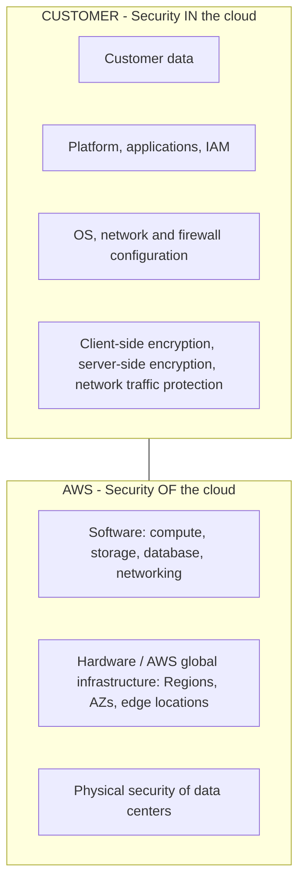
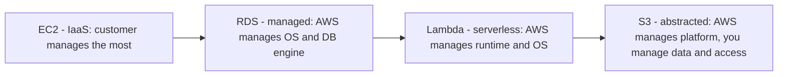
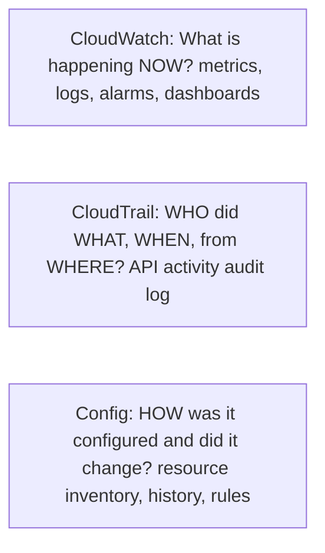
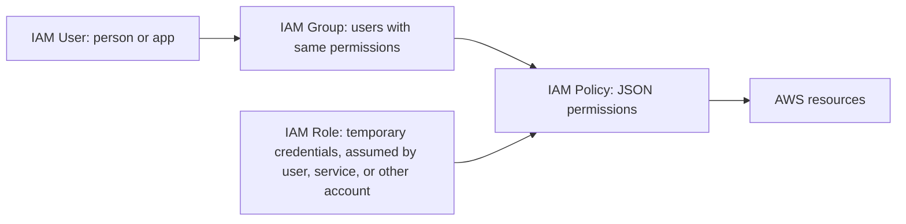
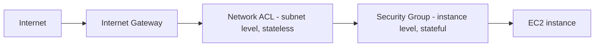
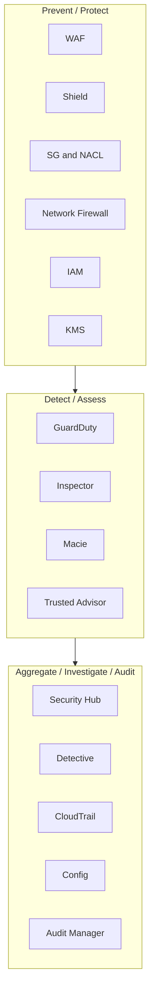

# 02 · Domain 2 — Security and Compliance (30%)

Task statements: **2.1** Shared responsibility model · **2.2** Security, governance, compliance concepts · **2.3** Access management · **2.4** Security components and resources

> **Scope tags (official guide v1.3):** [v1.3] listed in the latest guide · [LEGACY] = older guide only / not listed now · [OUT] explicitly out of scope · [NEW] new in the v1.3 list. See file 00 for the full scope map.
>
> **Security services on the v1.3 list [v1.3]:** Artifact · ACM · CloudHSM · Cognito · Detective · Directory Service · Firewall Manager · GuardDuty · IAM · IAM Identity Center · Inspector · KMS · Macie · RAM · Secrets Manager · Security Hub · Shield · WAF (+ CloudTrail, CloudWatch, Config, Trusted Advisor, Systems Manager).

> The heaviest conceptual domain after Domain 3. Master the **shared responsibility model**, **IAM**, and a **"which security service for which need"** map.

---

## 2.1 The AWS Shared Responsibility Model

> **AWS is responsible for security OF the cloud. The customer is responsible for security IN the cloud.**



| AWS responsibility (OF the cloud) | Customer responsibility (IN the cloud) |
|---|---|
| Physical security of data centers (guards, badges, cameras) | **Your data** and its classification |
| Hardware and global network infrastructure | **IAM**: users, groups, roles, policies, MFA, access keys |
| Hypervisor / host virtualization layer | **Guest OS** patches/updates (on EC2) |
| Managed-service software (e.g., the RDS engine on managed instances) | **Network configuration**: security groups, NACLs, firewall, routing |
| Availability of Regions/AZs/edge locations | **Encryption** settings (at rest, in transit), application security |
| Destroying decommissioned storage media | Configuring service features correctly (e.g., S3 bucket public access) |

### Shared controls (apply to both, in different contexts)
1. **Patch management** — AWS patches the infrastructure/host; customer patches guest OS and applications.
2. **Configuration management** — AWS configures its infrastructure devices; customer configures its guest OS, databases, applications.
3. **Awareness and training** — AWS trains its employees; customer trains its own.

### Responsibility shifts depending on the service



| Service | AWS manages | You manage |
|---|---|---|
| **Amazon EC2** | Hardware, hypervisor, global infra | **Guest OS and patches**, apps, security groups, IAM, data, encryption |
| **Amazon RDS** | Hardware, **OS and DB engine patching**, backups infrastructure, Multi-AZ failover | Data, DB users/IAM, security groups, DB parameter settings, encryption options, what is stored |
| **AWS Lambda** | Servers, OS, runtime, scaling | **Function code**, IAM permissions, data |
| **Amazon S3** | Infrastructure, durability, availability | Bucket policies, **public access settings**, versioning, encryption config, the data |
| **AWS Fargate** | Servers/hosts for containers | Container image, app, task IAM roles |

> **Rule of thumb**: the more abstracted/managed the service, the more AWS handles. **But data, identities/access (IAM), and configuration are *always* your responsibility.**

Related fact: **Penetration testing** against your own resources is allowed for many services **without prior approval** (EC2, RDS, CloudFront, API Gateway, Lambda, etc.), but not DoS/DDoS simulation or flooding attacks outside the AWS-approved process, and not against AWS infrastructure itself.

---

## 2.2 Security, governance and compliance concepts

### 2.2.1 Compliance: where to find it

| Need | Service / Resource |
|---|---|
| Download AWS **compliance reports** (SOC, ISO, PCI DSS, etc.) and accept **agreements** (e.g., BAA for HIPAA) on demand | **AWS Artifact** (Artifact Reports + Artifact Agreements) |
| See which compliance programs AWS meets (by geography/industry) | **AWS Compliance** website (compliance programs: e.g., **ISO 27001, SOC 1/2/3, PCI DSS, HIPAA, GDPR**-supporting, FedRAMP) |
| Continuously collect **evidence** to prepare for audits | **AWS Audit Manager** [LEGACY] (not on v1.3 list) |
| Evaluate resource configuration against rules; keep history of configurations | **AWS Config** |

- Compliance **requirements vary by service, geography and industry** — AWS services are in scope of different programs; use AWS Artifact / AWS Services in Scope to check.
- **Compliance of the platform ≠ your compliance**: AWS is compliant for *its part*; you must configure your workload accordingly (shared responsibility).
- **Data sovereignty**: data stays in the Region you choose unless you replicate/move it.

### 2.2.2 Governance, monitoring and logging — three services people confuse



| Service | Answers | Details |
|---|---|---|
| **Amazon CloudWatch** | "How is my system performing?" | **Metrics**, **Logs**, **Alarms** (trigger SNS/Auto Scaling), **Dashboards**, Events (→ EventBridge) |
| **AWS CloudTrail** | "Who did what in my account?" | Records **API calls and console actions**. Event history (last **90 days**) is on by default; create a **trail** to keep logs long-term in S3. Used for **auditing, security analysis, compliance** |
| **AWS Config** | "What changed and is it compliant?" | Records **configuration history** of resources; **Config rules** evaluate compliance (e.g., "S3 buckets must be encrypted"); can auto-remediate |
| **VPC Flow Logs** | "What network traffic hit my VPC?" | Captures IP traffic information for interfaces |
| **AWS Audit Manager** [LEGACY] (not on v1.3 list) | "Can I prove compliance?" | Maps your usage to frameworks, collects evidence |
| **Access reports** | "Who has what access?" | **IAM credential report** (all users + credential status), **IAM Access Advisor** (last-accessed services per user/role), **IAM Access Analyzer** (external access findings) |

> Memory aid: **CloudTrail = "Trail of footprints" (who).** **CloudWatch = "Watch the performance".** **Config = "Configuration history".**

**Where to capture/locate security logs**: CloudTrail (API activity), CloudWatch Logs (application/system logs), VPC Flow Logs (network), S3 server access logs / ELB access logs, GuardDuty findings, Security Hub.

### 2.2.3 Encryption

| Type | What | AWS tools |
|---|---|---|
| **Encryption at rest** | Protects stored data | **KMS** keys for S3, EBS, RDS, DynamoDB; S3 SSE-S3 / SSE-KMS |
| **Encryption in transit** | Protects data moving between systems | **TLS/SSL (HTTPS)**; **ACM** issues/manages certificates; VPN/IPsec |
| **Client-side encryption** | Customer encrypts before sending to AWS | AWS Encryption SDK |

| Service | Role |
|---|---|
| **AWS KMS** | Create and manage cryptographic keys; integrated with most services; **AWS managed keys** vs **customer managed keys**; key usage logged in CloudTrail |
| **AWS CloudHSM** | **Dedicated hardware security module** (single-tenant, FIPS 140-2 level 3); **you** control keys fully — for strict compliance |
| **AWS Certificate Manager (ACM)** | Provision, manage and deploy **public/private SSL/TLS certificates** (free public certs for integrated services such as ELB/CloudFront) |
| **AWS Secrets Manager** | Store, **rotate**, retrieve secrets (DB passwords, API keys) |
| **SSM Parameter Store** | Store config values and secrets (simpler, no built-in rotation of managed type) |

Benefit of cloud security: encryption options built into services, **security automation**, global compliance programs, and you pay only for what you use in security tooling.

---

## 2.3 Access management — IAM and friends

### AWS Identity and Access Management (IAM)
Global service (not Region-specific), **free**. Controls **who** (authentication) can do **what** (authorization) on **which** resources.



| Concept | Details |
|---|---|
| **Root user** | Created with the account (email + password). **Unlimited access.** Not for daily use |
| **IAM user** | Long-term credentials (password and/or access keys) for a person/application |
| **IAM group** | Collection of users; attach policies to the group. A group cannot contain another group |
| **IAM role** | **No long-term credentials**; assumed → **temporary credentials**. Use for EC2 instances, Lambda, cross-account access, federation |
| **IAM policy** | JSON document of permissions. Types: **AWS managed**, **customer managed**, **inline** |
| **Permission boundary** | Maximum permissions an identity can get |
| **Service Control Policy (SCP)** | Organization-level guardrails (AWS Organizations) — limit what accounts can do (they don't grant permissions) |

**Policy example** (read it — the exam may show JSON and ask what it does):
```json
{
  "Version": "2012-10-17",
  "Statement": [{
    "Effect": "Allow",
    "Action": ["s3:GetObject", "s3:ListBucket"],
    "Resource": ["arn:aws:s3:::my-bucket", "arn:aws:s3:::my-bucket/*"]
  }]
}
```
Parts: **Effect** (Allow/Deny) · **Action** (what API) · **Resource** (which) · optional **Condition**.

**Evaluation logic**: everything is **denied by default (implicit deny)** → an **explicit Allow** permits → an **explicit Deny always wins**.

### Principle of least privilege
Grant **only** the permissions required to do a task, nothing more. Start minimal, add as needed; review with Access Advisor; prefer roles and groups over many individual permissions.

### Protecting the root user
- Enable **MFA** on root · use a strong unique password
- **Do not create access keys** for root; don't use root for everyday tasks (create an IAM admin user / use IAM Identity Center)
- Use root **only** for tasks that require it.

**Tasks only the root user can perform** (examples from AWS docs):
- Change account settings (account name, email address, root password, root access keys)
- **Close the AWS account**
- **Change or cancel the AWS Support plan**
- Restore IAM user permissions (if the only IAM admin lost access)
- Register as a seller in the **Reserved Instance Marketplace**
- Enable MFA Delete on an S3 bucket / certain S3 bucket policy fixes
- Sign up for **AWS GovCloud (US)**

### Authentication methods

| Method | Notes |
|---|---|
| **Password + MFA** | MFA types: virtual authenticator app, **hardware TOTP token**, **FIDO security key / passkey** |
| **Access keys** (Access Key ID + Secret) | For programmatic access (CLI/SDK/API). **Never hard-code or commit to Git.** Rotate; prefer roles |
| **IAM roles / temporary credentials (STS)** | For services and cross-account access |
| **IAM Identity Center** (successor to AWS SSO) | **Single sign-on** to multiple AWS accounts and business apps; workforce access; integrates with Active Directory/external IdPs |
| **Federation (SAML 2.0 / OIDC)** | Use existing corporate identities (e.g., Microsoft Entra ID, Okta) |
| **Amazon Cognito** | Sign-up/sign-in for **your application's end users** (customers), social login |
| **AWS Directory Service** | Managed Microsoft Active Directory in AWS |

**Password policy**: set minimum length, complexity, expiration, reuse prevention (account-level IAM setting).

**Credential storage best practices**: use **Secrets Manager** / **SSM Parameter Store** / environment roles instead of plaintext; never share credentials; rotate regularly.

---

## 2.4 Security components and resources

### Network-level security (VPC)

| | **Security Group (SG)** | **Network ACL (NACL)** |
|---|---|---|
| Acts at | **Instance / ENI** level | **Subnet** level |
| State | **Stateful** (return traffic auto-allowed) | **Stateless** (must allow return traffic) |
| Rules | **Allow only** | **Allow and Deny** |
| Evaluation | All rules evaluated together | Rules processed **in number order**, first match wins |
| Default | Inbound denied, outbound allowed | Default NACL allows all |
| Layering | First line at instance | Second layer at subnet (**defense in depth**) |



### Detection, protection and response — the service map

| Service | In one sentence | Typical trigger phrase |
|---|---|---|
| **Amazon GuardDuty** | **Intelligent threat detection**; analyzes CloudTrail, VPC Flow Logs, DNS logs using ML/threat intel; **no agents** | "detect malicious activity / compromised instance / unusual API calls" |
| **Amazon Inspector** | Automated **vulnerability scanning** of EC2, container images (ECR), Lambda for software flaws and unintended network exposure | "scan for vulnerabilities / CVEs" |
| **AWS Security Hub** | **Central dashboard** aggregating findings from GuardDuty, Inspector, Macie, etc.; checks against standards (CIS) → security posture | "single view of security alerts across accounts" |
| **Amazon Detective** | **Investigate** and find root cause of security findings (graph/visualization) | "investigate the cause of a finding" |
| **Amazon Macie** | Uses ML to **discover and protect sensitive data (PII)** in **S3** | "find personal data in S3" |
| **AWS Shield** | **DDoS protection**. **Standard**: free, automatic for all customers. **Advanced**: paid, extra protections, 24/7 DDoS Response Team, cost protection | "DDoS" |
| **AWS WAF** | **Web application firewall (Layer 7)**: block SQL injection, XSS, bad bots using **web ACLs** on CloudFront, ALB, API Gateway | "block common web exploits / rate limit by IP" |
| **AWS Firewall Manager** | **Centrally manage** WAF, Shield Advanced, SG, Network Firewall rules across accounts (Organizations) | "enforce firewall rules across all accounts" |
| **AWS Network Firewall** [OUT] (out of scope in v1.3) | Managed **network firewall for VPCs** (stateful/stateless inspection, IPS) | "filter VPC traffic at network perimeter" |
| **AWS Trusted Advisor** | Best-practice checks across **cost optimization, performance, security, fault tolerance, service limits, (operational excellence)** | "recommendations to improve my account" |
| **AWS Artifact** | Compliance documents on demand | "download SOC report" |
| **AWS RAM** | Share resources (subnets, etc.) across accounts | "share resources without duplicating" |
| **Amazon Cognito / IAM Identity Center / Directory Service** | Identity (see 2.3) | |



### Where to find security information and help
- **AWS Security Center** · **AWS Security Blog** · **AWS Security Bulletins**
- **AWS Knowledge Center** · **re:Post** · **documentation and whitepapers**
- **AWS Marketplace** — buy **third-party security products** (firewalls, SIEM, antivirus…)
- **AWS Trust & Safety team** — report abuse of AWS resources (spam, DDoS, malware hosted on AWS)

---

## Memory aids
- **GuardDuty = Guard** watching for threats · **Inspector = Inspects** your instances for flaws · **Macie = Mace** → sensitive data in S3 · **Detective = detective** investigates · **Security Hub = hub** collects everything.
- **Shield → DDoS (layer 3/4)** · **WAF → web exploits (layer 7)**.
- **KMS = keys** (managed) · **CloudHSM = Hardware** (dedicated).
- **SG = stateful** ("**S**G = **S**tateful").

## Common traps
1. "Who patches the guest OS on EC2?" → **Customer.** "On RDS?" → **AWS.**
2. Root user: needs **MFA**, **no access keys**, not for daily use.
3. IAM is **global** and **free**.
4. Explicit **Deny** always overrides Allow.
5. **CloudTrail** is *not* performance monitoring (that's CloudWatch).
6. Shield Standard is **automatic and free**; Advanced is **paid**.
7. **Roles** use *temporary* credentials; **users** use long-term credentials.
8. Cognito = your **app's customers**; IAM Identity Center = your **workforce**.

---

## Self-check

1. Who is responsible for patching: (a) EC2 guest OS (b) RDS engine (c) the hypervisor?
2. What are the three shared controls?
3. Which service: download SOC 2 report? · detect compromised EC2? · scan EC2 for CVEs? · find PII in S3? · block SQL injection? · mitigate DDoS? · see all findings in one place?
4. Difference between CloudTrail, CloudWatch, Config?
5. SG vs NACL: stateful? allow/deny? level?
6. Name 3 tasks only root can do.
7. User vs group vs role vs policy?
8. Which service gives SSO across many AWS accounts?

<details><summary>Answers</summary>

1. (a) customer (b) AWS (c) AWS.
2. Patch management, configuration management, awareness & training.
3. Artifact · GuardDuty · Inspector · Macie · WAF · Shield · Security Hub.
4. See 2.2.2.
5. SG: stateful, allow only, instance. NACL: stateless, allow+deny, subnet.
6. Close account; change support plan; change account email/name; restore IAM permissions.
7. See 2.3.
8. IAM Identity Center.
</details>
