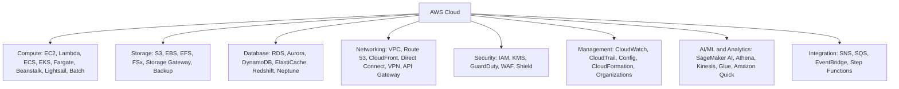

# 03 · Domain 3 — Cloud Technology and Services (34%)

The **biggest domain**. It is split in three parts for readability.

> **Scope tags (official guide v1.3):** [v1.3] listed in the latest guide · [LEGACY] = older guide only / not listed now · [OUT] explicitly out of scope · [NEW] new in the v1.3 list. See file 00 for the full scope map.

| Part | Content | Task statements |
|---|---|---|
| [03a — Deploy, global infrastructure, compute](03a-deploy-global-compute.md) | Ways to access AWS, IaC, deployment models, connectivity, Regions/AZs/edge, EC2, containers, serverless, scaling, load balancing | 3.1 · 3.2 · 3.3 |
| [03b — Databases, networking, storage](03b-databases-networking-storage.md) | RDS/Aurora/DynamoDB…, VPC/Route 53/CloudFront…, S3/EBS/EFS/FSx… | 3.4 · 3.5 · 3.6 |
| [03c — AI/ML, analytics, integration and other services](03c-ai-analytics-other-services.md) | SageMaker AI, Lex, Athena, Kinesis, SNS/SQS, dev tools, management & governance, IoT, end-user computing | 3.7 · 3.8 |

## The mental map of AWS

## The "which service?" master table 

| If the question says… | Answer |
|---|---|
| Virtual servers in the cloud | **EC2** |
| Run code without managing servers, event-driven | **Lambda** |
| Containers without managing servers | **Fargate** |
| Container orchestration (AWS-native) / Kubernetes | **ECS** / **EKS** |
| Deploy a web app, AWS handles infra (upload code) | **Elastic Beanstalk** |
| Simple, low-cost VPS for small apps/blogs | **Lightsail** |
| Distribute incoming traffic across targets | **Elastic Load Balancing** |
| Add/remove instances automatically | **EC2 Auto Scaling** |
| Managed relational database | **RDS** (or **Aurora** for high performance) |
| Serverless NoSQL key-value, single-digit ms | **DynamoDB** |
| In-memory cache / microsecond reads | **ElastiCache** / **MemoryDB** |
| Data warehouse / analytics on petabytes | **Redshift** |
| Graph database | **Neptune** |
| Migrate databases | **DMS** (+ **SCT** to convert schema) |
| Object storage (files, backups, static site, data lake) | **S3** |
| Block storage for an EC2 instance | **EBS** |
| Shared file system for Linux (NFS) | **EFS** |
| Windows file shares / high-performance Lustre | **FSx** |
| On-prem to cloud storage gateway | **Storage Gateway** |
| Centralized backup | **AWS Backup** |
| Private isolated network | **VPC** |
| DNS | **Route 53** |
| CDN / cache at edge | **CloudFront** |
| Static anycast IPs, AWS backbone routing | **Global Accelerator** |
| Dedicated private connection to AWS | **Direct Connect** |
| Encrypted tunnel over internet | **AWS VPN** |
| Create/publish APIs | **API Gateway** |
| Decouple (queue) | **SQS** |
| Pub/sub notifications (email, SMS, push) | **SNS** |
| Event bus / schedule / SaaS events | **EventBridge** |
| Orchestrate workflows | **Step Functions** |
| Build/train/deploy ML models | **SageMaker AI** (name in v1.3; formerly SageMaker) |
| Chatbot | **Lex** |
| Enterprise search | **Kendra** [LEGACY] (not on v1.3 list) |
| Images/video analysis | **Rekognition** |
| Text to speech / speech to text | **Polly** / **Transcribe** |
| Translate text | **Translate** |
| Extract text from scanned documents | **Textract** |
| Sentiment / entities in text | **Comprehend** |
| Query S3 with SQL | **Athena** |
| Real-time streaming data | **Kinesis** |
| ETL / data catalog | **Glue** |
| BI dashboards | **Amazon Quick** (v1.3 name; formerly QuickSight) |
| Infrastructure as code | **CloudFormation** |
| Monitor metrics/logs/alarms | **CloudWatch** |
| Audit API activity | **CloudTrail** |
| Manage many accounts | **Organizations** (+ **Control Tower**) |
| Virtual desktops | **WorkSpaces** |
| Streaming desktop apps | **AppStream 2.0** |
| IoT device connectivity | **IoT Core** |
| Cloud contact center | **Connect** |
| Send bulk email | **SES** |
