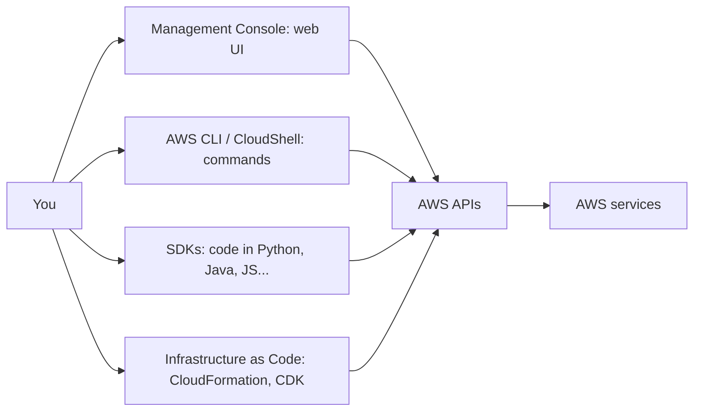
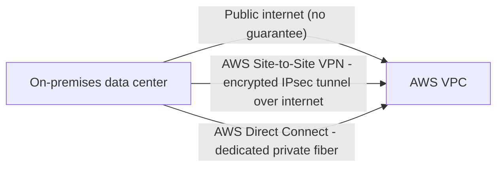
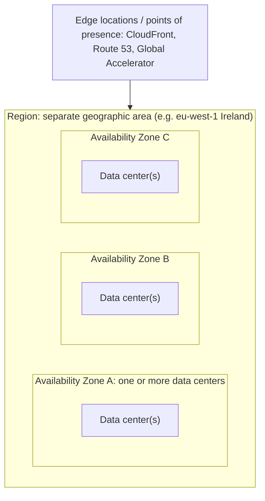
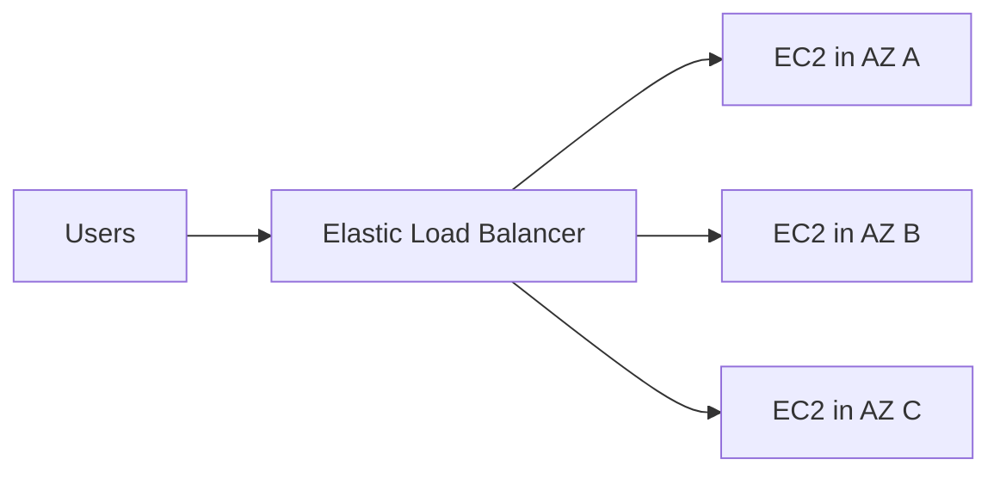
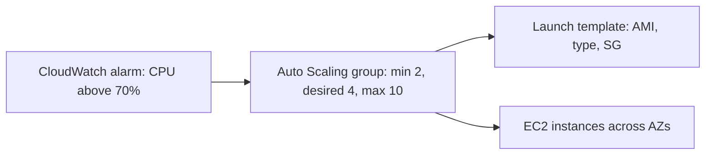
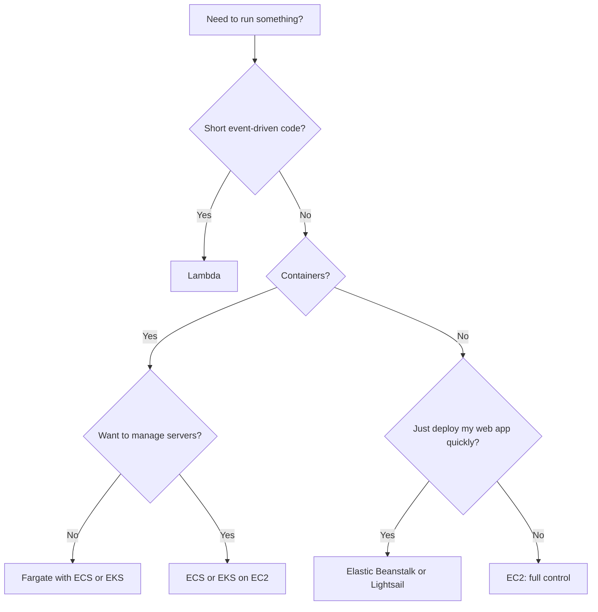

# 03a · Deploying, Global Infrastructure and Compute

Task statements: **3.1** Methods of deploying and operating · **3.2** AWS global infrastructure · **3.3** Compute services

> **Scope tags (official guide v1.3):** [v1.3] listed in the latest guide · [LEGACY] = older guide only / not listed now · [OUT] explicitly out of scope · [NEW] new in the v1.3 list. See file 00 for the full scope map.

---

## 3.1 Methods of deploying and operating in the AWS Cloud

### Ways to access and provision AWS services

| Method | What it is | Use when |
|---|---|---|
| **AWS Management Console** | Web interface | Learning, one-time/manual tasks, exploring |
| **AWS CLI** | Command-line tool (also **AWS CloudShell** — browser-based shell; [OUT] out of scope in v1.3) | Scripting, automation, repeatable tasks |
| **AWS SDKs** | Libraries for programming languages | Applications calling AWS services programmatically |
| **AWS APIs** | Underlying HTTP APIs (everything above uses them) | Direct programmatic access |
| **Infrastructure as Code (IaC)** | Describe infrastructure in templates | **Repeatable**, consistent, versioned deployments |

**IaC services**
- **AWS CloudFormation**: define resources in **JSON/YAML templates** → creates a **stack**; repeat across Regions/accounts; rollback on failure; free (you pay for the resources).
- **AWS CDK (Cloud Development Kit)**: define infra using programming languages; generates CloudFormation.
- **AWS Elastic Beanstalk**: upload code; AWS provisions and manages the environment.

**One-time vs repeatable**: console = one-time/manual; **IaC/CLI/SDK = repeatable processes** (fewer errors, scalable, auditable).

### Deployment models (recap)
**Cloud** · **Hybrid** · **On-premises**. Hybrid enablers: Direct Connect, VPN, Storage Gateway, **AWS Outposts** (AWS infrastructure on-prem).

### Connectivity options

| Option | Description | Pros | Cons |
|---|---|---|---|
| **Public internet** | Access AWS public endpoints over HTTPS | Simple | Variable latency, no dedicated bandwidth |
| **AWS VPN** (Site-to-Site / Client VPN) | **Encrypted** IPsec tunnel **over the internet** | Fast to set up, low cost, encrypted | Variable performance (internet-dependent) |
| **AWS Direct Connect** | **Dedicated private network connection** from your site to AWS (via a Direct Connect location) | **Consistent** performance, higher bandwidth, lower data-transfer cost, private | Takes weeks to provision, higher cost; **not encrypted by default** (can combine with VPN) |

> "Consistent network performance / dedicated private" → **Direct Connect**. "Quick, encrypted, over internet" → **VPN**.

---

## 3.2 AWS Global Infrastructure

| Component | Definition | Key facts |
|---|---|---|
| **Region** | A **geographic area** containing **multiple isolated Availability Zones** | Each Region is **independent**; resources are **not automatically replicated** across Regions; **data stays in the Region** unless you move it |
| **Availability Zone (AZ)** | **One or more discrete data centers** with redundant power, networking, connectivity, in a Region | AZs are physically separated (but close, low-latency links); **do not share a single point of failure**; design for HA by using **multiple AZs** |
| **Edge location** (point of presence) | Sites used by **CloudFront** (cache content), **Route 53** (DNS), **Global Accelerator**, WAF/Shield at the edge | Many more edge locations than Regions; bring content **closer to users** |
| **Regional edge cache** | Larger cache between edge locations and origin | Keeps content longer |
| **AWS Local Zones** | Extension of a Region placing compute/storage **near large population/industry centers** for **single-digit-ms latency** | Example: media rendering, real-time gaming near a city [LEGACY] not on v1.3 list |
| **AWS Wavelength Zones** | AWS infrastructure embedded in **5G telecom networks** | Ultra-low latency for mobile apps [OUT] out of scope in v1.3 |
| **AWS Outposts** | AWS-managed racks/servers **in your own data center** | Hybrid, local data processing, consistent AWS APIs [v1.3] |

### How to choose a Region (4 factors)
1. **Compliance / data governance** (legal requirements on where data resides)
2. **Latency** (closest to users)
3. **Service availability** (not all services/features in every Region)
4. **Pricing** (varies by Region)

### Achieving high availability
- Use **multiple AZs**: e.g., EC2 instances in 2+ AZs behind a load balancer; **RDS Multi-AZ**.
- Use **multiple Regions** for: **disaster recovery**, **business continuity**, **low latency for global users**, **data sovereignty** needs, resilience to a Region-wide failure.
- AZ failure ≠ Region failure; design accordingly.

> Trap: **A Region has multiple AZs; an AZ has one or more data centers; edge locations are separate from AZs.** **CloudFront uses edge locations, not AZs.**

---

## 3.3 Compute services

### Amazon EC2 (Elastic Compute Cloud) — virtual servers (IaaS)

**Key concepts**
- **Instance** = virtual server · **AMI** (Amazon Machine Image) = template (OS + software) used to launch instances
- **Instance type** = combination of vCPU, memory, storage, network (e.g., `t3.micro`, `m5.large`, `c6g.xlarge`)
- **Key pair** = SSH/RDP login credentials · **Security group** = virtual firewall · **EBS** = persistent volumes · **User data** = bootstrap script at launch
- You pay per second/hour (Linux) while running; choose **purchasing option** (On-Demand, Reserved, Savings Plans, Spot… see Domain 4)
- You manage: **OS, patches, apps, security groups** (shared responsibility)
- **Regional** service; instance lives in **one AZ**

**Instance families (what the letter means)**

| Family | Letters | Optimized for | Example use cases |
|---|---|---|---|
| **General purpose** | **M**, **T** (burstable) | Balance of compute/memory/network | Web servers, small DBs, dev/test |
| **Compute optimized** | **C** | High CPU performance | Batch processing, HPC, gaming servers, scientific modeling, media encoding |
| **Memory optimized** | **R**, **X**, **z** | Large memory | In-memory DBs, big data caches, real-time analytics |
| **Storage optimized** | **I**, **D**, **H** | High sequential/random I/O on local storage | NoSQL DBs, data warehousing, distributed file systems |
| **Accelerated computing** | **P**, **G**, **Inf**, **Trn**, **F** | GPUs / custom accelerators | ML training, graphics rendering, video transcoding |

> **"C = Compute, R = RAM, I = I/O, G/P = GPU, T = Tiny/burstable, M = Medium/balanced."**

### Elastic Load Balancing (ELB) — distribute traffic

| Type | Layer | Use |
|---|---|---|
| **Application Load Balancer (ALB)** | **Layer 7** (HTTP/HTTPS) | Path/host-based routing, microservices, containers |
| **Network Load Balancer (NLB)** | **Layer 4** (TCP/UDP) | Extreme performance, static IP, millions of requests/s |
| **Gateway Load Balancer (GWLB)** | Layer 3 | Deploy/scale 3rd-party virtual appliances (firewalls) |
| (Classic Load Balancer) | L4/L7 | Legacy |

Load balancers perform **health checks** and send traffic only to healthy targets; spread across **AZs** → HA.

### EC2 Auto Scaling — elasticity

Automatically **adds/removes EC2 instances** based on rules → **elasticity + cost savings + availability**.

Scaling types: **dynamic** (target tracking, step), **scheduled** (known traffic), **predictive** (ML-based), plus **manual/fixed** and **health-check replacement** (maintains desired capacity). Defined by **min / desired / max**. Auto Scaling itself is **free** (pay for the resources).

### Containers

| Service | What it does |
|---|---|
| **Docker container** | Package of app + dependencies; portable |
| **Amazon ECS** (Elastic Container Service) | **AWS-native** orchestration to run/manage Docker containers (on EC2 or Fargate) |
| **Amazon EKS** (Elastic Kubernetes Service) | **Managed Kubernetes** control plane; use when you want Kubernetes/portability |
| **Amazon ECR** (Elastic Container Registry) | **Registry** to store/manage container images |
| **AWS Fargate** | **Serverless compute for containers**: no EC2 to provision/manage; works with ECS and EKS; pay per vCPU/memory used |

> ECS vs EKS: AWS proprietary simple vs open-source Kubernetes. Fargate vs EC2 launch type: serverless vs you manage the instances.

### Serverless

**AWS Lambda** — run code **without provisioning/managing servers**.
- **Event-driven**: triggered by S3 uploads, API Gateway, DynamoDB, SQS, EventBridge schedules, etc.
- Pay only for **number of requests + duration (ms)** — **no charge when idle**
- **Automatic scaling**; max run time **15 minutes** per invocation; choose memory (CPU scales with it)
- You manage: code + IAM; AWS manages servers/OS/runtime
- Good for: small, short tasks, image processing, backends, automation

| Compute service | When to choose |
|---|---|
| **EC2** | Full control of OS, long-running/stateful workloads, custom software |
| **Lambda** | Short event-driven functions, no servers |
| **Fargate** | Containers, no server management |
| **ECS / EKS (EC2)** | Containers with control over hosts |
| **Elastic Beanstalk** | Upload code (Java, .NET, Python, Node…) → AWS deploys with EC2, ELB, Auto Scaling for you (PaaS-like) |
| **Lightsail** | Simple, **fixed low monthly price** VPS, WordPress sites, small apps; for beginners |
| **AWS Batch** | Run **batch jobs** at any scale; provisions optimal compute automatically |
| **AWS Outposts** | AWS services on-premises |
| **AWS Local Zones / Wavelength** | Low-latency edge compute |

### Compute decision flow

---

## Self-check

1. Console vs CLI vs SDK vs CloudFormation — when each?
2. VPN vs Direct Connect?
3. Region vs AZ vs edge location vs Local Zone vs Outposts?
4. Four factors to choose a Region?
5. Instance family for: in-memory DB? ML training? batch processing? NoSQL with high I/O?
6. ALB vs NLB layer? Which service gives elasticity?
7. ECS vs EKS vs Fargate vs ECR?
8. Max Lambda duration? Does Lambda cost anything when idle?

Answers

1. Console = manual; CLI = scripts; SDK = code; CloudFormation = repeatable IaC.
2. VPN = encrypted over internet, quick; Direct Connect = dedicated private, consistent.
3. See table.
4. Compliance, latency, service availability, price.
5. Memory optimized (R/X) · Accelerated (P/G) · Compute optimized (C) · Storage optimized (I).
6. ALB = L7, NLB = L4 · Auto Scaling.
7. ECS = AWS-native orchestration · EKS = Kubernetes · Fargate = serverless compute for containers · ECR = image registry.
8. 15 min · No (pay per request/duration).

