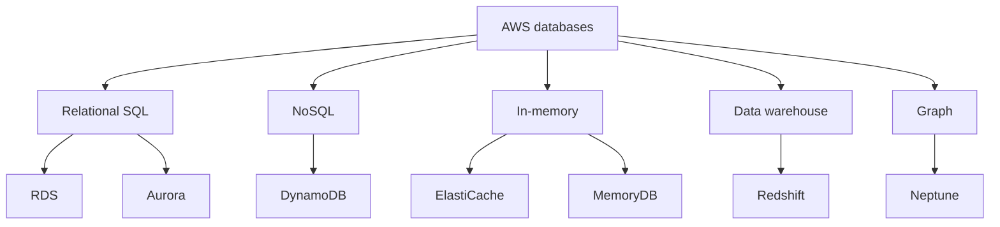
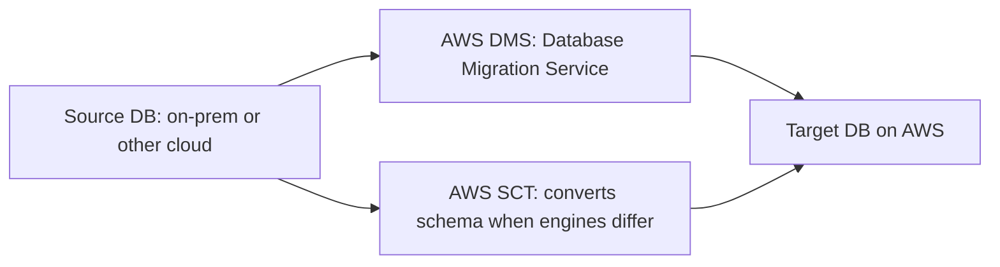
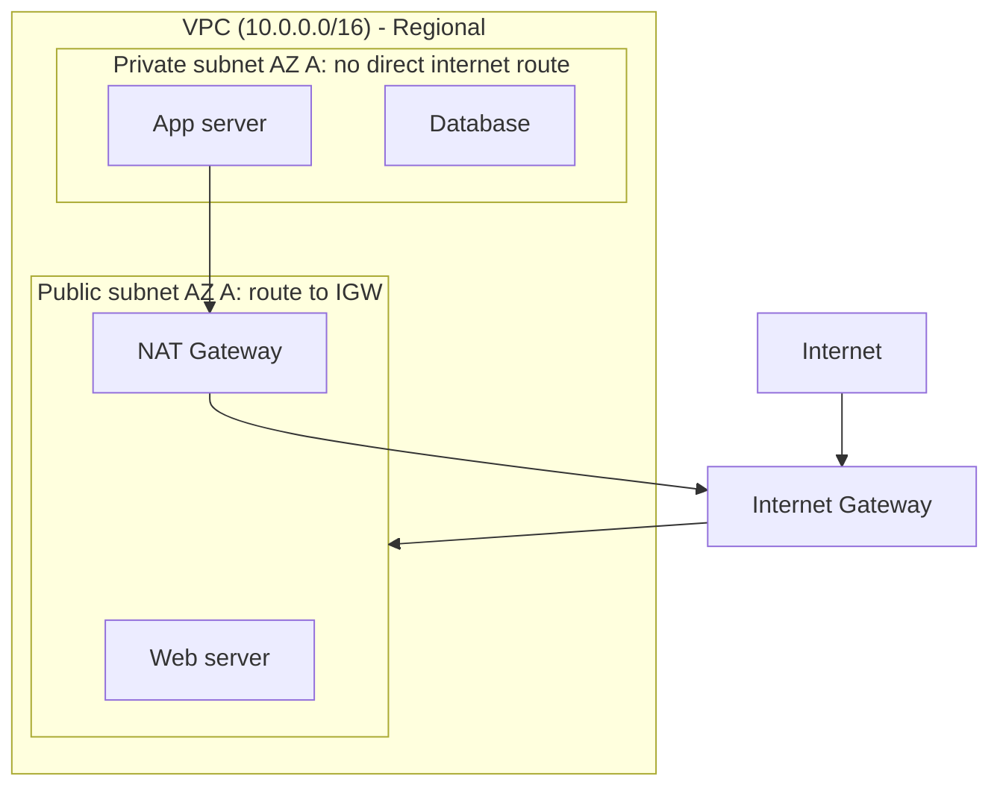
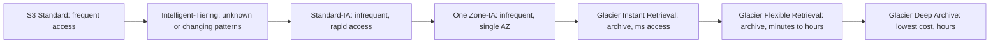
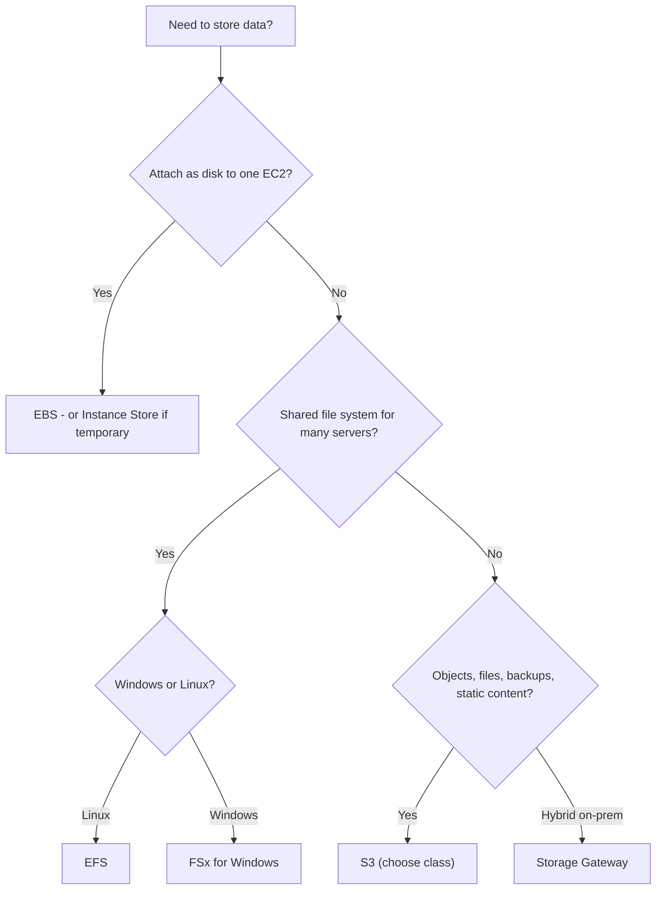

# 03b · Databases, Networking and Storage

Task statements: **3.4** Database services · **3.5** Network services · **3.6** Storage services

> **Scope tags (official guide v1.3):** [v1.3] listed in the latest guide · [LEGACY] = older guide only / not listed now · [OUT] explicitly out of scope · [NEW] new in the v1.3 list. See file 00 for the full scope map.

---

## 3.4 Database services

### Decision: self-managed on EC2 vs AWS managed database

| | **DB on EC2** (self-managed) | **Managed DB (RDS, DynamoDB…)** |
|---|---|---|
| OS & DB patching | You | **AWS** |
| Backups, HA, failover | You build it | **Built in** (Multi-AZ, automated backups) |
| Scaling | Manual | Easier / automatic |
| Control | Full (OS access, any version/engine) | Limited (no OS access) |
| Effort/cost of ops | High | **Low** |

→ Choose EC2-hosted only if you need OS-level control or an unsupported engine. Otherwise **managed**.

### Database types and services

| Service | Type | Key facts |
|---|---|---|
| **Amazon RDS** | **Managed relational** | Engines: **MySQL, PostgreSQL, MariaDB, Oracle, SQL Server, Db2**(+ Aurora). AWS handles patching, backups, **Multi-AZ** (HA, automatic failover), **Read Replicas** (read performance scaling). You can't SSH to the instance |
| **Amazon Aurora** | Relational, **MySQL- and PostgreSQL-compatible**, cloud-built | Up to ~**5× MySQL / 3× PostgreSQL** performance claims; storage auto-scales; **6 copies of data across 3 AZs**; ~1/10 cost of commercial DBs; **Aurora Serverless** auto-scales |
| **Amazon DynamoDB** | **NoSQL key-value & document**, **serverless** | **Single-digit millisecond** latency at any scale; fully managed; **Global Tables** (multi-Region); **on-demand** or provisioned capacity; **DAX** = in-memory cache for DynamoDB |
| **Amazon ElastiCache** | **In-memory cache** (**Redis / Memcached**) | Sub-ms latency; reduce DB load; sessions, leaderboards |
| **Amazon MemoryDB** (for Redis) | **Durable in-memory database** (Redis-compatible) | Primary DB with microsecond reads, multi-AZ durability [OUT] out of scope in v1.3 (ElastiCache [v1.3] is the in-scope memory DB) |
| **Amazon Redshift** | **Data warehouse** (columnar, OLAP) | Analytics over **petabytes**; SQL; BI; not for transactional OLTP |
| **Amazon Neptune** | **Graph database** | Relationships: social networks, fraud detection, knowledge graphs |
| **Amazon DocumentDB** | Document DB, **MongoDB-compatible** | JSON-like documents [v1.3] on v1.3 list |
| **Amazon QLDB** (ledger) | Immutable ledger | (Check current availability) (beyond scope) |
| **Amazon Keyspaces** | Cassandra-compatible | [OUT] out of scope |
| **Amazon Timestream** | Time-series | IoT/metrics (beyond scope) |

> Exam pairs: **relational + managed → RDS**, **relational + highest performance/cloud-native → Aurora**, **NoSQL + serverless + ms → DynamoDB**, **cache → ElastiCache**, **warehouse/analytics → Redshift**, **graph → Neptune**.

### Database migration

- **AWS DMS**: migrates databases to AWS **with minimal downtime**; source stays operational; supports **homogeneous** (MySQL→MySQL) and **heterogeneous** (Oracle→Aurora) migrations; continuous replication.
- **AWS SCT**: **converts the schema and code** from one engine to another (used with DMS for heterogeneous migrations).

---

## 3.5 Network services

### Amazon VPC (Virtual Private Cloud) — your private network in AWS

| Component | Role |
|---|---|
| **VPC** | Logically isolated virtual network in a **Region**; you define the IP range (CIDR) |
| **Subnet** | A range of IPs **within one AZ**. **Public subnet**: route to an Internet Gateway. **Private subnet**: no direct route to the internet |
| **Internet Gateway (IGW)** | Connects the VPC to the internet (inbound/outbound) |
| **NAT Gateway** | Lets **private-subnet** resources **initiate outbound** internet traffic (e.g., updates) without being reachable from the internet |
| **Route table** | Rules that decide where network traffic goes |
| **Security Group** | Instance-level stateful firewall (allow only) |
| **Network ACL** | Subnet-level stateless firewall (allow + deny) |
| **VPC Peering** | Private connection between two VPCs |
| **Transit Gateway** | Hub to connect many VPCs and on-prem networks [v1.3 NEW] v1.3 |
| **VPC Endpoints / PrivateLink** | Private access to AWS services **without traversing the internet** (Gateway endpoints for S3/DynamoDB; Interface endpoints) (PrivateLink [v1.3 NEW] v1.3) |
| **VPN Gateway / Direct Connect Gateway** | Connect to on-premises |

A **default VPC** exists in each Region so you can launch EC2 immediately.

### Other networking and content-delivery services

| Service | What it does | Remember |
|---|---|---|
| **Amazon Route 53** | **Scalable DNS** + domain registration + **health checks** | Routing policies: **simple, weighted, latency-based, failover, geolocation**, geoproximity. The "53" is the DNS port |
| **Amazon CloudFront** | **CDN**: caches content at **edge locations** → lower latency for users | Origins: S3, ALB, EC2, custom; integrates with WAF/Shield; **HTTPS** |
| **AWS Global Accelerator** | Gives **2 static anycast IPs**, routes user traffic over the **AWS global network** to the best healthy endpoint | Improves availability/performance for **TCP/UDP** apps; not caching |
| **Amazon API Gateway** | Create, publish, secure, monitor **APIs** (REST, HTTP, WebSocket) | Common front for **Lambda** |
| **AWS Direct Connect** | Dedicated private connection | See 03a |
| **AWS VPN** | Encrypted tunnel | See 03a |
| **AWS Transit Gateway** | Network hub | [v1.3 NEW] v1.3 |
| **Elastic Load Balancing** | Traffic distribution | See 03a |

> CloudFront vs Global Accelerator: **CloudFront caches content (HTTP/S, static+dynamic)**; **Global Accelerator doesn't cache — it optimizes the network path** (static IPs, fast failover).

---

## 3.6 Storage services

### The three storage types

| Type | Example | Access | Best for |
|---|---|---|---|
| **Object** | **S3** | HTTP API (key = object name) | Files, backups, media, data lakes, static sites — unlimited scale |
| **Block** | **EBS**, instance store | Attached to an EC2 as a **disk** | OS volumes, databases, low-latency |
| **File** | **EFS**, **FSx** | Network file system (NFS/SMB) | Shared files across many servers |

### Amazon S3 (Simple Storage Service)

- **Object storage** in **buckets** (globally unique names; bucket created in a Region). Object up to **5 TB**; single PUT up to 5 GB (multipart for larger).
- **Durability: 99.999999999% (11 nines)**; Standard availability 99.99% (design target).
- Features: **versioning**, **replication** (CRR/SRR), **encryption** (SSE-S3, SSE-KMS, SSE-C), **bucket policies / ACLs**, **Block Public Access**, **static website hosting**, **lifecycle policies**, **Object Lock** (WORM), **Transfer Acceleration**, event notifications, access logs.
- Pay for **storage + requests + data transfer out** (and retrieval for cold classes).

**S3 storage classes — from hot to cold**

| Class | Use case | AZs | Min storage duration | Retrieval |
|---|---|---|---|---|
| **S3 Standard** | Frequently accessed, general | ≥3 | none | ms |
| **S3 Intelligent-Tiering** | Unknown/changing access; **auto-moves** objects between tiers | ≥3 | none | ms (+ small monitoring fee) |
| **S3 Standard-IA** | Infrequent access, need rapid access; lower storage cost, **retrieval fee** | ≥3 | **30 days** | ms |
| **S3 One Zone-IA** | Infrequent, **re-creatable** data; stored in **one AZ** (lost if AZ lost) | **1** | 30 days | ms |
| **S3 Glacier Instant Retrieval** | Archive, rarely accessed but needs **millisecond** access | ≥3 | 90 days | ms |
| **S3 Glacier Flexible Retrieval** (formerly Glacier) | Archive; retrieval **minutes to hours** | ≥3 | 90 days | min–hours |
| **S3 Glacier Deep Archive** | **Cheapest**; long-term retention (compliance, 7–10+ years) | ≥3 | **180 days** | hours (~12–48 h) |

(There are also S3 Express One Zone for ultra-low latency — beyond the exam's core.)

**S3 Lifecycle policies**: rules that **automatically transition** objects between classes (Standard → IA → Glacier) after N days and/or **expire (delete)** them. Use to cut cost automatically.

### Amazon EBS (Elastic Block Store)
- **Persistent block storage** for EC2; **lives independent of the instance** (data survives stop/termination if configured); **attached to one instance in the same AZ** (Multi-Attach for some types).
- **Snapshots**: incremental backups stored in S3; copy across AZ/Region; restore to new volumes.
- Volume types: **SSD** (gp3/gp2 general purpose, io2/io1 Provisioned IOPS for DBs) and **HDD** (st1 throughput-optimized, sc1 cold).
- Encryption with KMS.

### EC2 Instance Store
**Temporary block storage physically attached to the host**; **very high performance** but **data is lost** when the instance stops, terminates, or hardware fails → for caches, buffers, scratch data.

### File storage
| Service | What | Use |
|---|---|---|
| **Amazon EFS** | **Managed NFS** file system for **Linux**; **elastic** (grows/shrinks automatically); **multi-AZ**; shared by **thousands of EC2/containers/Lambda** | Content management, shared home dirs, web serving |
| **Amazon FSx** | Managed 3rd-party file systems: **FSx for Windows File Server** (SMB, Active Directory), **FSx for Lustre** (HPC/ML; [OUT] out of scope in v1.3), **FSx for NetApp ONTAP**, **FSx for OpenZFS** | Windows shares; high-performance computing |

### Hybrid / transfer / backup / DR

| Service | Purpose |
|---|---|
| **AWS Storage Gateway** | **Hybrid storage** — on-prem apps use cloud storage with **local cache** (File, Volume, Tape gateway) |
| **AWS Backup** | **Centralized, policy-based backup** across services (EBS, RDS, DynamoDB, EFS, S3, etc.), cross-Region/account, compliance reporting |
| **AWS Elastic Disaster Recovery (DRS)** | Fast recovery of on-prem/cloud servers into AWS |
| **AWS Snow Family** | **Physical devices** to move data offline / edge compute [LEGACY] not on v1.3 list |
| **AWS DataSync** | Automated online transfer on-prem AWS storage [LEGACY] not on v1.3 list |
| **AWS Transfer Family** | SFTP/FTPS/FTP into S3/EFS [OUT] out of scope in v1.3 |

### Storage decision flow

---

## Self-check

1. RDS vs Aurora vs DynamoDB vs Redshift vs ElastiCache vs Neptune — one-line each.
2. DMS vs SCT?
3. Public vs private subnet? What does a NAT Gateway do? IGW?
4. CloudFront vs Global Accelerator vs Route 53?
5. S3 classes: which is cheapest? which needs ms retrieval but rarely accessed? which auto-moves objects? which is single-AZ?
6. EBS vs Instance Store vs EFS vs S3?
7. What do lifecycle policies do? What is S3 durability?
8. Which service centrally backs up many AWS services?

Answers

1. RDS managed relational · Aurora cloud-native MySQL/Postgres-compatible · DynamoDB serverless NoSQL · Redshift data warehouse · ElastiCache in-memory cache · Neptune graph.
2. DMS migrates data (minimal downtime); SCT converts schema.
3. Public = route to IGW; private = no direct internet; NAT = outbound only for private subnets; IGW = VPCinternet.
4. CloudFront = CDN cache; Global Accelerator = static IPs/AWS backbone; Route 53 = DNS.
5. Deep Archive · Glacier Instant Retrieval · Intelligent-Tiering · One Zone-IA.
6. EBS = persistent block for EC2; Instance Store = ephemeral block; EFS = shared Linux files; S3 = objects.
7. Auto transition/expire objects; 11 nines.
8. AWS Backup.

