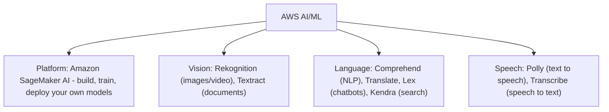
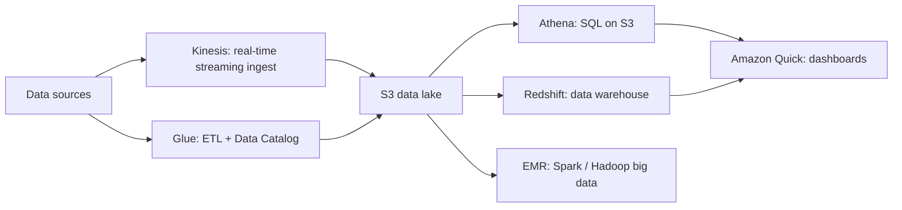
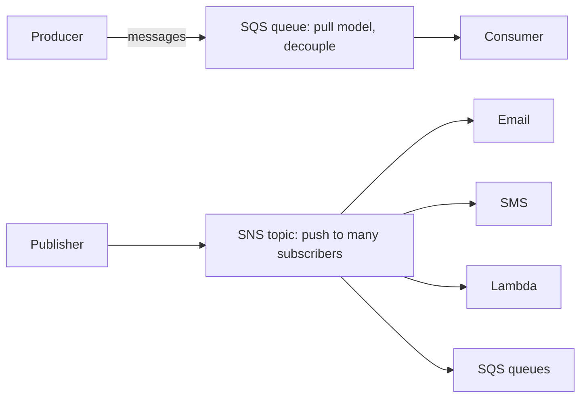
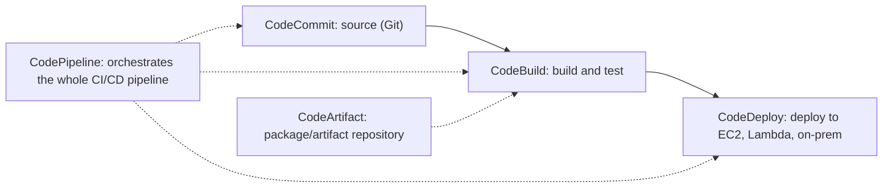

# 03c · AI/ML, Analytics and Other In-Scope Services

Task statements: **3.7** AI/ML and analytics services · **3.8** Other in-scope service categories

> **Scope tags (official guide v1.3):** [v1.3] listed in the latest guide · [LEGACY] = older guide only / not listed now · [OUT] explicitly out of scope · [NEW] new in the v1.3 list. See file 00 for the full scope map.

---

## 3.7 AI/ML services

| Service | What it does | Typical exam phrase |
|---|---|---|
| **Amazon SageMaker AI** (v1.3 name; formerly SageMaker) [v1.3] | Fully managed platform to **build, train and deploy ML models** (notebooks, data labeling, training, hosting) | "build/train/deploy custom machine learning models" |
| **Amazon Rekognition** | **Image and video analysis**: object/face detection, facial comparison, content moderation | "identify objects/faces in images" |
| **Amazon Textract** | **Extracts text, forms and tables** from scanned documents (beyond simple OCR) | "extract data from scanned invoices/forms" |
| **Amazon Comprehend** | **NLP**: sentiment, entities, key phrases, language detection | "analyze sentiment of customer reviews" |
| **Amazon Translate** | **Language translation** (neural machine translation) | "translate text" |
| **Amazon Polly** | **Text → lifelike speech** | "convert text to speech" |
| **Amazon Transcribe** | **Speech → text** (automatic speech recognition) | "transcribe call recordings" |
| **Amazon Lex** | Build **conversational interfaces / chatbots** (voice & text; same tech as Alexa) | "build a chatbot" |
| **Amazon Kendra** | **Intelligent enterprise search** powered by ML (natural-language questions over your documents) | "search across company documents" [LEGACY] — not on v1.3 list |
| **Amazon Bedrock** | Managed access to **foundation models (generative AI)** via API | "build generative AI apps with FMs" *(newer service — may be beyond the guide's list but appears in modern AWS content)* (not on the v1.3 list — know only that it exists) |
| **Amazon Q** | Generative-AI assistant for business/developers | (modern context) [v1.3] on v1.3 list |

> Trick: **Polly = parrot (speaks).** **Transcribe = transcript (writes).** **Rekognition = recognition (sees).** **Lex = Alexa.** **Comprehend = comprehends text.** **Textract = extracts from documents.**

## 3.7 Analytics services

| Service | What it does | Remember |
|---|---|---|
| **Amazon Athena** | **Serverless interactive SQL** queries **directly on data in S3** | Pay **per query (data scanned)**; no infrastructure |
| **Amazon Kinesis** | **Real-time streaming data** ingestion and processing (Data Streams, Data Firehose, Managed Flink, Video Streams) | Logs, clickstreams, IoT telemetry in real time |
| **AWS Glue** | Serverless **ETL** (extract-transform-load) + **Data Catalog** | Prepare/discover data |
| **Amazon Quick** (v1.3 name; formerly Amazon QuickSight) [v1.3] | **Business intelligence**: dashboards & visualizations, ML insights, pay-per-session | "create dashboards for business users" |
| **Amazon EMR** | Managed **big data** frameworks (**Hadoop, Spark**, Hive, Presto) | Process vast datasets |
| **Amazon Redshift** | Data warehouse | See 03b |
| **Amazon OpenSearch Service** | Search, log analytics, observability (Elasticsearch-derived) | Log search and analysis |
| **Amazon MSK** | Managed **Apache Kafka** streaming | Existing Kafka workloads [OUT] out of scope in v1.3 |
| **AWS Data Exchange** | Find/subscribe/use **third-party data sets** | Buy external data [OUT] out of scope in v1.3 |
| **AWS Lake Formation** | Build and secure data lakes | (not on list) |

---

## 3.8 Other in-scope service categories

### Application integration — decouple and connect

| Service | Role | Key facts |
|---|---|---|
| **Amazon SQS** (Simple Queue Service) | **Message queue** to **decouple** components | **Pull** model (consumers poll); messages persist until processed; Standard (at-least-once, best-effort ordering) / FIFO (ordering) queues |
| **Amazon SNS** (Simple Notification Service) | **Pub/sub** messaging and **notifications** | **Push** to many subscribers: email, SMS, mobile push, HTTP, Lambda, SQS |
| **Amazon EventBridge** | **Serverless event bus**: route events from AWS services, your apps, and **SaaS partners**; **scheduled rules** (cron) | Successor of CloudWatch Events |
| **AWS Step Functions** | **Serverless workflow orchestration** (state machines) coordinating Lambda & services | Visual workflows |
| **Amazon MQ** | Managed ActiveMQ/RabbitMQ | Migrate existing brokers |

> **SQS = queue (pull, decouple).** **SNS = broadcast (push).** Classic combo: **SNS → multiple SQS (fan-out)**.

### Business applications
- **Amazon Connect** — **cloud contact center** (omnichannel customer service, pay-as-you-go)
- **Amazon SES** (Simple Email Service) — send **bulk/transactional/marketing email** at scale

### Customer engagement and support (also Domain 4)
- **AWS Activate for Startups** [OUT] (out of scope in v1.3) — credits, training, support for startups
- **AWS IQ** [OUT] (out of scope in v1.3) — hire **AWS Certified third-party experts** for projects
- **AWS Managed Services (AMS)** [OUT] (out of scope in v1.3) — AWS operates your infrastructure day-to-day
- **AWS Support** — Basic, Developer, Business, Enterprise On-Ramp, Enterprise

### Developer tools

| Service | Purpose |
|---|---|
| **AWS CodeCommit** | Managed private **Git repositories** *(AWS stopped onboarding new customers in 2024; know it for the exam)* [LEGACY] not on v1.3 list |
| **AWS CodeBuild** | **Compile, test, package** code (serverless build) [v1.3] |
| **AWS CodeDeploy** | **Automate deployments** to EC2, Lambda, ECS, on-prem [OUT] out of scope in v1.3 |
| **AWS CodePipeline** | **CI/CD orchestration** (release pipeline) [v1.3] |
| **AWS CodeArtifact** | Secure **artifact/package repository** (npm, Maven, pip…) [OUT] out of scope in v1.3 |
| **AWS CodeStar** | Unified project setup/management of dev toolchain *(retired for new use; know for the exam)* [LEGACY] not on v1.3 list |
| **AWS Cloud9** | Cloud-based **IDE** *(legacy for new customers)* [LEGACY] not on v1.3 list |
| **AWS CloudShell** | Browser-based shell with CLI pre-authenticated [OUT] out of scope in v1.3 |
| **AWS AppConfig** | Deploy **application configuration/feature flags** safely [OUT] out of scope in v1.3 |
| **AWS X-Ray** | **Distributed tracing**: analyze/debug requests across microservices (find bottlenecks) [v1.3] |

### End-user computing
| Service | Purpose |
|---|---|
| **Amazon WorkSpaces** | **Virtual desktops (DaaS)** — Windows/Linux in the cloud |
| **Amazon AppStream 2.0** | **Stream desktop applications** to a browser (no full desktop) |
| **Amazon WorkSpaces Secure Browser** (v1.3 name; formerly WorkSpaces Web) [v1.3] | Secure **browser access** to internal websites/SaaS |

→ These services **present the output of VMs/applications on end-user machines**.

### Frontend web and mobile
- **AWS Amplify** [v1.3] — build, deploy and host **full-stack web/mobile apps** quickly
- **AWS AppSync** — managed **GraphQL** API (real-time/offline data) [LEGACY] not on v1.3 list
- **AWS Device Farm** — test apps on real mobile devices/browsers [OUT] out of scope in v1.3

### Internet of Things (IoT)
- **AWS IoT Core** [v1.3] — connect **IoT devices** to the cloud securely (MQTT), route messages
- **AWS IoT Greengrass** [OUT] (out of scope in v1.3) — run **IoT logic locally at the edge** on devices, sync with cloud

### Management and governance (very testable)

| Service | One-line purpose |
|---|---|
| **AWS Management Console** | Web UI for managing AWS |
| **AWS Organizations** | **Centrally manage multiple accounts**: **consolidated billing**, **OUs**, **SCPs** (guardrails) |
| **AWS Control Tower** | Set up and govern a **multi-account landing zone** with best-practice guardrails |
| **AWS CloudFormation** | Infrastructure as code (stacks) |
| **AWS Systems Manager** | **Operational hub**: patch management, run commands, Parameter Store, Session Manager across fleets |
| **Amazon CloudWatch** | Metrics, logs, alarms, dashboards |
| **AWS CloudTrail** | API audit log |
| **AWS Config** | Resource configuration history & compliance rules |
| **Service Quotas** [v1.3 NEW] | View and manage your **service quotas (limits)** across AWS services, request increases |
| **AWS Service Catalog** | Catalog of **approved IT products** users can self-provision (governance) |
| **AWS License Manager** | Track and manage **software licenses** (BYOL) |
| **AWS Launch Wizard** | Guided deployment of **enterprise apps** (SAP, SQL Server) [OUT] out of scope in v1.3 |
| **AWS Compute Optimizer** | ML-based **rightsizing recommendations** |
| **AWS Resource Groups & Tag Editor** | Group resources by tags; edit tags in bulk [LEGACY] not on v1.3 list |
| **AWS Health Dashboard** | **Service health** + **personalized events affecting your resources** |
| **AWS Trusted Advisor** | Best-practice checks (cost, performance, security, fault tolerance, limits) |
| **AWS Well-Architected Tool** | Review workloads against the 6 pillars |
| **AWS Auto Scaling** | Scaling for multiple resources (EC2, DynamoDB, Aurora…) |

---

## Disambiguation cheat — services that sound alike

| Pair | Difference |
|---|---|
| **SQS vs SNS** | Queue (pull, decouple) vs pub/sub (push to many) |
| **SNS vs SES** | General notifications (SMS/push/email) vs bulk email marketing/transactional |
| **EventBridge vs SNS** | Event routing/rules/schedules & SaaS events vs simple fan-out notifications |
| **Athena vs Redshift** | Serverless SQL on S3 (ad hoc) vs data warehouse (repeated heavy analytics) |
| **Kinesis vs SQS** | Real-time streaming of ordered, replayable data vs message queue |
| **Glue vs EMR** | Serverless ETL/catalog vs big-data cluster frameworks |
| **Amazon Quick (ex-QuickSight) vs Athena** | Dashboards vs queries |
| **Lex vs Polly vs Transcribe** | Chatbot vs text→speech vs speech→text |
| **Rekognition vs Textract** | Objects/faces in images vs text/forms in documents |
| **Kendra vs OpenSearch** | [LEGACY] Kendra (legacy, not on v1.3 list): ML natural-language enterprise search · OpenSearch [v1.3]: search/log analytics engine |
| **WorkSpaces vs AppStream 2.0 vs WorkSpaces Secure Browser** | Whole virtual desktop · streaming individual apps · secure browser access |
| **Amplify vs Elastic Beanstalk** | Frontend/full-stack mobile & web hosting vs deploy backend app on managed infrastructure |
| **Organizations vs Control Tower** | Account management/billing/SCPs vs automated landing zone with guardrails |
| **CloudWatch vs X-Ray** | Metrics/logs/alarms vs request tracing |
| **Systems Manager vs CloudFormation** | Operate/patch/manage instances vs provision infrastructure |

---

## Self-check

1. Which AI service: chatbot · text-to-speech · speech-to-text · image analysis · sentiment · translate · document forms extraction · enterprise search · build custom models?
2. Athena vs Redshift vs Glue vs Amazon Quick vs Kinesis — one line each.
3. SQS vs SNS vs EventBridge vs Step Functions?
4. Which service lets customers call a contact center in the cloud?
5. Which tool traces requests across microservices?
6. WorkSpaces vs AppStream 2.0?
7. Organizations vs Control Tower vs Service Catalog?

Answers

1. Lex · Polly · Transcribe · Rekognition · Comprehend · Translate · Textract · Kendra ([LEGACY] legacy) · SageMaker AI.
2. SQL on S3 · warehouse · ETL/catalog · dashboards · real-time streaming.
3. Queue · pub/sub · event bus/schedules · workflow orchestration.
4. Amazon Connect.
5. AWS X-Ray.
6. Full desktop vs individual apps.
7. Multi-account mgmt & SCPs · landing zone guardrails · approved product catalog.

