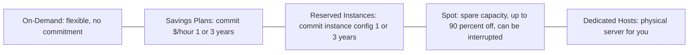
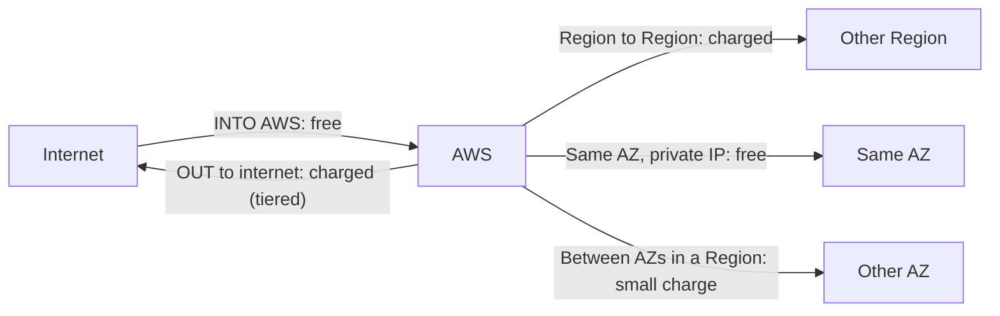
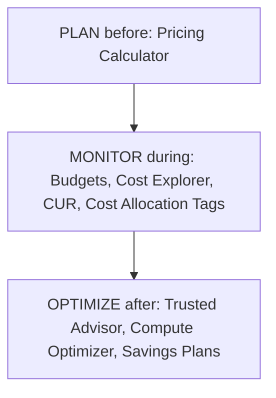
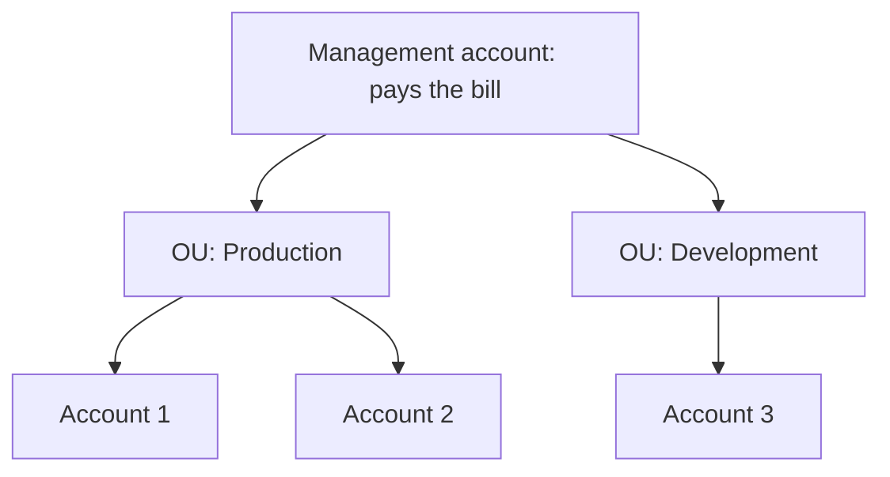
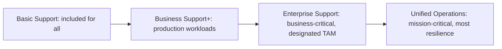

# 04 · Domain 4 — Billing, Pricing, and Support (12%)

Task statements: **4.1** Compare pricing models · **4.2** Billing, budget and cost management resources · **4.3** Technical resources and AWS Support options

> **Scope tags (official guide v1.3):** [v1.3] listed in the latest guide · [LEGACY] = older guide only / not listed now · [OUT] explicitly out of scope · [NEW] new in the v1.3 list. See file 00 for the full scope map.

> Smallest domain but **fastest to master** — mostly distinct concepts that do not overlap. Aim for near-perfect here.

---

## 4.1 AWS pricing models

### The 3 fundamental pricing principles
1. **Pay as you go** — pay only for what you use, no upfront, no termination fees.
2. **Pay less when you reserve** — commit to 1 or 3 years → big discounts.
3. **Pay less per unit when you use more** — volume/tiered discounts (e.g., S3 gets cheaper per GB as storage grows).

Plus: **AWS keeps reducing prices** as economies of scale grow.

### What you actually pay for (3 core drivers)
**Compute**, **storage**, and **data transfer out**. (Data **in** to AWS is generally **free**.)

### EC2 purchasing options

| Option | Commitment | Discount | Best for | Notes |
|---|---|---|---|---|
| **On-Demand** | None | None (baseline) | Short-term, unpredictable, first-time/dev-test | Pay per second (Linux) or hour; no upfront |
| **Savings Plans** | **1 or 3 years** of consistent **$/hour spend** | Up to ~**72%** | Steady usage, want **flexibility** | **Compute Savings Plans** (any instance family/size/Region/OS; also Fargate & Lambda), **EC2 Instance Savings Plans** (specific family in a Region), SageMaker Savings Plans |
| **Reserved Instances (RI)** | **1 or 3 years** for specific instance attributes | Up to ~**72%** | Steady-state, predictable workloads | **Standard RI** (highest discount, less flexible) vs **Convertible RI** (can change attributes; lower discount). Payment: **All Upfront / Partial Upfront / No Upfront** (more upfront = bigger discount). Also for RDS, ElastiCache, Redshift, etc. |
| **Spot Instances** | None | Up to ~**90%** | **Fault-tolerant, flexible, stateless** jobs: batch, big data, CI/CD, rendering | AWS can **reclaim with a 2-minute warning** → don't use for critical/stateful workloads |
| **Dedicated Hosts** | On-Demand or 1/3-year reservation | — | **Bring your own server-bound licenses (BYOL)**, compliance, visibility into sockets/cores | **Physical server fully dedicated to you**; you control instance placement |
| **Dedicated Instances** | — | — | Compliance needing hardware isolation | Instances run on hardware **dedicated to your account** (no control of placement) |
| **Capacity Reservations** | None (cancel anytime) | **None** by itself (can combine with Savings Plans/RI) | **Guarantee capacity in a specific AZ** (e.g., event, DR) | Reserve capacity for any duration; you pay On-Demand rate whether used or not |

> Selection:
> - Unpredictable / short → **On-Demand**
> - Steady 1–3 years → **RI or Savings Plans** (flexible → **Savings Plans**)
> - Interruptible / cheapest → **Spot**
> - Own licenses per-socket/core → **Dedicated Hosts**
> - Guarantee capacity in an AZ → **Capacity Reservation**

### Reserved Instance flexibility and behavior in AWS Organizations
- **Standard RI**: modify AZ/size within family, can be sold in the **Reserved Instance Marketplace**.
- **Convertible RI**: exchange for other instance families/OS/tenancy of equal or greater value.
- In **AWS Organizations with consolidated billing**, RI (and Savings Plans) **discounts are shared across all accounts** in the organization (unused reservations in one account can benefit another). Sharing can be turned off per account.

### Data transfer costs (high-yield!)

- **Inbound** data transfer to AWS: **free**.
- **Outbound** to the internet: **charged** (first GB per month free; tiered pricing).
- **Between Regions**: charged. **Between AZs** (same Region): charged per GB (both directions). **Same AZ using private IPs**: free.
- Using **CloudFront** can reduce egress cost; **Direct Connect** has lower data-transfer-out rates than internet.

### Storage pricing
Depends on **storage class/tier** (S3: Standard → Glacier Deep Archive), **volume type** (EBS gp3 vs io2), **requests**, **retrieval fees** (IA/Glacier), **min storage durations**, **replication**, **data transfer**.

### AWS Free Tier
Three types: **Always Free** (e.g., Lambda 1M requests/month, DynamoDB 25 GB), **12 months free** from sign-up (e.g., limited EC2 hours, S3), **Trials** (short-term, per service). *Note: AWS has revised its free-tier program recently (including credit-based plans for new accounts) — check the current terms on the AWS Free Tier page.*

### Other pricing concepts
- **Per-second billing** for EC2 Linux / EBS; **per-request** for Lambda; **per-GB** for storage; **per-hour** for some services.
- **Free services**: IAM, VPC, Auto Scaling, Organizations, CloudFormation (you pay for the resources created), Elastic Beanstalk (pay for resources).
- **AWS Marketplace** software may add license fees.

---

## 4.2 Billing, budgeting and cost management

### Tools — know each one's *purpose*

| Tool | Purpose | Memory hook |
|---|---|---|
| **AWS Pricing Calculator** | **Estimate cost** of a planned architecture/migration **before** building | "**Calculator = estimate future**" |
| **AWS Budgets** | Set **custom budgets** (cost, usage, RI/Savings Plans coverage) and get **alerts** (email/SNS) when **actual or forecasted** thresholds exceeded; can trigger actions | "**Budgets = alerts at threshold**" |
| **AWS Cost Explorer** | **Visualize, understand, forecast** cost & usage over time (up to 12 months history, 12 months forecast); filter by service/tag/account; **rightsizing & RI/SP recommendations** | "**Explorer = analyze past + forecast**" |
| **AWS Cost and Usage Report (CUR)** | **Most comprehensive, line-item** cost and usage data, delivered to **S3**; analyze with Athena/Amazon Quick | "**CUR = raw detailed data**" |
| **AWS Billing Conductor** | Customize **billing data** (pro forma pricing, group accounts into billing groups) to **chargeback/showback** | "**Conductor = custom billing views**" [OUT] out of scope in v1.3 |
| **AWS Billing and Cost Management console / Bills page** | Monthly bills, payment methods, Free Tier usage | |
| **Cost allocation tags** | **Labels (key/value)** on resources to categorize costs; **must be activated** in the Billing console to appear in reports | Two types: **AWS-generated** (e.g., `aws:createdBy`) and **user-defined** (prefixed `user:`) |
| **AWS Trusted Advisor** (cost optimization checks) | Finds idle/underutilized resources | |
| **AWS Compute Optimizer** | ML-based **rightsizing** recommendations | |
| **AWS Cost Anomaly Detection** | Detects unusual spend | |

### AWS Organizations — consolidated billing

- **One bill** for all accounts (consolidated billing) — **free** feature.
- **Combined usage → volume discounts** (tiered pricing reached sooner) and **shared RI/Savings Plans**.
- Organize accounts into **OUs**, apply **SCPs** (guardrails), track costs per account.
- Separate accounts = **blast-radius** isolation (e.g., prod vs dev).

---

## 4.3 Technical resources and AWS Support

### AWS Support plans — v1.3 names (official guide)

The v1.3 exam guide (4.3) lists these Support options: **customer service and communities → Basic Support → AWS Business Support+ → AWS Enterprise Support → AWS Unified Operations.**

> **Transition (AWS Support docs):** the older **Developer**, **Business** and **Enterprise On-Ramp** plans **end on January 1, 2027**. Developer/Business customers move to **Business Support+**; Enterprise On-Ramp customers are upgraded to **Enterprise Support**. (They remain available in AWS GovCloud (US).) Because the exam guide was updated in stages (v1.0 → v1.3, Jun–Oct 2026), a question may still use the **old names** — see the legacy mapping below.

| | **Basic Support** | **Business Support+** | **Enterprise Support** | **Unified Operations** |
|---|---|---|---|---|
| **Price** | Included for all customers | From **$29/month minimum per account** | **$5,000 minimum** (reduced from $15,000) | Not stated on the pages I could read [verify] |
| **For** | All AWS customers | **Minimum recommended plan for production workloads** | **Business-critical** workloads needing expert guidance | **Mission-critical** workloads needing enhanced resilience and application-specific expertise |
| **Technical support** | 24/7 **customer service**, documentation, whitepapers, **re:Post** (no technical support cases) | **24/7 phone, web, chat, email**; AWS Support App in Slack; unlimited cases and contacts; third-party software support; Support API | Same as Business Support+ | Same as Business Support+ |
| **Business/mission-critical system down** | — | **< 30 min** | **< 15 min** | **< 5 min** (Incident Management Engineer) |
| **Production system down** | — | < 1 hour | < 1 hour | < 1 hour |
| **Production system impaired** | — | < 4 hours | < 4 hours | < 4 hours |
| **System impaired** | — | < 12 hours | < 12 hours | < 12 hours |
| **General guidance** | — | < 24 hours | < 24 hours | < 24 hours |
| **Technical Account Manager (TAM)** | No | Not listed | **Designated TAM** | **Designated TAM** |
| **Trusted Advisor** | **Core** checks | **Full set** of checks | Full set + **Trusted Advisor Priority** | Full set + Trusted Advisor Priority |
| **Health** | Personalized Health view and alerts | Health Dashboard + Health API | Health Dashboard + Health API | Health Dashboard + Health API |
| **AI assistance** | — | 24/7 contextual recommendations; **AWS DevOps Agent** with Support integration; DevOps Agent credits = **30%** of Support charge | credits = **75%** | credits = **100%** |
| **Billing support** | — | 24/7 billing support | White-glove billing concierge | Designated Senior Billing and Account Specialist |
| **Security Incident Response** | — | Available for a fee | **Included** | Included (+ **Incident Detection and Response** included) |
| **Proactive guidance** | — | Architectural guidance for your use cases | Consultative reviews of your applications | Continuous architectural and resiliency reviews with designated specialists |

*Response times are targets ("every reasonable effort"). Prices/features change — confirm on the live AWS Support plans page.*

> **Remember (v1.3):** **Basic = no technical cases.** **Business Support+ = minimum for production, 24/7, full Trusted Advisor, < 1 h prod down, < 30 min critical.** **Enterprise = designated TAM, < 15 min, Security Incident Response included.** **Unified Operations = mission-critical, < 5 min, continuous resiliency reviews.**

#### LEGACY plan names (older guide; end 1 Jan 2027) — know the mapping

| Legacy plan | Key facts | Maps to |
|---|---|---|
| **Developer** | Business-hours email to Cloud Support Associates; for testing/non-production | → Business Support+ |
| **Business** | 24/7 phone/chat/email, full Trusted Advisor, < 1 h production down | → Business Support+ |
| **Enterprise On-Ramp** | Pool of TAMs, < 30 min business-critical | → Enterprise Support |
| **Enterprise** | Designated TAM, concierge, < 15 min business-critical | = Enterprise Support |

**Trusted Advisor** (inspects your account): categories — **Cost Optimization, Performance, Security, Fault Tolerance, Service Limits (quotas)** (+ Operational Excellence). **Basic/Developer** get core checks; **Business+** get all checks plus API access.

**AWS Health Dashboard** — **Service Health** (public status of AWS services) + **Your Account Health** (events affecting your resources, scheduled changes, maintenance); **AWS Health API** for automation.

### Technical resources and documentation

| Resource | What |
|---|---|
| **AWS Documentation** | Official technical docs |
| **AWS Whitepapers / Guides** | Deep dives (e.g., Well-Architected, Security) |
| **AWS Prescriptive Guidance** | Time-tested **strategies, guides and patterns** (migration, modernization) |
| **AWS Knowledge Center** | **FAQs / most common support questions** with solutions |
| **AWS re:Post** | **Community Q&A** (replaced AWS Forums) |
| **AWS Blogs** & **What's New** | News, announcements |
| **AWS Training and Certification / Skill Builder / AWS Academy** | Learning |
| **AWS Support Center** | Open and manage support cases |
| **AWS Trust & Safety team** | **Report abuse** of AWS resources (spam, malware, DDoS originating from AWS) |

### AWS Partners

| | |
|---|---|
| **AWS Partner Network (APN)** | Global program of **partners** who build solutions on AWS: **ISVs (Independent Software Vendors)** and **SIs (System Integrators)** / consultancies |
| **Benefits of being a partner** | **Partner training and certification**, **events**, **co-selling/marketing**, **funding programs**, **volume discounts** (e.g., Marketplace/ISV) |
| **AWS Marketplace** | **Digital catalog** of third-party software, data and services you can **buy and deploy**; billing consolidated into your AWS bill; key services: **cost management, governance and entitlement** (private offers, license tracking); security, networking, analytics products |
| **AWS Professional Services** | AWS-employed **consultants** that work with you (fee-based) on cloud adoption |
| **AWS Solutions Architects** | Free architectural **guidance** for customers (account teams) |
| **AWS IQ** | Marketplace to **hire certified freelance experts** [OUT] out of scope in v1.3 |
| **AWS Managed Services (AMS)** | AWS **operates** your cloud infrastructure for you [OUT] out of scope in v1.3 |
| **AWS Activate** | Startup program [OUT] out of scope in v1.3 |

---

## Memory aids
- **Spot = spot-the-cheapest-but-it-can-vanish.**
- **Pricing Calculator = Before** · **Budgets = Alert** · **Cost Explorer = Analyze** · **CUR = Detailed data in S3**.
- **Support response ladder: 24 → 12 → 4 → 1 hour → 30 min → 15 min → 5 min** (general guidance < 24 h, system impaired < 12 h, production impaired < 4 h, production down < 1 h; critical-system down: **< 30 min Business Support+**, **< 15 min Enterprise Support**, **< 5 min Unified Operations**).
- **Designated TAM = Enterprise Support and Unified Operations only.**

## Common traps
1. **Data IN is free; data OUT costs.**
2. **Savings Plans (flexible) vs RI (specific)** — both need commitment; neither is for unpredictable short workloads.
3. **Spot can be interrupted** → never for critical stateful jobs.
4. **Cost allocation tags must be activated** to appear in billing.
5. **Consolidated billing is free** and **shares discounts** across accounts.
6. **Dedicated Host ≠ Dedicated Instance** (host = full control of physical server/licensing).
7. **Basic Support = no technical support cases** (customer service, docs, re:Post only).
8. **Full Trusted Advisor checks need Business Support+ or higher** (Basic gets core checks).

---

## Self-check
1. Three pricing principles? Which options give discounts for commitment?
2. Which purchasing option for: dev/test spikes · 3-year steady DB · fault-tolerant batch · BYOL per-socket · guarantee AZ capacity?
3. Inbound / outbound / inter-Region / same-AZ data transfer costs?
4. Pricing Calculator vs Budgets vs Cost Explorer vs CUR vs Billing Conductor?
5. What must you do for a tag to appear in cost reports?
6. Benefits of consolidated billing?
7. Which support plan first offers 24/7 support? Which offers a designated TAM?
8. Marketplace vs APN vs Professional Services vs IQ?
9. Where to report abuse? Where to find community answers? Where to find common solutions?

Answers

1. Pay as you go, reserve, volume; Savings Plans and Reserved Instances.
2. On-Demand · RI/Savings Plans (3-year) · Spot · Dedicated Hosts · Capacity Reservation.
3. Free · charged · charged · free (private IP).
4. Estimate · alert · analyze/forecast · line-item data · custom billing groups/pricing.
5. **Activate** it in the Billing console.
6. One bill, combined volume discounts, shared RI/Savings Plans.
7. Business Support+ (legacy: Business) · Enterprise Support / Unified Operations (legacy: Enterprise; On-Ramp = pool of TAMs).
8. Software catalog · partner program · AWS consulting · hire freelance experts.
9. Trust & Safety team · re:Post · Knowledge Center.

