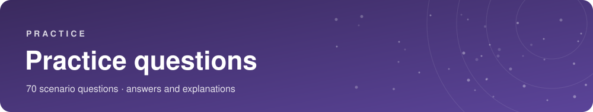

# Practice questions

> These 70 questions are **written by me for learning**, in the style of the exam (concepts + scenarios). They are **not** real exam questions or dumps. Answers and explanations are at the end of each domain section. Cover the answers, commit to one before checking.
> Target: **≥ 80%** on a first pass, **≥ 90%** on the second pass after reviewing mistakes.

Questions marked **(choose 2)** are multiple response.

---

## Domain 1 — Cloud Concepts (15)

**Q1.** A startup wants to avoid buying servers up front and only pay for what it uses. Which cloud advantage is this?
- A. Massive economies of scale
- B. Trade fixed expense for variable expense
- C. Go global in minutes
- D. Increase speed and agility

**Q2.** A shop's traffic spikes on Black Friday and drops afterwards. Resources must automatically grow and shrink. Which concept?
- A. Fault tolerance
- B. Durability
- C. Elasticity
- D. Compliance

**Q3.** Which Well-Architected pillar covers *automatically recovering from failure* and *scaling horizontally*?
- A. Security
- B. Reliability
- C. Performance Efficiency
- D. Sustainability

**Q4.** A company wants to run workloads with the *smallest possible carbon footprint* by maximizing utilization. Which pillar?
- A. Cost Optimization
- B. Operational Excellence
- C. Sustainability
- D. Reliability

**Q5.** Which are perspectives of the AWS Cloud Adoption Framework? **(choose 2)**
- A. Platform
- B. Networking
- C. Governance
- D. Compute
- E. Billing

**Q6.** A company moves its virtual machines to Amazon EC2 with **no changes** as quickly as possible. Which migration strategy?
- A. Refactor
- B. Repurchase
- C. Rehost
- D. Retire

**Q7.** A company moves a self-managed MySQL database on a VM to Amazon RDS with minimal changes. Which strategy?
- A. Replatform
- B. Relocate
- C. Retain
- D. Rehost

**Q8.** Which service helps migrate a database with minimal downtime?
- A. AWS SCT
- B. AWS DMS
- C. AWS DataSync
- D. AWS Snowball

**Q9.** *(`LEGACY` legacy topic — Snow Family is not on the v1.3 list)* A customer needs to transfer 80 TB of data to AWS and has slow internet. Which is the best fit?
- A. AWS VPN
- B. Amazon Route 53
- C. AWS Snow Family
- D. AWS Transit Gateway

**Q10.** Which statement about CapEx and OpEx is correct?
- A. Cloud moves spending from OpEx to CapEx
- B. Cloud moves spending from CapEx to OpEx
- C. Cloud eliminates all costs
- D. Cloud requires upfront hardware purchase

**Q11.** What is *rightsizing*?
- A. Buying the largest instance
- B. Matching resource size to actual workload needs
- C. Moving to another Region
- D. Reserving capacity for 3 years

**Q12.** Which AWS service enables repeatable provisioning of infrastructure from templates?
- A. AWS CloudTrail
- B. AWS CloudFormation
- C. AWS Config
- D. AWS Trusted Advisor

**Q13.** Which are examples of *managed services* that reduce operational overhead? **(choose 2)**
- A. Amazon RDS
- B. MySQL installed on EC2
- C. Amazon DynamoDB
- D. Self-managed Kubernetes on EC2
- E. A physical rack

**Q14.** A company can reuse existing per-socket software licenses on AWS. What is this model called?
- A. License included
- B. Bring Your Own License (BYOL)
- C. Spot licensing
- D. On-demand licensing

**Q15.** Which design principle belongs to *Operational Excellence*?
- A. Perform operations as code
- B. Encrypt data at rest
- C. Use Spot Instances
- D. Use edge locations

<b>Answers — Domain 1</b> (click to reveal)

1. **B** — variable expense replaces upfront investment.
2. **C** — elasticity = automatic scale out *and* in.
3. **B** — Reliability.
4. **C** — Sustainability (maximize utilization, efficient hardware).
5. **A, C** — Platform and Governance (also Business, People, Security, Operations).
6. **C** — Rehost = lift and shift.
7. **A** — Replatform.
8. **B** — DMS migrates DBs; SCT only converts schema.
9. **C** — Snow Family for large offline transfers.
10. **B** — CapEx → OpEx.
11. **B**.
12. **B** — CloudFormation (IaC).
13. **A, C**.
14. **B**.
15. **A** — operations as code.

---

## Domain 2 — Security and Compliance (18)

**Q16.** Who is responsible for patching the guest OS of an Amazon EC2 instance?
- A. AWS
- B. The customer
- C. Both equally
- D. The hypervisor vendor

**Q17.** Under the shared responsibility model, AWS is responsible for which of the following? **(choose 2)**
- A. Physical security of data centers
- B. Customer data classification
- C. Hypervisor and host infrastructure
- D. IAM policies
- E. Security group rules

**Q18.** A customer wants to download AWS compliance reports such as SOC and ISO. Which service?
- A. AWS Config
- B. AWS Artifact
- C. AWS Audit Manager
- D. AWS Inspector

**Q19.** Which service records *who* made API calls in an account and *when*?
- A. Amazon CloudWatch
- B. AWS CloudTrail
- C. AWS Config
- D. Amazon Inspector

**Q20.** Which service evaluates whether resource configurations comply with rules and keeps configuration history?
- A. AWS Config
- B. AWS CloudTrail
- C. Amazon GuardDuty
- D. AWS Artifact

**Q21.** Which service uses ML to detect compromised instances or unusual API activity by analyzing CloudTrail, VPC Flow Logs and DNS logs?
- A. Amazon Inspector
- B. Amazon Macie
- C. Amazon GuardDuty
- D. AWS WAF

**Q22.** Which service discovers sensitive data such as PII stored in Amazon S3?
- A. Amazon Macie
- B. Amazon GuardDuty
- C. AWS Shield
- D. AWS KMS

**Q23.** A company wants to protect against SQL injection and cross-site scripting attacks on its web application behind an ALB. Which service?
- A. AWS Shield Standard
- B. AWS WAF
- C. Amazon Inspector
- D. Security group

**Q24.** Which service provides automatic, free DDoS protection to all AWS customers?
- A. AWS Shield Advanced
- B. AWS Shield Standard
- C. AWS WAF
- D. AWS Firewall Manager

**Q25.** A security team wants a single dashboard aggregating findings from GuardDuty, Inspector and Macie across accounts. Which service?
- A. AWS Security Hub
- B. AWS Trusted Advisor
- C. AWS Config
- D. Amazon Detective

**Q26.** What best describes an IAM role?
- A. A user with permanent credentials
- B. An identity with temporary credentials assumed by a trusted entity
- C. A group of users
- D. A billing account

**Q27.** What is the best practice for the AWS account root user?
- A. Create access keys and share with admins
- B. Use it daily for administration
- C. Enable MFA and avoid using it for everyday tasks
- D. Delete it

**Q28.** Which of these tasks can **only** be done by the root user? **(choose 2)**
- A. Launch an EC2 instance
- B. Close the AWS account
- C. Create an IAM user
- D. Change the AWS Support plan
- E. Create an S3 bucket

**Q29.** What is the main difference between security groups and network ACLs?
- A. SGs are stateless, NACLs stateful
- B. SGs are stateful at instance level; NACLs are stateless at subnet level
- C. Both work at the subnet level
- D. NACLs are allow-only

**Q30.** An IAM policy has an explicit Deny and an explicit Allow for the same action. What happens?
- A. Allowed
- B. Denied
- C. Depends on policy order
- D. AWS asks the admin

**Q31.** Which service lets workforce users sign in once and access multiple AWS accounts?
- A. Amazon Cognito
- B. AWS IAM Identity Center
- C. AWS KMS
- D. AWS Directory Service only

**Q32.** Which service creates and manages encryption keys and integrates with S3, EBS and RDS?
- A. AWS KMS
- B. AWS CloudHSM only
- C. AWS Shield
- D. AWS Artifact

**Q33.** Which service gives you a *dedicated hardware security module* under your control?
- A. AWS KMS
- B. AWS CloudHSM
- C. ACM
- D. Secrets Manager

<b>Answers — Domain 2</b> (click to reveal)

16. **B** — customer (guest OS).
17. **A, C**.
18. **B** — Artifact.
19. **B** — CloudTrail.
20. **A** — Config.
21. **C** — GuardDuty.
22. **A** — Macie.
23. **B** — WAF (Layer 7).
24. **B** — Shield Standard.
25. **A** — Security Hub.
26. **B**.
27. **C**.
28. **B, D**.
29. **B**.
30. **B** — explicit deny always wins.
31. **B** — IAM Identity Center.
32. **A** — KMS.
33. **B** — CloudHSM.

---

## Domain 3 — Cloud Technology and Services (20)

**Q34.** Which describes an Availability Zone?
- A. A geographic area with many Regions
- B. One or more discrete data centers in a Region with redundant power and networking
- C. A CloudFront cache site
- D. A VPN endpoint

**Q35.** Why deploy across multiple Availability Zones?
- A. Lower price
- B. High availability
- C. Data sovereignty
- D. Higher bandwidth

**Q36.** A company needs consistent, dedicated, private network performance between its data center and AWS. Which service?
- A. AWS Site-to-Site VPN
- B. AWS Direct Connect
- C. Internet Gateway
- D. Route 53

**Q37.** Which instance family is best for a memory-intensive in-memory database?
- A. Compute optimized
- B. Memory optimized
- C. Storage optimized
- D. General purpose

**Q38.** Which service runs code in response to events without provisioning servers, and bills per request and duration?
- A. Amazon EC2
- B. AWS Lambda
- C. Amazon Lightsail
- D. AWS Outposts

**Q39.** Which service runs containers without managing servers or clusters of EC2?
- A. AWS Fargate
- B. Amazon ECR
- C. Amazon EC2
- D. AWS Batch

**Q40.** Which service distributes incoming traffic across multiple EC2 instances in several AZs?
- A. Auto Scaling
- B. Elastic Load Balancing
- C. Route 53 only
- D. CloudFront

**Q41.** A developer uploads code and wants AWS to handle provisioning, load balancing and scaling. Which service?
- A. AWS Elastic Beanstalk
- B. AWS CloudFormation
- C. Amazon EC2
- D. AWS Lambda

**Q42.** Which AWS database is serverless NoSQL with single-digit millisecond latency?
- A. Amazon RDS
- B. Amazon DynamoDB
- C. Amazon Redshift
- D. Amazon Neptune

**Q43.** Which service is a data warehouse for large-scale analytics?
- A. Amazon Redshift
- B. Amazon Aurora
- C. Amazon ElastiCache
- D. Amazon DocumentDB

**Q44.** Which service converts the database schema when migrating from Oracle to PostgreSQL?
- A. AWS DMS
- B. AWS SCT
- C. AWS Snowball
- D. AWS Backup

**Q45.** A resource in a private subnet needs outbound internet access for updates but must not be reachable from the internet. What should be used?
- A. Internet Gateway attached to the instance
- B. NAT Gateway
- C. VPC peering
- D. Direct Connect

**Q46.** Which service caches content at edge locations to reduce latency for global users?
- A. Amazon CloudFront
- B. AWS Direct Connect
- C. Amazon VPC
- D. AWS Outposts

**Q47.** Which S3 storage class automatically moves objects between access tiers based on changing access patterns?
- A. S3 Standard-IA
- B. S3 One Zone-IA
- C. S3 Intelligent-Tiering
- D. S3 Glacier Deep Archive

**Q48.** A company must archive data for 10 years at the lowest possible cost; retrieval can take hours. Which class?
- A. S3 Standard
- B. S3 Glacier Deep Archive
- C. S3 One Zone-IA
- D. S3 Intelligent-Tiering

**Q49.** Which storage is *ephemeral* and lost when the EC2 instance is stopped or terminated?
- A. EBS volume
- B. EC2 instance store
- C. S3
- D. EFS

**Q50.** Multiple Linux EC2 instances need a shared file system. Which service?
- A. Amazon EBS
- B. Amazon EFS
- C. Amazon S3 Glacier
- D. Instance store

**Q51.** Which service performs SQL queries directly on data stored in Amazon S3 without servers?
- A. Amazon Athena
- B. Amazon Redshift
- C. AWS Glue
- D. Amazon EMR

**Q52.** Which service builds conversational chatbots?
- A. Amazon Polly
- B. Amazon Lex
- C. Amazon Transcribe
- D. Amazon Comprehend

**Q53.** Which service decouples application components using a message queue?
- A. Amazon SNS
- B. Amazon SQS
- C. Amazon EventBridge
- D. AWS Step Functions

<b>Answers — Domain 3</b> (click to reveal)

34. **B**.
35. **B**.
36. **B** — Direct Connect.
37. **B** — Memory optimized.
38. **B** — Lambda.
39. **A** — Fargate.
40. **B** — ELB.
41. **A** — Elastic Beanstalk.
42. **B** — DynamoDB.
43. **A** — Redshift.
44. **B** — SCT.
45. **B** — NAT Gateway.
46. **A** — CloudFront.
47. **C** — Intelligent-Tiering.
48. **B** — Glacier Deep Archive.
49. **B** — Instance store.
50. **B** — EFS.
51. **A** — Athena.
52. **B** — Lex.
53. **B** — SQS.

---

## Domain 4 — Billing, Pricing, and Support (7 + bonus)

**Q54.** Which pricing option offers up to ~90% discount but can be interrupted by AWS with a 2-minute notice?
- A. On-Demand
- B. Spot Instances
- C. Reserved Instances
- D. Dedicated Hosts

**Q55.** A company runs a steady workload for 3 years and wants the biggest discount with some flexibility across instance families. Which option?
- A. Compute Savings Plans
- B. On-Demand
- C. Spot
- D. Capacity Reservations

**Q56.** Which tool estimates the cost of an architecture *before* you deploy it?
- A. AWS Budgets
- B. AWS Pricing Calculator
- C. AWS Cost Explorer
- D. AWS CUR

**Q57.** Which tool sends alerts when actual or forecasted costs exceed a threshold?
- A. AWS Budgets
- B. AWS Cost Explorer
- C. AWS Trusted Advisor
- D. AWS Config

**Q58.** A finance analyst needs the most detailed line-item cost and usage data in S3. Which service?
- A. AWS Cost and Usage Report
- B. AWS Budgets
- C. AWS Pricing Calculator
- D. AWS Billing Conductor

**Q59.** Which support plan is the lowest tier that provides 24/7 phone, email and chat access to Cloud Support Engineers?
- A. Basic Support
- B. Business Support+
- C. Enterprise Support
- D. Unified Operations

**Q60.** Which of the following is true about AWS Organizations consolidated billing?
- A. It costs extra
- B. It combines usage across accounts for volume discounts and can share Reserved Instance discounts
- C. It prevents using IAM
- D. It only works with one account

<b>Answers — Domain 4</b> (click to reveal)

54. **B**.
55. **A** — Compute Savings Plans.
56. **B**.
57. **A**.
58. **A**.
59. **B** — Business Support+ (legacy name: *Business*). Basic has no technical cases.
60. **B**.

---

## Added for guide v1.3 (new names and new in-scope items) (10)

**Q61.** A company wants EC2 instances to reach an AWS service privately, without traffic crossing the public internet. Which service?
- A. AWS PrivateLink
- B. Amazon CloudFront
- C. AWS Shield
- D. Amazon Route 53

**Q62.** A company must connect dozens of VPCs and its on-premises network through a single central hub. Which service?
- A. VPC peering for each pair
- B. AWS Transit Gateway
- C. Internet Gateway
- D. Amazon Route 53

**Q63.** Which service lets a customer view and request increases for AWS service quotas (limits)?
- A. AWS Service Quotas
- B. AWS Budgets
- C. AWS Config
- D. AWS Artifact

**Q64.** Which service helps build a business case and TCO for migrating on-premises servers to AWS?
- A. AWS Migration Evaluator
- B. AWS Backup
- C. AWS CloudTrail
- D. Amazon Inspector

**Q65.** Which AWS service provides a generative-AI-powered assistant for business and development tasks?
- A. Amazon Q
- B. Amazon Polly
- C. Amazon Textract
- D. AWS Glue

**Q66.** Amazon Quick (formerly Amazon QuickSight) is primarily used for…
- A. Business intelligence dashboards and visualizations
- B. Streaming data ingestion
- C. Container orchestration
- D. DDoS protection

**Q67.** Which support plan includes a **designated TAM** and a **< 15-minute** response for business-critical system down?
- A. Basic Support
- B. Business Support+
- C. AWS Enterprise Support
- D. Developer Support

**Q68.** A company runs mission-critical workloads and wants a **< 5-minute** response for critical incidents plus continuous resiliency reviews. Which option?
- A. Business Support+
- B. AWS Unified Operations
- C. Basic Support
- D. Trusted Advisor

**Q69.** A team wants a managed, MongoDB-compatible document database. Which service?
- A. Amazon DocumentDB
- B. Amazon RDS for MySQL
- C. Amazon Redshift
- D. Amazon ElastiCache

**Q70.** Employees need secure **browser** access to internal web apps and SaaS without a full virtual desktop. Which service?
- A. Amazon WorkSpaces Secure Browser
- B. Amazon AppStream 2.0 only
- C. AWS Direct Connect
- D. Amazon Connect

<b>Answers — v1.3 additions</b> (click to reveal)

61. **A** — PrivateLink (private connectivity to services).
62. **B** — Transit Gateway.
63. **A** — Service Quotas.
64. **A** — Migration Evaluator.
65. **A** — Amazon Q.
66. **A** — BI dashboards.
67. **C** — Enterprise Support (designated TAM, < 15 min).
68. **B** — Unified Operations (< 5 min, continuous resiliency reviews).
69. **A** — DocumentDB.
70. **A** — WorkSpaces Secure Browser (formerly WorkSpaces Web).

---

## Score yourself

| Score | Next step |
|---|---|
| < 60% | Re-read the domain files, then redo |
| 60–79% | Review weak domains, make flashcards of mistakes |
| 80–89% | Good. Do a timed mock from official AWS practice resources |
| ≥ 90% | Ready — book the exam |

> For realistic timed practice, use **official AWS resources (AWS Skill Builder: Cloud Practitioner Official Practice Question Set / Exam Prep)** — never exam dumps.

---

<a href="../course/05-exam-day.md">← Exam day</a> &nbsp;·&nbsp; <a href="../README.md">Contents</a>

